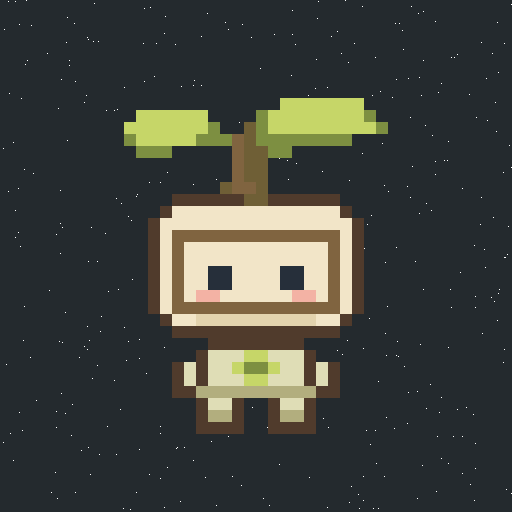

<div align="center">



# Clankie

**The open-source, self-hosted super agent platform.**

Run always-on lead agents on your own machines, tie in the leads and workers you
already have, and see all of the work in one place.

[Get started](https://docs.clankie.bot/get-started/#diy-install-on-your-own-machine) ·
[How it works](https://docs.clankie.bot/how-it-works/) ·
[Technical reference](docs/README.md)

[](#license)
[](https://pi.dev)
[](https://www.typescriptlang.org)

</div>

<p align="center">
  <picture>
    <source media="(max-width: 600px) and (prefers-color-scheme: dark)" srcset="docs/assets/clankie-system-phone-dark.svg" />
    <source media="(max-width: 600px)" srcset="docs/assets/clankie-system-phone-light.svg" />
    <source media="(prefers-color-scheme: dark)" srcset="docs/assets/clankie-system-dark.svg" />
    
  </picture>
</p>

A lead is an agent you talk to directly: Grok Bot, Claude Code, Codex, or the
built-in lead on [pi](https://pi.dev). You tell a lead what you want. It hires
coding workers, Claude Code or Codex in [Herdr](https://herdr.dev) terminals
across your machines, and those workers come and go and report back. The lead
stays, so the conversation and the context stay with it.

That is the difference from a ticket board. You don't file work into a queue and
wait; you talk to a lead that is already running, and it staffs the job, answers
its workers and tells you what landed.

## What you get

**Always-on leads.** The service keeps running on your machine, and a lead can
wake on a worker's report, a schedule or its own webhook. Pick one lead or
several. "Always on" means while the machine is
awake and online; a Mac stays awake while plugged in by default
([always on](docs/always-on.md)).

**Workers across your machines.** Leads hire into real terminals you can watch
and type into, on your Mac, a Linux machine or a linked Windows PC. New hires go
to the account with capacity to spare, and heavy builds take turns so a busy
fleet doesn't stall the machine
([machines](https://docs.clankie.bot/diy/#bring-your-own-team),
[harness support](packages/agent-hosts/README.md#tool-flow-and-current-support)).

**The leads and workers you already have.** Agents you opened by hand in Herdr
show up beside hired ones. Claude, Claude Code, Codex and Grok connect through
one remote MCP server, and each sign-in is a device you approve and can revoke
([bring your own lead](https://docs.clankie.bot/diy/#bring-your-own-lead)).

**A way to see the work.** The iPhone, iPad and desktop app has Sessions, with
every agent by machine; the Feed, with what needs you and what finished, grouped
by project; the World, which draws the same agents as a little village; and
Terminal, which opens the real panes. Reports carry evidence, kept in its own store rather than
your git history ([the app](https://docs.clankie.bot/using-clankie/#the-app),
[evidence store](docs/adr/0258-evidence-lives-in-the-evidence-store.md)).

**Your machines, your rules.** There is no hosted Clankie. Credentials, history
and settings stay on your host, you bring your own models and agent
subscriptions, and one autonomy setting decides how much a lead does without
asking. Money and accounts always come to you
([autonomy](https://docs.clankie.bot/cli/#autonomy-dial)).

## Choose your leads

| Lead                              | How it joins                                                                                                                   | Runs on                         |
| --------------------------------- | ------------------------------------------------------------------------------------------------------------------------------ | ------------------------------- |
| [Built-in](docs/built-in-lead.md) | Part of the service, with its own persona, memory and Discord presence if you want them                                        | A model you connect             |
| Claude Code or Codex              | `clankie claude` or `clankie codex` opens that harness as a seat with the service's tools ([seats](docs/cli.md#seat-commands)) | Your own Claude or ChatGPT plan |
| Connected apps                    | Add the connector URL in Claude, Claude Code, Codex or Grok ([connector](https://docs.clankie.bot/diy/#bring-your-own-lead))   | That app's own account          |
| Grok Bot or your own bot          | A connected app with a webhook, so Clankie can wake it with a job                                                              | Whatever you built it on        |

Leads share one fleet, and the fleet reports which are active.
`clankie connector lead apps` switches the built-in lead off and hands its
worker traffic to the connected apps.

## Run it

The installer brings its own runtime on **Apple silicon, macOS 14 or newer**, and
on **arm64 or x64 Linux (Ubuntu 24.04 or newer)**. A Windows PC joins as a fleet
machine.

```sh
curl -fsSL https://clankie.bot/install | sh
clankie
```

`/setup` connects a model, then offers phone pairing, account connections and a
first agent. Only the model is required, and it can't be a Claude subscription;
use `clankie claude` for that plan. The
[get started guide](https://docs.clankie.bot/get-started/) covers each platform;
[distribution](docs/distribution.md) covers checksums, pinning and the Mac app,
whose signed release is not available yet. To work on the code, see
[CONTRIBUTING.md](CONTRIBUTING.md).

The software is free; model providers and connected services may charge. A
Clankie account is free too, and you need one only for the public gateway:

| To reach your machine from      | You need                                                                                                                                         |
| ------------------------------- | ------------------------------------------------------------------------------------------------------------------------------------------------ |
| The console, CLI or a seat      | Nothing extra                                                                                                                                    |
| The app, on your LAN or tailnet | No account: `clankie gateway direct` ([pairing](https://docs.clankie.bot/get-started/#bring-your-mac-s-clankie-into-the-app))                    |
| The app, from anywhere          | A free account, for the encrypted gateway                                                                                                        |
| A connected app                 | Remote access for the connector URL, which needs that account. The app's own sign-in is a code you approve on your machine, not a Clankie login. |

Check [clankie.bot](https://clankie.bot) for account and install availability.

## Under the hood

Clankie is one persistent service plus the clients and connections around it.
The service owns conversations, memory, credentials, tool authority and device
access; runtimes, trackers and leads are connections. A headless CLI, an HTTP API
and an MCP bridge expose the same authorized tools to scripts and other agents.

- [Architecture](docs/architecture.md): the system diagram and request flows
- [Library index](docs/README.md): every subsystem's canonical guide
- [CLI](docs/cli.md) and [HTTP catalog](apps/clankie/openapi.yaml): command and route contracts
- [The built-in lead](docs/built-in-lead.md): planning, Auto, Discord, voice and play

This repository holds the service, console, relay, phone gateway and public
contracts. The Clankie app and the gateway's deployment are private
([ADR 0311](docs/adr/0311-the-doorway-source-is-public.md)).

## Contribute

[CONTRIBUTING.md](CONTRIBUTING.md) covers the toolchain, source setup, and
checks; read [AGENTS.md](AGENTS.md) before pointing a coding agent at the
checkout. Questions go to the [docs](https://docs.clankie.bot) or
[support](https://clankie.bot/support/), and security issues to
[SECURITY.md](SECURITY.md).

## License

Apache-2.0 except `apps/vox`, the native Discord media executable, which is
AGPL-3.0-or-later under its own [LICENSE](apps/vox/LICENSE). Third-party components
retain their own licenses; see [THIRD_PARTY_NOTICES.md](THIRD_PARTY_NOTICES.md).
