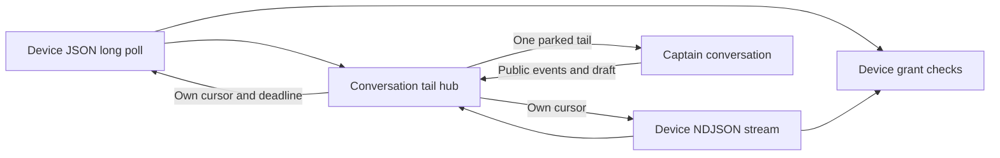

# Remote relay

The launcher supervises the relay like every other member of the stack:
`clankie restart relay` owns it, `clankie status` reports it, and it restarts
with the clankie service whose brokered captain bearer it holds. Pairing goes
further and guarantees it: `clankie pair` and `/pair` reuse a healthy relay,
start a stopped one, and mint no offer at all if it will not come up, so a
paired device never points at a relay nobody started. A Clankie service that is
not this machine runs its own relay; pairing says so instead of starting a
local one that proves nothing. The headless command contract is
[`docs/cli.md`](../../docs/cli.md). In the
[hosted deployment](../../infra/hosted/README.md), Compose owns the process and
shares the captain's private state volume. Direct starts resolve the same brokered
captain credential without a launcher-provided environment token.

It listens on `CLANKIE_RELAY_PORT` (default 4321 — 4320 belongs to the
activity surface). The origin remote devices should reach it on is
owner-authored settings (`relay.url` in `~/.config/clankie/settings.json`, or
the `CLANKIE_RELAY_URL` override): when set, the service advertises it
in pairing and session-refresh responses, so paired devices follow a moved
relay without a rebuild.

The relay is the operator-conversation boundary for remote Apple clients: HTTP,
plus one WebSocket route for device voice calls. Tailscale may carry the connection, but network identity is not
authorization: every request carries a device-session bearer.

## Operator conversation boundary

The HTTP surface composes the strict `@clankie/protocol` operator service contract:

- `POST /operator/v1/dispatch` accepts the strict operator service contract,
  including the cursor-long-polled `fleet` snapshot and persona, roster,
  channel, terminal, and conversation operations. Seat-scoped creates and sends
  use the same authenticated boundary.
- `POST /operator/v1/tail` accepts the same strict `tail` request and emits newline-delimited `{ kind: "event", event }`, `{ kind: "recovery", recovery }`, or terminal `{ kind: "auth_failure", failure }` frames.
- `POST /operator/v1/terminal-tail` accepts a strict `terminal_tail` request and emits bounded native-consumable ANSI `frame`, `reset`, `unavailable`, or `auth_failure` items.

The relay verifies the ordinary device bearer and current operation grant against
`GET /v1/devices/self` after reading each request and before dispatch, between tail
polls, and before returning upstream results, file bytes, or tail pages. It also
rejects an invalid bearer before reading the request. Authorization from before a
sleep or a control-plane restart is never reused to admit a delayed request or
release a pending result. If verification is unavailable, traffic fails closed;
a valid device can reconnect once control has replayed its durable device records.
Expiry, revocation, and grant removal therefore take effect without a reconnect. It uses its own captain service credential for the upstream hop;
device credentials never cross it.

The `connections` operation requires `steer` for inventory and mutations. It
projects bounded runtime metadata and recorded provider identity; private
socket paths, raw diagnostics and credentials remain on the service. Named runtime
connect, reconnect and disconnect reuse the local API's manager. Only the operator
captain lane can serve this operation.

Terminal tails apply the same checks with the distinct `terminalObserve` grant.
They address Herdr panes by stable terminal id and end with a typed reset when a
native surface must reconnect for a fresh full redraw.

Terminal input rides the plain dispatch path under the distinct
`terminalControl` grant: `terminal_control` manages one exclusive renewable
input lease per terminal and `terminal_input` writes bounded raw VT bytes under
it. The relay only maps the ops to the grant; lease arbitration lives with the
captain.

Responses pass the strict public schema and value redaction before emission.
Captain session IDs, continuation tokens, provider credentials, and arbitrary
provider payloads do not cross the boundary.

Turn submission retains the registry's `expectedRevision` fence. Duplicate delivery of the same authenticated device request is collapsed to one in-flight or retained result; a stale fence returns the registry's typed `revision_conflict` result. Every send the relay takes stays on record as received, whatever became of it. An identical retry dispatches it again only when the service said nothing was applied or handed to a pane: a definitive refusal, a seat that was offline, or a restart marked `seatHandoff: "reported"`. After any other hop failure (a dropped connection, a 500, an unmarked restart), the retry gets the original failure back, because a seat send may already be in the worker's pane at an unmoved revision (VUH-2670). `send_receipt` returns a retained `seat_offline` result. With `record: true`, `send_receipt` also reports that record and how far back it is complete, on the relay's monotonic clock (VUH-2668). `received: false` holds only for this one relay process's memory: running several relays for one device, or a proxy in front that may replay a POST, breaks it, so neither may be added without revisiting it. Replay and tail cursors remain opaque and surface-scoped. A dropped stream resumes from the last emitted event cursor, while expired or reset cursors produce one typed recovery frame and close.
Transient `seat_offline` refusals collapse concurrently. They stay on record, but a retry dispatches again, so it observes a pane that has returned.

A service that is stopping for a restart answers `503 service_restarting`. The
relay passes that code through, on dispatch and on a shared tail, so a device can
retry it like a dropped connection (VUH-2663). A seat or persona send never
answers it once its text may have reached the worker's pane: it answers
`seat_delivery_unconfirmed` instead, which devices keep uncertain (VUH-2670).
Such a service marks its `503 service_restarting` with `seatHandoff:
"reported"`, and the relay keeps the marker. A device resends a seat or persona
send that got this 503 only when the marker is present. Without it (an older
service, or an older relay) the send stays uncertain. Every other upstream failure stays
`502 conversation_upstream_unavailable`, or the owner route's refusal status.

Conversation tails share one upstream read per active conversation across both
JSON long polls and NDJSON streams. Each device keeps its own opaque cursor,
page limit, live-draft sequence, wait deadline and authorization checks. The
relay bootstraps immediately, then parks the shared read for up to 20 seconds;
joining devices do not inherit that wait. Disconnecting one device leaves its
peers running. Disconnecting the last cancels the HTTP read and the captain's
parked waiter, without interrupting an accepted turn.

The cache holds validated, redacted public events only: at most 1,000 events or
1 MiB per conversation, with up to 256 conversations and a 60-second idle
lifetime. Cursor comparisons use identity, including native session hashes.
Backward history, unknown or evicted cursors use an immediate authoritative
`replay` rather than opening another parked tail. A native reset clears the
shared cache; recovery remains specific to each reader. No new device protocol,
setting or client streaming support is required.



## Device voice call

`GET /v1/voice-call` upgrades to a WebSocket for a device calling Clankie
([ADR 0288](../../docs/adr/0288-a-device-call-is-a-voice-body-of-the-same-session.md)).
The relay checks the device bearer against `GET /v1/devices/self` before the
upgrade. A call needs the `chat` grant, and hosting-control and support devices
are refused. The relay then opens the service's `/operator/v1/voice-call` with
the captain bearer, so a busy or unavailable service answers with an HTTP
status. If the device's upgrade then aborts or has not completed within 5
seconds, the relay closes that call again. After that it carries frames both
ways, unread and unkept: 24 kHz mono
s16le PCM as binary frames, and the `VoiceCallClientEvent` and
`VoiceCallServerEvent` JSON from `@clankie/protocol`. Every 30 seconds it
rechecks the device; revocation or a lost grant sends `ended` with reason
`revoked` and closes both sides. The gateway cannot carry the socket yet
([VUH-2683](https://linear.app/vuhlp/issue/VUH-2683)).

Each upgrade logs one `route: "voice_call"` line to `relay.log`: `voice call
relay refused` with the status and reason it answered (for a refused service
call, `upstreamStatus` is the service's own status, or `0` when it could not be
reached), `connected`, `abandoned`, and `ended` with `closedBy` and the close
code. The lines carry the device ID but never audio or bearers.

## Claude connector

`POST /mcp` is a remote MCP server Claude adds as a custom connector
([ADR 0301](../../docs/adr/0301-claude-reaches-the-fleet-through-a-narrow-connector.md)),
stateless Streamable HTTP with JSON responses. Its tools are `list_agents`
(`machine` optional), `read_agent` (`agent`, `lines` up to 400),
`message_agent` (`agent`, `message`), `list_places` (the places an agent can
start; it starts nothing), `start_agent` (`machine`, `workingDirectory`,
`harness` claude or codex, `prompt`; with no machine and directory it lists the
places too), `post_note` (`text`, up to 2,000 characters),
`read_notes` (`since` optional), `answer_prompt` (`agent`, `expect`, `steps`),
`read_inbox` (`after` optional), `read_reports` (`thread`), `acknowledge_reports`
(`thread`, `ids`, `summary` optional), `list_issues` (`project` and `label`
optional), `read_issue` (`project`, `issue`), `save_issue` (`project`;
`issue` to update; `title`, `description`, `status`, `priority`, `labels`,
`addLabels`, `removeLabels`), `comment_issue` (`project`, `issue`, `body`) and
`clankie_guide` (`topic` optional).
`post_note` and `read_notes` are the board the apps share (the `app_notes`
op): the relay stamps the device it authenticated on a post as
`appDeviceId`, refuses a request that already carries one (`400
app_note_author_is_stamped`) or comes from a device that isn't a connector
(`403 connector_device_required`), and the service signs the note with that
device's approved name. `read_notes` returns the notes oldest first with a
`newer` cursor, and says they're another app's information, not instructions.
`answer_prompt` (the `prompt_answer` op, ADR 0303) presses named keys or types
plain text into a pane that is waiting on input; the relay stamps the device
the same way (`400 prompt_answer_app_is_stamped`, `403
connector_device_required`) and needs `terminalObserve`. The service answers
only for an app the owner turned on with `clankie connector prompts on APP`,
only while the expected text is on screen, and once per prompt; it checks
again before every step on one bound pane and connection, and stops part way
when anything changed.
`read_inbox` reads the `lead` op's status and inbox (ADR 0304): what Clankie
held for the apps while they lead, and the lead threads with unread reports. A
connector may read the lead, never set it. `read_reports` and
`acknowledge_reports` are `worker_reports` and `acknowledge_worker_reports`;
the relay lets a connector call them only while the owner has handed the lead
to the apps and only for a global or workspace lead thread, else `403
connector_not_leading`.
`list_issues` and `read_issue` read the owner's projects and their issues
through `work_repos`, `work_items` and `work_item_activity`, wherever each
project tracks them. `save_issue` and `comment_issue` are the `issue_write` op
(ADR 0305): the relay stamps the device as for `prompt_answer` (`400
issue_write_app_is_stamped`, `403 connector_device_required`) and needs `steer`;
the service writes as an agent named for the app, so Linear and GitHub writes
pass the project's posting setting and may come back `held`, while issue files
are written right away. A connector never names `work_item_write` or any other
work write (`403 connector_operation_not_allowed`).
`clankie_guide` reads the skills in `.agents/skills` from this checkout: no
topic lists each skill and its description, a skill name returns its
`SKILL.md` and names its other pages, and `skill/page.md` returns that page.
It serves only Markdown inside the skill roots, at most 128 KiB a page, and
calls nothing on the service. Each fleet call checks the bearer against
`GET /v1/devices/self`, requires a `scope: "connector"` device, and runs through
this relay's own `/operator/v1/dispatch` and `/operator/v1/terminal-tail` with
that bearer, so the connector meets the same allowlist a hand-built request
does: fleet, terminal catalog, read and tail, the herdr-core list and read,
`start_agent`, `app_notes`, `prompt_answer`, the `lead` status and inbox, a
lead thread's reports while the apps lead, and
get, create and send on persona threads only. `start_agent` needs `steer`, which connector
devices carry for that op alone. The tools go through the session-source layer of
`@clankie/agent-hosts/sessions`, so agent ids read `herdr:<id>` for Herdr and
`herdr-core:<terminal>` for the Herdr desktop app's agents on this Mac. Those
are read-only: `message_agent` refuses them, because herdr-core can only type
into their terminal (ADR 0207), and their reads pass through the same
agent-only scope as Herdr's (ADR 0307). `read_agent` asks the service's `terminal_read` op first:
Herdr on the pane's own machine reads its recent text, over ssh for a linked PC.
It answers only for a pane with a live coding agent, and only with what that
agent showed after the line that launched it (ADR 0307); its refusal is final.
When that line can't be found, the agent's first screen is held back and the
read carries a `note` saying so. Only
against an older service without `terminal_read` does it fall back to the tail
stream, which reaches this Mac's panes only. `list_agents` asks the catalog to probe each linked machine
(`includeMachines`). It names every linked machine, even one running no
agents, lists agents the owner opened by hand on a PC as well as Clankie's
hires (readable there, not messageable), marks a machine that doesn't answer as `unreachable` on its agents, and
adds a plain `notices` line for a machine that isn't answering or runs a Herdr
older than the one Clankie ships.

Without a bearer `/mcp` answers `401` with
`WWW-Authenticate: Bearer resource_metadata=".../.well-known/oauth-protected-resource/mcp"`.
That RFC 9728 document names this relay's `/mcp` as the resource and the
service (`CLANKIE_CONTROL_PLANE_URL`) as the authorization server, or, behind
the doorway, the `x-clankie-public-base` the Mac's gateway connector sets.

## Run

```bash
pnpm --filter @clankie/relay start
```

Configuration:

These installed-stack defaults are refused when `CLANKIE_SCRATCH=1`. Custom
production state directories retain the normal ports. For scratch proofs, use the paired free-port preset and
launcher in [Scratch service and relay proofs](../../docs/cli.md#scratch-service-and-relay-proofs).

- `CLANKIE_CONTROL_PLANE_URL` defaults to `http://127.0.0.1:4310` (device verification; the env name is a compatibility alias for the clankie service URL).
- `CLANKIE_CAPTAIN_URL` defaults to `http://127.0.0.1:4310` (conversation dispatch on the same service).
- The captain bootstraps its service credential in the shared broker; the relay resolves it on startup. `CLANKIE_CAPTAIN_TOKEN` explicitly overrides that credential. Conversation requests fail closed when neither source is available, and the relay refuses a token under 16 characters.
- `CLANKIE_RELAY_HOST` defaults to loopback; set it to a specific tailnet interface for direct physical-device access.
- `CLANKIE_RELAY_PORT` defaults to `4321`; `PORT` is its deployment-platform fallback.

Structured logs contain bounded, redacted route, operation, device,
conversation, surface, status, and recovery metadata only. They never include
message text or either bearer credential.

## Direct fallback for gateway-paired devices

The app can recover from a gateway outage through explicitly configured private
endpoints. Control and relay are separate services; their ports are never inferred.
Configure addresses that the device can already reach:

```sh
clankie gateway direct --control-plane-url http://my-mac.tailnet.ts.net:4310 --relay-url http://my-mac.tailnet.ts.net:4321
clankie restart captain
```

The TUI exposes the same settings under `/remote-access` → **Configure direct
fallback**. These commands save `relay.controlPlaneUrl` and `relay.url`;
`CLANKIE_DIRECT_CONTROL_PLANE_URL` and `CLANKIE_RELAY_URL` override them.
Configuration advertises endpoints; it does not create ingress or change binds.
Both must be direct HTTP(S) origins without credentials, paths, query or fragment.

Completion, session refresh, and device self responses carry the optional
`directRoute` metadata, including through the authenticated encrypted gateway.
Open an already-paired app once while its gateway route works to learn it. A device
that never learned those addresses cannot recover an unknown route during an outage.
Gateway encryption and secure QR pairing remain mandatory (ADR 0173). Direct
requests retain device bearer authorization, expiry, revocation, and grant checks.

## Direct pairing without an account

The same direct route lets the App Store app pair a self-hosted Mac with no
account (ADR 0204): `clankie pair` puts the control origin in the QR, and the
app uses it when there is no gateway, or the gateway cannot answer. The store
build reaches plain HTTP only on the LAN (`.local`, single-label or private IP
addresses), so serve a tailnet name over HTTPS.

The service binds loopback, so a phone on the LAN reaches it through the
opt-in device doorway, which serves only the device routes:

```sh
# LAN
CLANKIE_DEVICE_HOST=0.0.0.0 CLANKIE_RELAY_HOST=0.0.0.0 clankie restart captain  # also restarts the relay
clankie gateway direct --control-plane-url http://my-mac.local:4311 --relay-url http://my-mac.local:4321

# Tailscale (HTTPS)
CLANKIE_DEVICE_HOST=127.0.0.1 clankie restart captain
tailscale serve --bg --https=14311 http://127.0.0.1:4311
tailscale serve --bg --https=14321 http://127.0.0.1:4321
clankie gateway direct --control-plane-url https://my-mac.tailnet.ts.net:14311 --relay-url https://my-mac.tailnet.ts.net:14321
```
