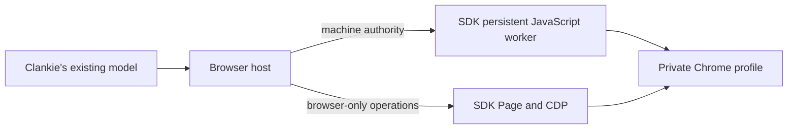

# ADR 0206: Browser Use Pi supplies the browser workspace

Status: accepted (2026-10-01), requested by James. Updates the implementation
in [ADR 0082](0082-clankie-holds-the-browser.md).

## Decision

Replace the agent-browser MCP process with the pinned `@browser_use/pi` SDK.
Clankie's existing model calls its persistent `execute()` workspace directly.
The SDK owns Chrome launch, private-profile locking, the killable JavaScript
worker, browser primitives, and worker recovery. No second model runs and no
provider key is required for browser execution.

Release builds preserve the SDK package and its dependency graph alongside the
service bundle, because the SDK forks a worker relative to its own module.

The SDK's JavaScript is Node code, not just page code. The catalog therefore
marks that tool `requiresShell`. Pi and MCP hide it from social turns, the
browser host checks host-stamped machine authority, and the standalone HTTP
route requires the operator credential. Social browser operations use the
SDK's page/CDP APIs in the browser realm. A request argument cannot grant
machine authority.

Keep the existing browser API envelope and hash-bound screenshot artifacts.
Use `browser_use_*` tool names, with `clankie browser tools` and
`clankie browser call TOOL JSON` for operator access. The protocol addition is
optional, so existing catalog consumers can still parse ordinary tools.

The private profile path stays the same. Chrome starts headless on the first
call and closes after 60 idle seconds. Headed takeover and explicit close
use the SDK lifecycle. JavaScript variables reset on mode changes, idle close
or worker termination; logins and workspace files persist.

## Recording and recovery

The SDK's automatic recorder wraps `run()`, which would introduce a second
agent loop. Direct execution instead samples the current tab using public
SDK screenshots every 750 ms and encodes WebM with the existing FFmpeg
dependency. Recording is opt-in and cannot prevent browser actions. The first
sample follows the initial action: navigating while the initial blank-tab
screenshot is pending can leave that capture waiting until its CDP timeout.

Do not automatically repeat a failed JavaScript cell: browser effects may
have happened before a timeout. The SDK resets its worker; Clankie inspects
the browser before continuing. A profile lock after a crash requires checking
its owner before recovery, rather than launching a competing browser.

## Verification

Host, Pi/MCP discovery, and HTTP/CLI tests cover machine authority, including
forged arguments. A real local Chrome exercise covers long pages, variables
across cells, accessibility, form input, clicks, screenshot artifacts,
worker timeout recovery, headed/headless transitions, local storage across
session restarts, and decodable WebM output.

## Amendment: concurrent conversation browsers (2026-10-11, VUH-2129)

The service owns one Chrome lifecycle: launch, SDK private-profile lock, crash
recovery and final shutdown. Each host-authenticated conversation attaches its
own Browser Use Pi workspace/worker and tab to that Chrome endpoint. Calls are
serialized per conversation, so independent rooms browse concurrently while
sharing Clankie's signed-in profile. Tab helpers list and select only that
conversation's tabs. Machine-authorized Node/root CDP retains its existing
machine authority; tab ownership is not a Node sandbox.

Browser use no longer acquires an exclusive body lease. Persisted browser claims
and requests are retired on startup. Idle cleanup after 60 seconds closes only
that conversation's tabs and recording; Chrome closes when no workspace remains.
A refused or uncertain operation cannot hold other rooms for recovery. Existing
authority guards remain revalidated after queueing and setup, before effects.

`browser_use_open` accepts `isolated: true` to use a disposable logged-out CDP
context in the same Chrome; returning to `isolated: false` resets that workspace
onto the persistent profile. Isolated cookies/storage are never copied back.
Headed mode changes are refused while other conversations have workspaces,
rather than closing their pages. A Chrome crash invalidates all handles; the
single lifecycle owner stops its SDK instance before relaunching. Failed cleanup
or a locked profile returns bounded `browser_unavailable`; no effect is replayed
and no caller can steal a lock or manufacture machine authority.

The earlier whole-browser serialization and burst/lease descriptions above are
historical and superseded by this amendment.

## Amendment: turns without machine access browse the public web logged out (2026-10-25, VUH-2590)

Every lane registered the browser, and social and voice turns shared the
signed-in profile with no URL limits. Any room member could have Clankie read
`file://` paths, loopback services or LAN devices, or act in his logged-in
accounts, and paste the result into the room.

The host now derives the boundary from the host-stamped `shell` authority it
already receives. Calls without it browse in a second, headless Chrome that the
host launches lazily with a throwaway profile (deleted on close) and the mock
keychain, so these turns never share a process, profile or secret store with
the owner's Chrome. Each such conversation also gets its own disposable context
there. That Chrome is launched with `--proxy-server` set to an in-process
public-web proxy, `--proxy-bypass-list=<-loopback>` (so Chrome's implicit
loopback bypass doesn't apply), and
`--webrtc-ip-handling-policy=disable_non_proxied_udp`. The proxy resolves each
request's host, refuses the name if any answer is loopback, RFC1918,
link-local, CGNAT/tailnet, multicast or another special-use address, refuses
`localhost` and `.local` names, and connects to the address it checked, which
closes DNS rebinding. HTTP, WebSocket and HTTPS requests all go through it, so
the check covers redirects, frames, popups, `fetch` and `browser_use_evaluate`
without per-navigation interception. The WebRTC policy keeps ICE/STUN off
direct UDP: peer connections may use only proxied TCP, which the same check
covers. WebTransport (QUIC) sends nothing under the proxy configuration. Chrome
already refuses page-initiated navigation to `file:` and `chrome:`.

The WebRTC policy is a whole-browser switch with no per-context or CDP control,
and without a proxy it disables WebRTC entirely. Setting it on the owner's
Chrome would have broken machine turns. That is why these turns get a
separate process rather than only a context in the owner's Chrome. The first
version of this amendment's fix used a per-context proxy, and review (Sage)
showed WebRTC sending STUN datagrams to loopback around it. The host refuses
non-http(s) URLs in tool arguments, refuses `isolated: false` and headed-mode
changes in these turns, and returns any tab that leaves the public web to
`about:blank` before a tool reads it. A conversation that switches between
machine and non-machine turns gets a fresh workspace on each switch.

Machine-authorized turns keep the shared profile, unrestricted navigation and
WebRTC. Proof: `apps/clankie/test/browser-public-web.integration.test.ts` drives
real Chrome against local HTTP and UDP fixtures. The private fixtures record no
request or datagram from a restricted turn, and the machine control reaches
both.
