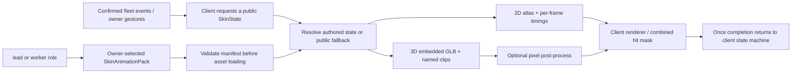

# 0267: Skins share one public animation spec

Status: accepted for implementation, 2026-10-13. Tracks
[VUH-2211](https://linear.app/vuhlp/issue/VUH-2211). Extends
[0183: The harness is public; the hosted service is private](0183-the-harness-is-public-the-hosted-service-is-private.md).

## Context

James wants swappable 2D and 3D texture packs, and a public animation contract
that anyone can implement. Clankie remains an open agent OS; the command-center
app, its renderer and its built-in art remain private. The public `lead-skin`
contract already serves sprite compilers, but the pet and World have separate
state lists. A model renderer adds another vocabulary unless they share one.

## Decision

`@clankie/skin-spec`, beside `protocol`, owns the node-free TypeScript schema,
bounded runtime validator, state vocabulary, fallback rules and semantic event
map. It has no renderer or runtime dependency. `lead-skin` consumes its sprite
types and lead state subset while retaining its existing upload limits. The
private app consumes the same spec through its own `skin-contract` package.

There is one `SkinState` set: the union of World acts, pet body acts and worker
specialties. Shared names mean the same act. Directional walking remains named
`walk_left/right/up/down`; `walk` is the direction-neutral act. `work_*` includes
both activities (type/read/write/tinker) and specialties
(planner/designer/builder/tester/reviewer/researcher). These are different
requests, with explicit fallbacks to think/work. Existing names such as happy
and celebrate remain authored acts in the same set, with an explicit fallback;
they are not independent client contracts. `face_*`, mini-avatar tags, badges,
attention overlays and client interaction state are outside the body spec.
The package exports the exact complete set as `SKIN_STATES`.

Role is `lead` or `worker`, independent of agent provider, account and project
specialty. A pack declares which roles it can dress; both roles use exactly the
same body schema. Role-specific UI, scheduling, status, click masks and resource
budgets belong to the client. A pack never grants an action or changes an agent.

### Events and completion

`SKIN_EVENT_STATES` defines presentation requests, not a second source of agent
status. Clients map their confirmed events to these semantic inputs. Hire
requests spawn (existing World germinate is its fallback); report requests
handoff (carry fallback); close requests poof. Working requests work or its
known specialty; thinking requests think; blockage requests blocked; successful
completion requests celebrate. Speech requests talk/listen, disconnect requests
offline, movement requests walk with the known direction, and rest requests idle.
Owner sleep/wake requests fall_asleep/wake. Pet gestures may request hop,
catch, lift/drop, play and the other public acts without changing agent status.

Once runs the authored sequence/range exactly once, then delivers completion to
the client. Loop repeats and never completes; hold freezes the selected pose
and never completes. Fallback changes pixels, not the requested lifecycle:
clients retain the original request's completion rule (including their existing
vendored one-shot rules). A 3D once completes when its animation mixer finishes,
not on a sprite-shaped synthetic timer. Clients prioritize transient acts and
resume the current ongoing act; the manifest cannot enqueue commands or work.

### Manifest

Both modes use `SkinAnimationPack`:
`specVersion: 1`, stable `id`, pack `version`, `displayName`, distinct `roles`,
`body`, and optional `restStill`. Missing idle is invalid. Other missing acts
follow `SKIN_STATE_FALLBACKS` then idle, so an author may ship a small valid pack.
Review of complete built-in skins remains stricter than basic load validity.

- **2D:** `body.kind: "2d"`, `atlas` (image, dimensions, named rectangles),
  `animations[state]` (frame IDs, loop/once/hold and exactly one of fps or
  per-frame millisecond timings), optional origin. Directional adapters can
  declare `mirrorX` without duplicating pixels. No timings are inferred.
- **3D:** `body.kind: "3d"`, a glTF 2.0 binary `model` with embedded buffers and
  images, pet-pixel `cell`, bounded render `fps`, and `animations[state]` with
  playback, optional canonical `clip` alias, optional normalized `{from,to}`
  range. Clip defaults to state name. Every clip is uniquely named after a
  public state. Multiple states may reuse one named clip, avoiding duplicated
  tracks. Equal range endpoints require hold. Retargeting is baked by the
  author, never performed in the pet's JS thread. Optional
  `postProcess: {kind:"pixel",levels,outline}` is data, not shader source.

Authored manifests use asset paths/URIs. A client binds them to private bundled
asset IDs; the in-memory schema permits numeric IDs for React Native. This is
not permission to fetch arbitrary URLs: client import/storage policy decides
which assets may be opened. `validateSkinModelAsset` checks parsed glTF metadata
for clip coverage/uniqueness and embedded resources before the scene is made;
the glTF loader still validates binary structure and decodes the actual bytes.
World, Messages and pairing may use a model's restStill while they remain 2D.

## Consequences

Third-party authors follow [the public authoring guide](../../packages/skin-spec/README.md).
The public package and examples contain no proprietary skin art or licensed
Mixamo/ActorCore clips. Authors retain responsibility for their asset licenses.
The app's answering ADR owns conversion of existing packs and renderer loading
proof. VUH-2207 owns the renderer; VUH-2206 owns worker frames; VUH-2201 owns
owner selection and VUH-2210 owns the 3D worker asset. A versioned public spec
does not imply those assets or settings have already shipped.
