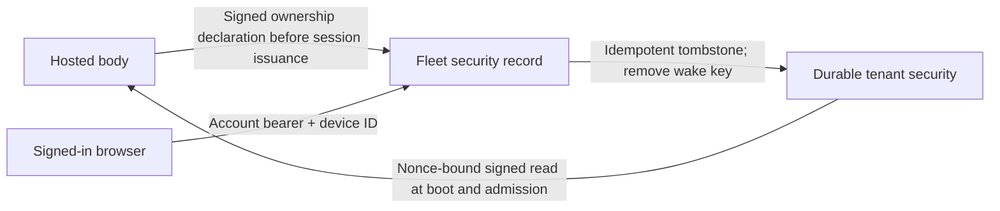

# 0268: Account-owned device revocation survives a sleeping body

Status: Superseded by [ADR 0300](0300-clankie-runs-only-on-the-owners-machine.md); `@clankie/protocol/hosted-browser-session` is removed. Accepted — lead decision, 2026-10-13

Tracks: VUH-2121 and backend VUH-2215. Builds on hosted security-state reconciliation (VUH-1068 RESTORE-1).

The hosted browser keeps its paired-device bearer and gateway keys in memory. Offline sign-out therefore cannot keep a device credential on disk for a later retry. The existing fleet tombstone is the durable authority, and the account may revoke only a device whose ownership the body has attested.

`@clankie/protocol/hosted-browser-session` supplies strict, node-free declaration, revocation and exact-ID receipt schemas. The hosted body declares each owner device through its credential, pairing-key signature, nonce and body digest before issuing the device session. Support provenance remains separate. A failed declaration prevents issuance; replay is idempotent.

The private account service checks account/tenant ownership and the body-attested ID, then writes the existing security tombstone and removes its wake key. This needs no live body. The public body consumes tombstones at boot and before device admission, including the periodic reauthorization of existing streams. A failed fresh security read refuses admission. This preserves the existing token, grants and support-validation boundaries.

The private web shell retains account authority and device IDs as revocation-only state, disconnects first, revokes devices, then revokes its account refresh session. Pending state cannot authorize re-pairing. Browser storage exposure and multi-tab behavior belong to the consuming app's ADR 0097.

Ship the private fleet routes before the matching public hosted body and web client. No production deployment or real-account proof is part of the local implementation. Self-hosted installations have no hosted security dependency and keep explicit pairing.
