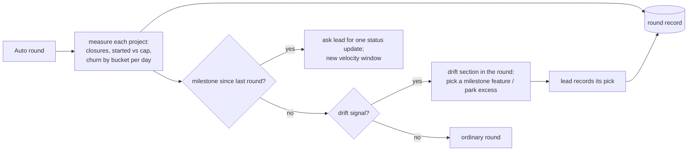

# ADR 0270: Auto rounds measure outcomes and name drift

Status: accepted by the lead for VUH-2255, 2026-10-14.
Tracked by [VUH-2255](https://linear.app/vuhlp/issue/VUH-2255). Builds on
[ADR 0264](0264-projects-on-auto-replace-goals.md); reads the per-project WIP
cap and owner-loop level that
[VUH-2256](https://linear.app/vuhlp/issue/VUH-2256) adds.

## Context

A project on Auto can stay busy for days without moving anything its owner can
see. KH2 Multiplayer, 2026-10-10 → 10-13: about 22k lines of rig and acceptance
tooling against about 2k in the game DLL, 22 issues parked in started states
and almost none closed. James found the stall by comparing notes with another
modder, not from Clankie. The guidance against it was already written (the lead
skill, the repo's proportional-rigor rule, KH2's D13) and the agents drifted
anyway. KH2's own answer, D14 in its `docs/ONLINE_COOP_PLAN.md`, is a measured
pace rule: at most six started issues, done means landed plus one live run, and
each lead round compares product lines with rig, test and doc lines and switches
to the next route feature when tooling leads two days running or a day ends with
no player-facing change.

Today's Auto round (ADR 0264) tells the lead which projects are on Auto, their
focus and how many workers are in their workspaces. It measures no outcome, and
nothing about a round is kept once it is delivered. The data to measure outcomes
already exists, unevenly:

- **Tracker state.** Linear and the built-in tracker hold each issue's state,
  `completedAt` and parent. Linear also keeps state history and project
  milestones. The service's Linear tracker lists issues by state today, but its
  issue selection omits history and completion times; the import path pages
  both.
- **Landings.** Commits on each project's origin default branch. The merge
  queue's batch records cover only Clankie's own two repositories and carry no
  issue key or changed paths, so they cannot measure other projects.
- **Cost.** `clankie metrics --issues` reports tokens, wall time and review
  rounds per issue from native transcripts. It counts cost, not outcome, and
  infers acceptance from prompt wording.

## Decision

**The service measures; the lead decides.** Each Auto round measures outcomes
for every project it carries, writes them to a durable round record, and adds
what it found to the round's existing wake. Measurement does not depend on the
agents being measured. Choosing what to do about it stays with the lead.

**Velocity, per project, since its last milestone:**

- **Closed.** Issues that reached a completed state, split into owner-facing,
  tooling and unlinked. A closure is tooling when every default-branch commit
  naming its key touched only non-product paths. A closure with no such commit
  counts as owner-facing and is recorded as `unlinked`, so the gap is visible
  rather than guessed.
- **Started against the cap.** The count of started-state issues now, against
  the project's WIP cap (VUH-2256). With no cap set the record says so.
- **Churn.** Lines added plus deleted on the origin default branch, bucketed
  `product`, `tooling`, `docs` and `excluded`, per local calendar day of the
  day each change landed there: first-parent history, merges diffed against
  their first parent, dated by committer time.

**Product paths.** A path is classified in this order. Lockfiles, generated
and binary files are `excluded`. A project may declare `productPaths`, a short
list of globs relative to the repository root. When it does, a matching path
is product and nothing else is. `docs/` and Markdown are docs, and the rest is
tooling. Without a declaration, test, fixture, rig, script, tool and CI paths
and `*.test.*`/`*.spec.*` files are tooling, `docs/` and Markdown are docs, and
everything else is product. The setting lives with the project's other
settings, through the same revision-fenced project update; the plain project
view strips it like `auto` and `focus`.

**Churn comes from origin, not the queue.** A project with a local workspace
reads its fetched origin default branch, as the projects status line already
does. A project whose workspaces are all on other machines (KH2) reads a
service-owned bare mirror fetched from the workspace's origin, at most once per
round. Per-commit numstat is cached by SHA. An unreadable repository leaves
churn `unknown` with its reason, never zero.

**Drift.** A working day is a local day on which the project was on Auto and
had a landing or an issue state change; idle days neither count nor break a
streak. Three signals:

- `tooling_lead`: non-product churn (tooling plus docs) exceeded product churn
  on two consecutive working days.
- `nothing_closed`: a completed working day with no owner-facing closure.
- `over_wip`: more started issues than the WIP cap, when one is set.

**What the round does.** A drifting project gets a drift section in the same
Auto round wake, never a separate wake: the signal, its numbers, and the
expectation. For `tooling_lead` and `nothing_closed`, stop starting tooling
work on that project, pick the next milestone feature and staff it. For
`over_wip`, return the excess started issues to Backlog, each with one line on
where it stopped. Which feature, and which issues to park, is the lead's call.
The lead records the pick through one lead tool over the round record, naming
the issue and a one-line reason. The next round checks that the named issue
started and product churn followed. Unresolved drift stays in the round and
follows the ordinary idle rewake; it does not escalate to the owner.

**Milestones.** A milestone is a parent issue reaching a completed state, or a
tracker project milestone whose issues are all done. The round that sees one
asks the lead for exactly one project status update with media and evidence
links, records the update it finds afterwards, and starts the next velocity
window. Routine rounds ask for no post, and the record flags a status update
posted without a milestone. When VUH-2256's owner-loop level is set it decides
how often the owner hears (silent, milestones, every landing); without it the
default is milestone reports.

**The round record.** `<state>/captain/auto-rounds/` holds an append-only
`rounds.jsonl` (one line per project per round: window, measurements, signals,
milestone, delivery result, lead response) and one state file per project (last
milestone, pending detections). A detection clears only when a round carrying
it is accepted, so a round lost to a limited or offline lead seat (VUH-2273)
carries it again. The round fingerprint gains the signal set and milestone
events, not raw counts, so new drift wakes the lead promptly while unchanged
drift costs no extra turns (VUH-2274). `clankie auto rounds` and one operator
API route read the record; `--replay` computes the same record from tracker
history and git for a past window without waking anyone.

## Alternatives rejected

- **More written rules.** The rules existed and were not followed; this has to
  be measured.
- **The lead measures itself.** The agent that drifted would grade its own
  drift, and the measure would vanish with its context.
- **Merge-queue receipts as the landing source.** They cover two repositories
  and carry no issue or path.
- **Tokens or wall time as the drift signal.** `clankie metrics --issues`
  measures cost. A cheap week of tooling is still drift.
- **The service parks issues or picks the feature itself.** That takes the
  decision away from the lead; the service supplies the measurement and the
  expectation, the lead acts.
- **Telling the owner about drift.** The point is correction without the
  owner, who hears milestones.

## Consequences

- Every Auto project gains a cost per round: one tracker read and one git read,
  plus a mirror fetch for remote-only projects.
- Commits that name their issue key make closures classifiable. Projects that
  don't (about one KH2 commit in five names one) see their closures counted as
  `unlinked` until they do.
- The WIP cap and owner-loop level are VUH-2256's settings. Before they land,
  `over_wip` never fires and milestone reports are the only owner-facing post.
- `apps/clankie` gains its first lines-changed measurement; anything else that
  needs churn should reuse it.

## Amendment: windows and classification range (VUH-2283, 2026-10-15)

Approved by the lead for VUH-2283, so VUH-2284 builds on the same rules.

- **Window start without a recorded milestone.** Each round reads the tracker over
  a 14-day lookback (or back to the recorded milestone, at most 30 days). The
  latest closed parent issue or complete tracker milestone in that range is the
  last milestone; with none, the window starts at the lookback start. The
  per-project state file keeps the last milestone, so a later round starts
  there. The parent issue that is the milestone counts in the window it closed,
  not the one it opens.
- **Days outlive the window.** The record keeps velocity totals since the last
  milestone and per-day facts (churn by bucket, closures by kind, state changes,
  working or not) for the window and the last seven local days, so drift
  detection always has a streak right after a milestone.
- **Classification range.** A closure's commits can predate the window, so
  classification reads default-branch commits from 14 days before the earliest
  recorded day.
- **Working days.** A working day has a landing or an issue state change (any
  state span after an issue's first). Auto history is not recorded, so a
  project counts as on Auto when it is on Auto at round time; the record says so.
- **Record shape.** `rounds.jsonl` holds one `measurement` line per project per
  round, written before the wake, and one `delivery` line per round once the
  wake settles, so a restart mid-wake leaves the measurement without a delivery
  instead of losing it. `projects/<id>.json` holds the last milestone. Each
  part of a measurement (tracker, churn) fails on its own as `unknown` with a
  reason, and a project's measurement is bounded at two minutes, so a round is
  never blocked.

## Amendment: drift detection details (VUH-2284, 2026-10-15)

Lead decisions for VUH-2284:

- **Measured every tick.** Each Auto tick measures every project on Auto, reusing a
  measurement younger than the tick, so new drift reaches the fingerprint without
  waiting for another change. Only rounds that wake are recorded.
- **Completed working days only.** Today is partial and never counts. Days whose
  sources were unreadable are skipped like idle days: they neither fire a signal
  nor break a streak. `nothing_closed` reads the last completed working day;
  `tooling_lead` the last two.
- **Fingerprint by signal name.** The fingerprint takes each project's signal
  names, not days or numbers, so drift that persists across days follows the
  idle rewake rather than waking the lead daily.
- **Carry until delivered.** A detection stays pending in the project's state
  file until a round carrying it is delivered; later rounds carry it, marked
  `carried`, alongside what they detect.
- **Status line by capability.** The projects status line shows signals only to
  clients that advertise support, so released app builds keep parsing it.

## Amendment: milestone reporting claims (VUH-2286, 2026-10-15)

- A round combines every newly seen milestone for one project into one update
  request. Native tracker ids identify milestones across renames and reopen/close
  cycles; completion dates still define velocity windows. Historical measurements
  without reporting fields did not request posts and therefore claim nothing.
- The append-only measurement claims the request before dispatch. A definite
  refusal permits another attempt; a wake left uncertain or interrupted after its
  delivery guard stays claimed across restart, avoiding a duplicate ask. Such a
  round stays visibly unsettled; there is no automatic resend on uncertainty.
- Each measured tick reconciles tracker status updates, including ticks without a
  wake. The first subsequent update satisfies an outstanding request; further or
  routine updates are flagged. A delayed update can satisfy its original request
  after routine rounds. Attribution uses the same tracker identity and creation
  time, and does not prove who authored it or inspect its media/evidence body.
- Milestone identities, rather than request state or counts, join the fingerprint.
  Recording a claim therefore causes no extra wake. Routine rounds ask for no
  project post. VUH-2256's cadence preference remains a future integration.

## Amendment: enforced project work policy (VUH-2256, 2026-10-15)

- Project `wipCap` bounds Started tracker issues independently of worker caps.
  Both live measurement and replay use it; replay applies today's cap to historical
  counts rather than claiming to reconstruct past settings.
- `ownerLoop` defaults to `milestones`; `silent` requests no owner posts, and
  `landings` also aggregates newly observed origin commits. The first observation
  establishes a baseline. Existing delivery claims, definite-refusal retries and
  status-update attribution apply to both landing and milestone requests.
- Project lead/worker profiles and plan/model constraints apply at hire admission.
  Subscription work hires require usage observed within five minutes and retain
  a 10% reserve for running work. Unknown usage cannot authorize a new hire.
  Each job names its effort rationale; fleet-wide effort no longer supplies it.
  Receipts and the private project hire journal retain selection evidence.
- Editable fleet size/model mode, verification mode, reporting style and global
  hire effort are retired. Saved values are archived read-only before defaults
  are filled; compatibility views retain old fields without accepting edits.
- Decision asks have a default and deadline. Expiry informs the lead and owner
  with service attribution; it never fabricates an owner answer or approves an
  owner gate. The lead can act only within existing authority.

## Amendment: unused capacity is measured (VUH-2335, 2026-10-17)

- Each delivered or refused round retains per-project ready/backlog keys, explicit
  blockers and their dependent keys, working and idle/done census seats, occupied
  seats against the worker cap, and Started issues against the WIP cap. The same
  record includes totals and per-plan usage windows, observed time, remaining
  fraction, reset horizon, burn per day and spare fraction per day.
- Known, signed-in, usable, unheld accounts need usage at most five minutes old,
  more than the existing 10% reserve in every general window, and positive spare
  capacity at their observed pace to count as headroom. An expired reset never
  becomes fresh capacity. Project plan/harness constraints filter the candidates;
  ordinary model, role, machine and hire admission remain authoritative.
- Ready work with headroom and room under worker/WIP caps flags `under_staffed` in
  the existing Auto wake. No ready work with headroom flags `backlog_not_ready`:
  plan backlog items into independent ready ones. Explicit blockers hold only
  their dependent keys; no project-wide hiring pause follows an owner blocker.
- The next recorded round compares active seats with the preceding signal and
  records `staffed`, `cap_reached`, `no_ready_work`, `plan_reserve`, `unresolved` or
  `unknown`. Signal names and unresolved checks join the existing fingerprint;
  unchanged signals follow the existing idle rewake. Measurements do not hire,
  change issue state, raise a cap, or add owner notifications.
- Queue reads follow the saved tracker route. Built-in reads use the same native
  ready/lease/run rules, restricted to Todo/unstarted items; Linear reads page
  open issues and blocker relations and use explicit owner-blocked labels/states.
  Free-text descriptions do not establish a blocker. Failed or partial reads
  remain unknown. Unreadable census sources cannot establish free seats.
- `clankie auto rounds` opts into additive staffing fields. HTTP clients request
  `includeStaffing=true`; historical records remain readable. Velocity replay
  cannot reconstruct census and account usage from git/tracker state alone; a
  staffing replay needs retained historical inputs and labels reconstructed facts.

## Amendment: census identity and bounded queue reads (VUH-2335, 2026-10-17)

The census joins enrolled workspaces and worktree roots by canonical machine ID:
`local` for local runtime routes, and the fleet route ID for remote runtimes.
The roster's display hostname is not a project machine ID. Project counts,
round totals and worker counts in the wake use the same seat projection and
workspace matching. Repeated projections of the same native occupant on the
same machine count once. An unavailable machine or unknown seat status leaves
its census unknown and cannot establish either staffing signal.

Linear project issue pages contain at most ten issues with the existing bounded
nested blocker selections. The original fifty-issue selection exceeded the live
provider's complexity limit. Every issue cursor and any overflow relation cursor
is still followed; limiting page size does not truncate the queue. A failed,
partial or nonadvancing read remains unknown. The first live check of the smaller
selection read all fifty current KH2 issues across five pages; deployed Auto-round
counts remain a separate verification requirement.
