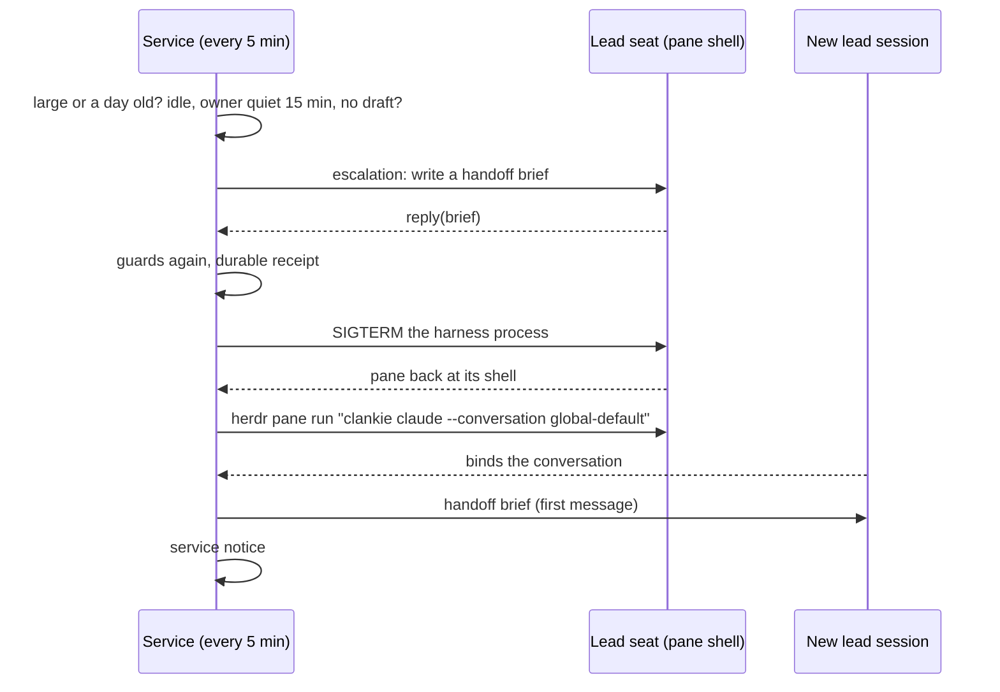

# 0271: The lead seat restarts fresh in its own pane

- Status: Accepted (James, 2026-10-15, through the lead)
- Work: VUH-2274; shared with VUH-2273 (lead seat failover)
- Extends: [0152](0152-a-harness-takes-the-operator-seat.md) and
  [0218](0218-native-seats-drive-their-attached-conversation.md)

## Context

The global-default lead seat is the owner's `clankie claude` session in a Herdr
pane. Nothing ended it. Its context only grew, and the harness compacted it
whenever the window filled: from 2026-10-07 to a manual `/clear` at
2026-10-15 00:05 UTC it ran eight days and 22 compactions. On 2026-10-13 it took
828 turns, at a per-hour median of ~516k tokens of context and up to ~958k in
its 1M window. Each turn re-reads that context, so the seat's cost scaled with
how long it had been running rather than with the work.

Claude Code cannot clear its own context, and Clankie never types into a pane
([ADR 0207](0207-work-records-and-native-agent-delivery.md)). The conversation
log is already the source of truth: a fresh seat starts from its projection
(ADR 0218), so a new session loses only what the old one held privately.

## Decision

**When the default lead seat is idle and large or old, the service relaunches
it fresh in the same pane, after the old session writes a handoff brief.**

A check every five minutes considers it when the seat's Claude transcript shows
at least 500k tokens of context in its latest main-thread call (half its 1M
window; Claude records no window, so this is a token budget), or a session that
started 24 hours ago. All of these must hold, and are read again just before
the old session is ended:

- the seat is bound and not in a turn;
- the owner has written nothing in the conversation for 15 minutes, from the
  pane or any app;
- the pane holds no unsent draft (the same styled-cell read that guards
  closing a worker pane; an unreadable input line refuses).

The service then sends the seat one escalation asking for a handoff brief and
waits for its `reply`. A seat that does not answer is not restarted, and the
service does not ask again for an hour.

The relaunch reads the pane's own process tree. It requires the `clankie
<command>` launcher under the pane's shell, and takes the command (`claude`,
`claude2`, `codex`, …) and the native harness process from it. It records a
durable receipt, signals the harness process with SIGTERM, waits for the pane
to return to its shell, and runs the same launcher with `--conversation <id>`
there. The new session binds to the same conversation and receives the brief as
its first message. The old session stays on disk and resumable. Each restart
records a service notice in the conversation.

Every refusal is definite: nothing was ended and nothing was launched. After the
signal, the result is either relaunched or an uncertain receipt that is
reconciled by reading the pane and conversation, never by trying again.

The fleet setting `leadRestarts` (`on` by default) turns this off. It is set
through the revision-fenced fleet settings API, `clankie fleet set
--lead-restarts on|off` and the TUI's `/fleet`.

VUH-2273 moves a usage-limited seat with the same relaunch, to another account
or harness and back after the reset, with its own guards (a limited seat cannot
write a brief or finish a turn).

## Alternatives

- **Compaction, as before.** It keeps one session alive indefinitely, and its
  summaries compound across days instead of starting from the shared log.
- **Ask the owner to relaunch.** It works, but the owner already chose to have
  this done for him when the guards hold.
- **Open a new pane and leave the old one.** It splits the owner's seat across
  panes he did not create and leaves a stale session holding the pane name.

## Consequences

- The lead seat's context is bounded by a schedule instead of the window.
- A restart costs one extra turn (the brief), and briefly leaves the
  conversation without a seat; ADR 0218's handoff covers turns the service lane
  ran meanwhile.
- Only seats launched by `clankie <command>` from a shell can be restarted;
  others are refused as `not_shell_launch`.
- The context threshold assumes the seat's current 1M window. A smaller window
  compacts before it is reached, and the 24-hour rule still applies.
