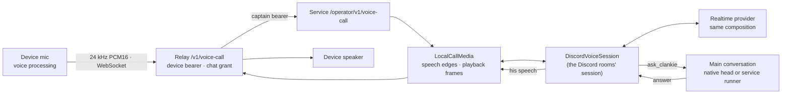

# ADR 0288: A device call is a voice body of the same session

Status: accepted for [VUH-2682](https://linear.app/vuhlp/issue/VUH-2682)
(design approved by the lead, 2026-10-23, from James's request that the desktop
pet's voice button be "like a voice call with him"). Extends
[ADR 0057](0057-realtime-voice-with-captain-handoff.md) (realtime voice speaks,
the captain acts) and [ADR 0215](0215-conversations-lease-one-body.md) (one
voice), and reuses the main-conversation path of
[ADR 0218](0218-native-seats-drive-their-attached-conversation.md). Learns from
[ADR 0125](0125-the-menu-bar-is-a-private-local-voice-room.md), whose surface
[ADR 0203](0203-clankie-keeps-what-better-models-cannot-absorb.md) retired.

## Context

The Mac pet's voice button dictated text into the pocket composer. James wanted
a call: speak, hear Clankie answer in his own voice, turn by turn, with
anything he does landing where the console sees it.

ADR 0125 once built a local voice room for the menu bar. Its session shared the
provider composition but was a second voice runtime: its own surface rules, no
voice register, no self tools, and none of ADR 0057's floor, barge-in, stop,
acknowledgement or stale-answer rules. Every one of those was tuned on live
Discord calls, and a parallel runtime would drift from them again.

## Decision

**A device call runs the same `DiscordVoiceSession` as his Discord rooms, with
the device as its media.** The session now takes a `VoiceMediaPort`: exactly
the Vox calls it already made. Vox satisfies it unchanged. A port that isn't
Discord skips the DAVE wait, and the joined receipt records DAVE version 0. The
session's `ask_clankie` destination becomes a `VoiceHandoffPort`, the interface
`DiscordVoiceIngress` already had in shape. Everything else is shared: the
floor, barge-in, stop, handoff acknowledgement and joining, stale-reply
cancellation, the spoken-answer cap, the self tools and `voice_leave`. So are
the provider composition (`createVoiceRealtimePorts` and the owner's voice
settings, the external mouth included) and the instruction composer: identity,
persona, the one voice register (its opening sentence says where he is), surface
rules and the private awareness card.

- **Media.** `LocalCallMedia` turns a continuous microphone stream into the
  speaking edges and capture frames Vox reports for a Discord member. An energy
  gate finds an onset and a 500 ms silence ends the utterance, matching
  Discord's packet-silence capture end. An utterance that ends before the
  session opens its capture is held whole and delivered. His speech goes back as
  framed PCM that the device acknowledges as started (audible), drained or
  stopped. Those acknowledgements drive turn-taking exactly as Vox playback
  states do. Audio stays in memory only.
- **Handoff and authority.** `ask_clankie` enters the main conversation through
  the path a linked private Discord channel uses (`replyToLinkedChannel`, now
  naming its surface). It becomes a queued turn there. A live native head
  answers through a reply-bearing escalation; otherwise the service runner
  answers. The final answer returns to the voice. Everything he does from a call
  is therefore a turn in global-default, visible in the console and the app.
  Voice approves nothing; an approval waits in that conversation. Plain spoken
  conversation is not written anywhere (ADR 0121 keeps exact speech opt-in).
- **Who may call.** The relay authorizes the device the way it authorizes chat.
  A call needs the `chat` grant. Hosting-control and support devices are
  refused. The relay rechecks the device every 30 seconds, and revocation ends
  the call. The service route takes only the captain bearer.
- **One voice.** A call holds the `voice` body lease for the main conversation
  for its whole length. While a Discord stay holds his voice, the call is
  refused (`voice_busy`) and names the room. The reverse holds too: a Discord
  stay shares a voice lease only when another stay holds it, so a join for the
  main conversation during a call is busy rather than riding on the call's
  lease. Ending the call releases the lease. There is no silent takeover; a
  one-tap "leave and call" is future work.
- **Lifecycle.** The device or Clankie (`voice_leave`) can hang up. So can a
  lost socket, a failed lease renewal or a revoked device. A device streams
  microphone frames the whole call, so 15 seconds with nothing from it ends the
  call; a half-open socket cannot hold his voice. The relay opens the service
  call before the device's upgrade completes, and closes it when that upgrade
  aborts or has not completed within 5 seconds. Each ends the session and
  releases the lease. Work the main conversation already accepted
  continues there. Provider credentials are read when a call starts, never at
  boot.

## Alternatives considered

- **Revive ADR 0125's local session.** Rejected: it was the second runtime that
  drifted.
- **Extract a transport-neutral session first.** Rejected for now: a much larger
  refactor of a 4,800-line class whose behaviour is pinned by its tests. The
  media port is the seam that refactor would start from.
- **WebRTC from the device straight to the provider.** Rejected: it moves the
  conversation loop into the app and cannot carry the Anthropic brain or the
  ElevenLabs mouth.
- **A fake Discord room through Vox.** Rejected: it would record a false DAVE
  session and Discord receipts for a call that never touched Discord.

## Consequences

- The Mac app (and any later device) reaches a call through its existing relay
  route. The gateway's sealed-envelope HTTP cannot carry a socket. A phone that
  reaches its Mac only through the gateway calls over a sealed stream instead
  ([ADR 0289](0289-a-call-through-the-gateway-is-a-sealed-stream.md), VUH-2761).
  Hosted bodies still have no device call
  ([VUH-2766](https://linear.app/vuhlp/issue/VUH-2766)).
- Speech-detection thresholds and echo behaviour are calibration knobs until
  James's first live call. The device must run its own echo cancellation, or
  his voice from the speakers can count as the owner talking over him.
- Call receipts are the session's content-free evidence, recorded as
  `voice-call.*` events.

## Amendment: the call and the chat are one conversation (VUH-2752)

James, asking for the phone's call to work like Grok's
([comment](https://linear.app/vuhlp/project/clankie-7f2de0de4a75/activity#comment-2972464d)
and its follow-up on [VUH-2752](https://linear.app/vuhlp/issue/VUH-2752)): "as
it's talking you, and as you're speaking, you should see that dialog appearing
in the chat like it should be very continuous". He also asked that nothing be
dumped into the chat when the call ends. The Decision above wrote plain
spoken conversation nowhere. For an owner's device call that no longer holds.

- **Both sides stream to the device.** The session publishes a live
  transcript (`subscribeLiveTranscript`): the owner's speech as the transcriber
  hears it, and his reply as it is generated. Each event is the whole line so
  far under a stable `lineId`, and `final` closes it. OpenAI streams deltas and
  xAI the whole line each time, so the session builds the line either way. A
  reply nobody heard (suppressed before any audio) closes empty, which retracts
  it. One that was cut off keeps what he was saying. The call forwards every
  event to the device as a `transcript` server event.
- **Closed lines are recorded in the main conversation as they close.** The
  owner's speech becomes an owner message and his reply becomes his message,
  through `recordVoiceCallLine`. Neither is a turn: the call's voice already
  answered. When the call ends the chat already holds it, so hanging up adds
  nothing. A reply the hang-up cut off closes like any other line before the
  call stops listening.
- **Only owner device calls record.** Each device call builds its own session,
  and only `VoiceCall` subscribes to the live transcript, for the call's
  length. Discord rooms never subscribe, so a room's speech is still written
  nowhere unless the owner's retention toggle is on (ADR 0121).
- **Spoken lines are not reports, and are not asked again.** His recorded
  line never passes through the autonomy report boundary, so a
  "continuation: …" or "blocked on owner: …" said aloud changes nothing. A
  recorded line is not a turn, so the next text turn runs on its own message
  alone. Text Clankie therefore hears nothing of the call beyond what its
  `ask_clankie` handoffs carried; the lines are the owner's record, not his
  context.
- **Recorded lines are marked spoken** (VUH-2764). Each carries `spoken: true`
  on its message, set only by the store's own record of a call line; no
  request can supply it. Surfaces that know the field show the line as said on
  a call. Apps that predate it read it through `parseProtocolResponse`, which
  drops the unknown key, so they show it as an ordinary message and keep the
  page. The same marker keeps his spoken line out of the report boundary.
- **No opt-out yet.** Every owner device call records its lines. A setting to
  keep a call out of the chat is future work.
- **Audio is still never retained.** Only text is kept, and only the owner's
  own call writes it, into the owner's own main conversation.

His text can arrive slightly ahead of his voice, because the provider
transcribes his reply as it generates it. The device paces nothing yet.
