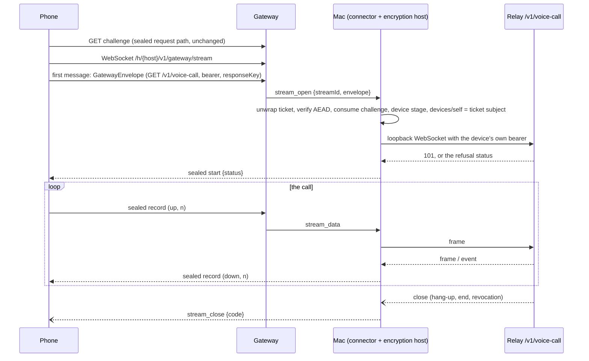

# ADR 0289: A call through the gateway is a sealed stream

Status: accepted for [VUH-2761](https://linear.app/vuhlp/issue/VUH-2761)
(design approved by the lead, 2026-10-23). Amends
[ADR 0173](0173-the-gateway-cannot-read-device-traffic.md) (the gateway cannot
read device traffic) and extends
[ADR 0288](0288-a-device-call-is-a-voice-body-of-the-same-session.md) (a device
call). The gateway half is in `clankie-ops/apps/gateway` and ships as its own
owner deploy.

## Context

A device call (ADR 0288) is a WebSocket to the relay's `/v1/voice-call`. A
phone that reaches its Mac only through the hosted gateway had no call: the
gateway carried one kind of device traffic, ADR 0173's sealed request. One
sealed request can't carry a call:

- its body is sent once, and every uplink chunk would cost another challenge
  round trip;
- its response is capped at 16 MiB, about six minutes of 24 kHz PCM16.

## Decision

**A call through the gateway is a sealed stream: a device socket the Mac opens
like a sealed request and then carries record by record.**

- **The opening is a sealed request.** Its `GatewayEnvelope` names `GET
/v1/voice-call` and carries the device bearer and a fresh `responseKey`.
  `GatewayEncryptionHost.openStream` checks it exactly as `handle` does:
  - ticket and expiry;
  - the one-use challenge, consumed synchronously;
  - the device stage;
  - that `/v1/devices/self` names the ticket's subject.

  Only a device's call opens a stream. Nothing else does, and no stream reaches
  any other route.

- **The relay decides who may call.** The Mac connects the stream to the relay's
  own call route over loopback, with the device's bearer. The relay checks the
  `chat` grant, refuses hosting and support devices, and re-checks every 30 s,
  just as it does for a direct call. Revocation ends the call (`ended revoked`,
  then close 1008). A refused upgrade comes back as the sealed start's status,
  so the phone shows the same notice a direct refusal would.
- **Records are sealed one by one under `responseKey`.** Each record's plaintext
  is a kind byte (`start`, `text` or `binary`) followed by its payload. The AAD
  binds the envelope's transcript, the direction and the sequence:
  `gatewayStreamAad`, `base#n`. That makes a record impossible to replay,
  reorder, reflect or move to another stream. The Mac closes the stream on a
  record that fails to open, arrives out of order, or comes before its start.
  Each sealed record is at most 16 KiB; a 20 ms audio frame is 960 bytes.
- **The gateway forwards bytes and enforces limits.** It sees ids, sizes,
  timing and close codes, never a key, bearer, route or event. Close reasons
  stay sealed inside the `ended` event.
- **A close code is sanitized before either end uses it.** `stream_close`
  admits any code from 1000 to 4999. Before a socket closes with one, both the
  Mac and the gateway pass it through `sendableStreamCloseCode`: codes a
  WebSocket refuses to send (1004, 1015, 1016 to 2999) become 1011, and 1005
  and 1006 become 1000. A peer's odd code ends that one call, never the
  service.

  Timing does show when the device talks and when it listens. A muted phone
  still sends silent frames (ADR 0288), so the uplink keeps a steady rhythm, but
  downlink bursts show when Clankie speaks. That is accepted.

- **A Mac opts in with a header.** It sends `x-clankie-gateway-streams: 1` on
  its connect request. An older gateway ignores the header, whereas a query
  parameter or a new frame would have refused the Mac. The gateway sends
  `stream_open` only to a Mac that sent the header, and never to a hosted body:
  hosted voice is credit-metered through the Discord edge, and pricing phone
  calls there is an owner decision
  ([VUH-2766](https://linear.app/vuhlp/issue/VUH-2766)). A hosted body's
  connector (`carriesCalls: false`) neither sends the header nor opens a
  stream.

  The gateway refuses the phone's upgrade with a status that says why: 404
  for a Mac that doesn't carry calls yet (the phone says to update Clankie on
  the Mac), and 403 for a hosted body (the phone says calls need the Mac's
  own connection).

- **A credential refresh waits for the call.** The Mac reconnects to the gateway
  to refresh its account credential, and a reconnect would drop every stream.
  It therefore holds the refresh while a call is open and reconnects once the
  last one ends. The gateway still closes the socket when the credential
  actually expires, so a call can't outlive the Mac's sign-in.
- **At most two streams per Mac:** a call, and room for one that is ending.

## Consequences

- There are three independent ships: the gateway (an owner deploy), the Mac
  (a release) and the app (TestFlight). Each is safe alone. Until both the
  gateway and the Mac carry streams, the phone keeps its current notice.
- Latency: the call takes two internet legs (phone to gateway to Mac) instead of
  one direct hop, over TCP with head-of-line stalls on a bad network. The local
  fixture measures only the seal and relay overhead; the network budget is
  measured after deploy.
- Bandwidth on the existing gateway instance is at most about 225 KB/s per call,
  counting both legs in and out with base64 on the tunnel. That is roughly
  0.8 GB per call-hour.
