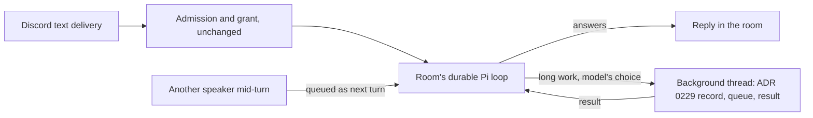

# ADR 0291: A room thinks in one loop

Status: proposed (VUH-2796, 2026-10-24). The lead approved building it, under
James's go-ahead to adjust Clankie to the guidance. It would amend
[ADR 0229](0229-room-handoffs-are-visible-parallel-threads.md) for Pi text rooms
only. Increment 1 (decisions 1 and 3, social rooms) is built behind the rollout
switch `CLANKIE_ROOM_LOOP`, which is off by default. The fork tool (decision 2)
and owner-only system lanes are not built yet. Acceptance still waits for the
eval below.

## Context

Anthropic's [guidance on folding subagents](https://claude.com/resources/articles/building-agents-when-to-fold-subagents-into-your-main-agent-loop)
(2026-10-22) says one loop with shared context usually beats a fan-out of fresh
children. It names the warning signs as lossy handoffs, an inconsistent voice
and extra hops. It keeps subagents for parallel work that needs little from the
rest of the system. It asks for one change at a time, measured against an
end-to-end eval.

[VUH-2796](https://linear.app/vuhlp/issue/VUH-2796) measured where Clankie runs
separate loops ([record](../testing/2026-10-24-vuh-2796-lane-folding/README.md)):

- **Pi text rooms** (the busiest separate lane, 250 handoffs in 18 days). Since
  ADR 0229, every admitted message starts a fresh Pi session. It starts at zero
  context and ends at a median of 40k tokens after a median of one tool call. It
  sees the room only through a 12-message excerpt and its sibling handoffs. End
  to end: p50 44 s, p95 285 s. The model turn dominates (p50 26 s).
- **Before ADR 0229**, the same rooms ran in their durable room session. Turns
  started with a median of 48k tokens of real room history: p50 27 s, p95 447 s.
  Models and load differ between the periods, so this is a hint, not a result.
  The longer tail is what ADR 0229 fixed: one person's long task held the room,
  and another person's message could steer it.
- **The owner's linked main channel** already runs in the native lead's own loop.
  Since that change (2026-10-19) its p50 dropped from 117 s to 40 s. Its p95
  (212 s) comes from waiting for the lead, whose turns are 93% fleet traffic.
- **The native `clankie:room` child** (ADR 0229's Claude executor) never ran: the
  lead's transcript has no `clankie:room` spawn since 2026-10-06.

So folding rooms into the _lead's_ loop would queue every room behind fleet
traffic. The parent ADR 0229 already names is the room conversation: it is "the
authority and reply destination". The fold is to let that parent think again.

## Decision (proposed)

A Pi text room answers in its own durable session, one per room and authority:

1. **One loop per room and grant.** A delivery runs as a turn of the room's
   existing durable Pi session (ADR 0118's social lane, or ADR 0133's system lane
   for an owner-only room), not a fresh handoff session. The session keeps its
   own history, so continuity no longer depends on the excerpt. Its stable
   prefix keeps the provider's prompt cache warm.
2. **Fork by context, not by message.** The room loop gets one tool to move work
   that would hold the room for a long time into a background thread. That
   thread reuses ADR 0229's visible child record, admission queue and result
   path, and reports back into the room loop. The model decides when to fork;
   no host rule triggers it.
3. **Speakers take turns; only the sender steers.** A message from someone else
   while a turn runs is queued as the next turn, never steering. ADR 0229's
   amendment still lets a sender's burst steer their own turn.
4. **Unchanged boundaries.** Grants, owner audience, mixed-room one-shot
   machine turns (ADR 0107, ADR 0251), voice `ask_clankie`, the linked main
   channel and native heads stay as they are. Social and system lanes stay
   separate sessions, so private context never enters a social history.

## Alternatives

- **Fold rooms into the native lead.** Rejected: owner DMs already wait up to
  166 s at p95 behind fleet work, and the lead would need per-actor tool scoping
  for non-owner grants.
- **Keep per-message threads.** This is the baseline the eval compares against.
- **Remove the dormant native `clankie:room` path.** Simpler, but it is the
  only native executor for non-linked owner machine rooms. A separate decision.

## Verification before acceptance

Run the [lanes eval](../evals.md#the-lanes-suite) before and after on the same
model and effort, two repetitions, and check which cases flipped, not only the
score. Add a case whose fact lies beyond the 12-message excerpt, since that is
where the fold should differ. Compare room latency from `discord.text.reply`
receipts and context tokens per turn from `turn-settled.jsonl`. Keep the fold
only if the eval holds and p50 latency drops without a worse p95. Otherwise
record why not on VUH-2796.

## Increment 1 (built, off by default)

`CLANKIE_ROOM_LOOP=all`, or comma-separated `guildId:channelId` targets, routes
a Pi text handoff whose plan is `social` into
[`RoomLoops`](../../apps/clankie/src/captain/room-loops.ts):

- The durable session key is the room's social session plus a hash of the
  exact grant fingerprint. A changed grant starts another loop.
- The handoff child record, admission queue, burst steering and result path
  are unchanged. The child shows "Answering in the room's loop", and the loop's
  transcript projects into the room conversation.
- Turns of one loop run one at a time. The session is built once, and a
  per-turn access holder gives room-skill tools the running turn's actor and
  grant. Each turn runs like a handoff on that session, so a sender's burst
  still steers their running turn (ADR 0229's amendment).
- A turn that waited for its loop re-resolves its grant before it runs. If the
  grant changed, it fails as `room_loop_grant_changed` instead of reaching the
  old grant's history and tools. The next message starts the new grant's loop.
- Machine turns, owner-audience rooms, voice, the linked main channel and
  native heads keep their ADR 0229 paths.

[`room-loop.integration.test.ts`](../../apps/clankie/test/room-loop.integration.test.ts)
covers both with the real Captain and Pi on a loopback model. A burst is
absorbed, the next speaker's turn carries the loop's history, and a queued
turn whose room skill was withdrawn is refused. Both cases fail without their
fixes. Proof so far also uses the [lanes eval](../evals.md#the-lanes-suite) `--smoke
--room-loop` against the real service. Social turns settle in `:loop:`
sessions. Two speakers sent to one room at once get two turns in one loop, the
second accepted after the first completed. That check fails when serialization
is removed. Every turn's reply, tools and usage stay its own. No real model has
run it.

## Consequences

- One room has one Clankie with one memory of what was just said there, which
  is the "same Clankie" property the eval measures.
- Room sessions grow again and rely on Pi compaction. Its cost needs watching.
- A long turn holds the room until the model forks it. The p95 check guards
  against a return of the pre-0229 tail.
