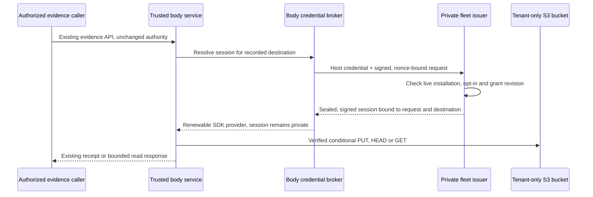

# ADR 0297: Hosted evidence uses renewable tenant credentials

Status: Accepted (offline slice only), 2026-10-26, James; hosted proof and activation not authorized

Extends [ADR 0258](0258-evidence-lives-in-the-evidence-store.md), subject to the
managed credits-only amendments in
[ADR 0239](0239-worker-harnesses-sign-in-with-their-own-logins.md) and
[ADR 0197](0197-hosted-workers-reach-the-owners-model-through-the-body.md).

## Context

The storage backend and destination preservation have landed, followed by the
owner API/CLI/TUI and app consumers. VUH-1913's next slice is hosted tenant
credential brokerage and renewal, off by default. Production startup and owner
activation follow separately. LOCAL-VUH-29, LOCAL-VUH-30 and LOCAL-VUH-32 are
existing consumer work, not new work for this proposal.

The public S3 adapter currently uses the AWS SDK provider chain. It does not
receive renewable tenant credentials from Clankie's broker. Its signed GET uses
one credential snapshot and caps expiry at both the credential's remaining
lifetime and the existing 15-minute URL maximum. Recorded destinations preserve
bucket, region and prefix across changes; credentials never belong in them.
Active uploads and historical reads must receive the same scoped provider.

The issue records an earlier bounded hosted proof and private ops landing. That
proof's operator-assumed role is not a tenant issuer or production authorization.
Its bucket-level listing permission also does not prove tenant metadata isolation.
No current cloud state was read for this proposal.

The 2026-10-26 04:58Z issue comment (edited 05:50Z) records a hire refusal after
a lead relaunch. The VUH-2860 commits `881942e8a`, `546215cf4` and `251de1c79`
fix successor binding and receipt-bound brief delivery on this proposal's base.
That historical refusal does not justify an account, trust or credential workaround.

## Decision

Use a dedicated, renewable evidence credential provider in the trusted body
service. The private fleet authenticates the current installation and issues
short-lived storage sessions for that tenant alone. No owner AWS key, shared
operator profile or model-provider credential enters this path.

Use S3 and **one private bucket per tenant** for the first implementation. Keep a
server-assigned prefix within it. This is a deliberate small-slice tradeoff:
the current adapter uses HEAD before PUT and GET; missing-object HEAD behavior
depends on bucket listing authority. Giving unrestricted ListBucket on a shared
bucket would expose other tenants' keys. A tenant-only bucket permits that
authority without cross-tenant enumeration. A shared bucket requires a separate
design and real provider proof; a prefix condition on ListBucket is not assumed
to solve HEAD absence. R2 issuance is deferred, not simulated with AWS semantics.

The private control plane, issuer, IAM, bucket configuration, retention, backups
and production records belong in `clankie-ops` under
[ADR 0183](0183-the-harness-is-public-the-hosted-service-is-private.md).
Public code owns only the generic validated provider seam, credential handling,
evidence integration and secret-free status. Optional managed composition uses
the existing runtime-provider mechanism; an ordinary install has no new hosted
dependency.

### Issuance and scope

The body uses its existing broker-held hosted identity and registered pairing
key. The fleet verifies the host credential, installation, request signature,
timestamp, nonce and body digest before issuance. It derives tenant/account
identity from verified credentials and live fleet state, never caller-supplied
tenant, bucket, role ARN, endpoint or policy. The request selects only a
server-issued destination identifier and required read/write purpose.

Reuse the hosted grant principles of
[ADR 0233](0233-activity-shares-own-their-media-scope.md),
[ADR 0268](0268-account-owned-device-revocation-survives-a-sleeping-body.md) and
[ADR 0269](0269-browser-pairing-binds-an-account-session-to-one-device.md):
exact installation and resource binding, durable revocation, fresh authority,
nonce-bound replies and no authority inferred from a browser claim. An evidence
storage lease is separate from device, support, Discord and model grants.

The signed reply binds audience `evidence-storage`, tenant, installation, body
key identity, destination identifier, bucket/region/prefix, read/write purpose,
grant revision, request nonce and absolute issue/expiry times. Encrypt its
credential payload to the registered body key using the existing sealed-body
transport conventions. TLS and a request signature alone do not hide response
credentials from a terminating intermediary. No redirect or caller-selected
credential endpoint is accepted.

The private issuer requests sessions lasting **at most 900 seconds**, no longer
than the admitted host identity. Its role policy and session policy intersect:

- GetObject (including HEAD) and PutObject only within the assigned
  `<prefix>/sha256/*` object namespace; historical destinations receive read-only
  leases, while only the configured, admitted write destination receives PUT.
- ListBucket only for the tenant's dedicated bucket. No bucket configuration,
  ACL, delete, version deletion, IAM, STS delegation or access to another bucket.
- The body validates complete size/SHA and uses conditional PUT as today.
  Before real deployment, private policy must enforce conditional creation too;
  application checks alone do not constrain a stolen session's direct writes.

Cloud credentials remain service-owned. Keep the typed, expiring session and
binding envelope in a dedicated internal broker entry keyed by installation,
destination and purpose. Reuse `CredentialStore` locking and revision witnesses;
do not mislabel an AWS session as a model OAuth credential. Add a dedicated typed
decoder and fully secret-free summary (including no access-key prefix). No
bootstrap, settings, environment, argv, harness file, telemetry, receipt, tracker
comment or generic model-auth endpoint may export this entry. The issuer's own
AWS authority stays private and never reaches a tenant body.

### Renewal, expiry and revocation

Supply the SDK a refreshable provider, not a one-time credential object. Use the
same provider factory for the active adapter and every recorded-destination
adapter; otherwise historical reads would silently use ambient credentials.
In managed evidence mode, absence or failure refuses storage access without
falling through to the standard chain, operator profiles or another destination.
Self-hosted installations retain their current provider-chain behavior.

Refresh on demand at half-life, coalescing callers and rechecking under the
broker's cross-process mutation lock. Give each exchange a ten-second deadline
and bounded backoff. Transient transport/5xx failures may use the previously
admitted session only while more than 60 seconds of validity remain; after that,
refuse new operations. Malformed, incorrectly bound, explicitly denied or
revoked replies invalidate the local session immediately. Do not log upstream
response bodies. Preserve the request identity when reconciling an uncertain
exchange; a retry cannot widen scope or manufacture activation.

The transport contract distinguishes explicit denial from delivery failure:
only `EvidenceSessionDenied` represents an explicit issuer denial. Every other
exchange exception (including fetch `TypeError`, resets, DNS failures, timeouts
and HTTP 5xx) is transient. A received reply that fails decoding/binding still
invalidates immediately. A transport must not turn an unclassified error into a
revocation tombstone.

Reconciliation repeats the original authenticated nonce, request timestamp and
body digest. Within that signed request's original five-minute nonce window and
the original session lifetime, an identical nonce/digest returns the **identical
sealed reply**, without issuing another session or extending issue/expiry times.
The same nonce with a different digest or admission binding is an explicit
denial. Pending issuance returns a transient response; it cannot be repeated
while its outcome is unknown. The private handler therefore requires atomic,
durable reservation and sealed-response storage before it can be mounted; a
fixture-only replay map is insufficient. Cached replies still require current
host/grant checks. The decoder binds issue time to the original request and
checks the original nonce window and absolute expiry; the ten-second deadline
bounds each attempt, not the lifetime of a recoverable reply. Once that window
expires, a pending identity is abandoned and replaced with a new nonce, this
provider instance and the current timestamp (`reconcile:false`). A result arriving after
its request window is discarded without withdrawing admission; a later call
starts fresh. An abandoned unobserved session expires on its own within 15
minutes. A restarted body must settle a still-recoverable old identity or abandon
an expired one, then obtain fresh live admission before using credentials.

The offline implementation currently delays retries by a fixed one second per
broker entry. Escalating backoff, issuance rate limits and pending-claim recovery
must be assessed before activation.

Every renewal checks the current installation, tenant enablement, destination
allowlist and monotonic grant revision. Publish only a validated reply whose
revision still matches the broker's admission state. Revocation and replacement
use that same lock: a late response cannot restore a deleted or superseded entry.
On service restart, revalidate with the fleet before using a persisted session;
offline startup cannot turn a cached grant into fresh authority.

Disabling the feature, revoking the evidence grant, replacing the installation
or disabling its tenant prevents further issuance. The body clears its cache
when it observes revocation, refuses new evidence operations and cancels its
owned streams where possible. A grant revision is enforced by our issuer and
service, not by S3 against an already-issued session. A stolen session or an
issued signed GET can admit new requests until absolute expiry: **up to 15
minutes after revocation**. This bounds request admission, not transfer duration.
S3 checks signed-URL expiry when the HTTP request starts: a download begun just
before expiry can continue afterward; a new request or reconnect after expiry
fails. See [S3's expiration contract](https://docs.aws.amazon.com/AmazonS3/latest/userguide/using-presigned-url.html#PresignedUrl-Expiration).
Body-side cancellation cannot terminate a leaked URL's direct-S3 transfer, and
bytes already downloaded cannot be recalled. This design promises neither a hard
transfer cutoff at 900 seconds nor immediate remote invalidation. Emergency
provider-side denial and recovery remain separate private operator procedures.

### Defaults and activation

| State                      | Required behavior                                                                                                                                                                                                                                     |
| -------------------------- | ----------------------------------------------------------------------------------------------------------------------------------------------------------------------------------------------------------------------------------------------------- |
| Fresh or unchanged install | Local remains the default; no issuer call, renewal task or storage provisioning. Existing explicit self-hosted S3 configuration retains its behavior.                                                                                                 |
| James accepts this ADR     | Authorizes scoping the implementation below; does not enable a tenant, obtain credentials, deploy or select storage.                                                                                                                                  |
| Implementation installed   | Managed evidence capability remains disabled globally and per tenant; missing configuration refuses managed S3. No automatic backfill or migration.                                                                                                   |
| Later operator enablement  | Separately approved private rollout enables the issuer and an exact tenant/destination grant; never derived from a paid plan, model credits or a generic host token alone.                                                                            |
| Later owner activation     | The existing revision-fenced evidence API/CLI/TUI/app saves the approved non-secret destination. Configured versus active remains explicit; an authorized restart/startup activates it only after live admission and legacy-preservation checks pass. |
| Disable or rollback        | Stop issuance and new managed operations; preserve records and blobs. Returning writes to local requires the existing explicit save/startup flow; historical S3 records remain recorded and unavailable until their read authority is restored.       |

The production/startup phase must show secret-free capability, configured,
active, renewal-health and refusal state through the API and CLI, preserving
existing TUI and app controls. It must reject a managed destination outside the
fleet allowlist even if the owner settings schema accepts its shape. No new
credential-entry UI or activation button is needed. Historical local data is not
retagged; unknown legacy associations retain ADR 0258's explicit preparation
refusal. No failing hosted read becomes a local fallback.

Managed bodies remain credits-only for inference and workers (ADRs 0239/0197).
Storage sessions are infrastructure credentials, not permission to restore
customer model keys, subscription logins or customer-model forwarding. A free
account or this feature's enablement does not provision a hosted body.

## Threat model

Protect tenant evidence and key names, issuer authority, session material,
recorded destination integrity and bounded platform spend. Adversaries include
another tenant with code execution, a stolen host/device bearer, a compromised
gateway, malicious repository/model output and replayed or delayed replies.

| Threat                                                     | Boundary and remaining exposure                                                                                                                                                                                                                                                                                                                                                            |
| ---------------------------------------------------------- | ------------------------------------------------------------------------------------------------------------------------------------------------------------------------------------------------------------------------------------------------------------------------------------------------------------------------------------------------------------------------------------------ |
| Cross-tenant/confused-deputy request                       | Verified installation maps to server-owned bucket, prefix and policy; exact response binding and SDK destination checks. Same-SHA blobs in different tenants confer no access. IAM is the final object boundary.                                                                                                                                                                           |
| Gateway reads or substitutes a session                     | Body-key proof on the request plus encrypted, fleet-signed, nonce-bound response; reject audience, binding, time, revision or signature mismatch. Gateway can still deny delivery.                                                                                                                                                                                                         |
| Prompt injection or hostile tenant code steals credentials | Never deliver credentials to workers or tools. The current single-uid body is not a secret boundary against arbitrary same-user execution. A tenant may compromise its own session; its resource scope must remain its tenant bucket; request admission ends at session expiry, while an already-started transfer may continue.                                                            |
| Refresh races revocation, restart or replacement           | Broker lock, durable revision/tombstone, fresh fleet check after restart and no publication after withdrawal. Existing S3 sessions retain the request-admission window above; ongoing direct transfers can outlast it.                                                                                                                                                                     |
| Overwrite, deletion or spend abuse                         | Conditional creation enforced in private policy; no delete/config authority, bounded existing upload contract, per-tenant issuance limits and private monitoring. Direct PUT with a stolen session bypasses service upload limits and can incur storage/egress costs. Session expiry alone is not a spend cap; require an explicit operational budget and containment plan before rollout. |
| Issuer, service uid or platform compromise                 | Trusted components can access that tenant's session; a compromised issuer or infrastructure administrator can cross tenants. This is not end-to-end encryption against the platform.                                                                                                                                                                                                       |

[ADR 0272](0272-a-hosted-body-runs-model-directed-work-as-a-separate-uid.md)
describes the intended service/agent uid boundary but remains Proposed. This
design must not claim that isolation is already active. Production review must
either demonstrate it for the deployed image or explicitly accept the stated
same-tenant credential exposure. Redaction is not an OS boundary. Signed URLs
are bearer capabilities: keep them out of issue text and logs, and retain the
existing authenticated device byte path instead of exposing them to devices.

## Smallest first implementation slice and acceptance

After approval, implement **one default-off broker-to-evidence vertical slice**:
the public typed provider hook and broker decoder, active/historical adapter
wiring, and the private issuer handler with an injected session issuer. Exercise
the real public CLI and evidence HTTP routes, production authentication,
isolated broker, SQLite and an owned S3-compatible server. Use a local signed
fleet fixture with disposable credentials and a controllable clock. Add the
private offline policy contract alongside the handler; no AWS SDK call or
production bootstrap, resource, credential, account or deployment action belongs
in this slice. Keep issuer integration and rollout files private. Update the
credential guide, CLI documentation and relevant shipped skill with the actual
availability and limits when code lands.

Acceptance for that slice:

- Defaults make zero issuer calls; missing/disabled managed admission refuses,
  while unchanged local and self-hosted S3 paths retain their behavior.
- Real CLI push/fetch over the evidence routes verifies full bytes/SHA and an
  applied receipt. Active writes and recorded historical reads use the scoped
  provider; changing current settings does not redirect a historical read.
- Expiring fixture sessions renew once under concurrent reads; later SDK calls
  use the replacement without restart. Signed GET expiry never exceeds the
  session or 15-minute cap. Expiry/outage refuses without ambient fallback.
- Wrong tenant/installation/key/nonce/audience/destination, replay, expired or
  malformed response, stale revision and explicit denial all refuse. A held
  renewal completed after revocation cannot resurrect the broker entry. Restart
  while revoked or offline cannot use a cached session.
- Captured settings, receipts, logs and status contain no disposable secret
  markers or signed URLs. An allowed destination cannot request a foreign
  bucket/prefix or read an unrecorded object. Existing device/support authority
  remains unchanged.
- Offline private policy checks prove exact resource/action bounds and required
  conditional creation. The local fixture proves our protocol and provider
  behavior, **not real STS renewal, IAM isolation, S3 HEAD 403/404 behavior or
  cloud revocation**. Focused checks and both repositories' applicable landing
  review pass; retain original outputs and fixture cleanup evidence.

Then stop for a separate, explicitly authorized hosted proof and production
startup/activation plan in `clankie-ops`. That plan must name real identity and
destination verification, two-tenant IAM negatives (including key enumeration),
real session expiry/renewal, conditional-write enforcement, and distinct
revocation/expiry cases: new or reconnected requests after expiry must refuse,
while a direct signed GET begun just before expiry may continue transferring
afterward. Record both admission time and last-byte time; do not report request
expiry as a proven transfer cutoff. It must also cover quotas,
retained-data/backups and restore acceptance, full startup and owner
activation, and a rollback preserving old records. The historical proof bucket
is not implicitly reused. Passing the local slice does not finish VUH-1913.

## Alternatives and consequences

- Keep the standard chain everywhere: simplest, but ambient operator credentials
  and unscoped historical clients do not satisfy hosted tenant brokerage.
- Give each body long-lived access keys: avoids renewal but increases leakage
  lifetime and rotation burden. Rejected.
- Proxy every object through the fleet: could centralize revocation and avoid
  handing storage sessions to bodies, but introduces a new bulk data service
  and changes the landed direct-S3 path. Reconsider if a 15-minute new-request
  window or continued transfers after expiry is unacceptable; a hard transfer
  cutoff needs its own enforced data path and proof.
- Use one shared bucket immediately: cheaper to operate, but requires solving
  metadata enumeration and missing HEAD without broadening tenant authority.
  Deferred rather than weakening the current adapter's access-error handling.

The proposal adds bucket lifecycle overhead and a bounded offline tolerance.
It preserves existing evidence semantics and isolates issuance from model and
account login policy. Production storage cost, retention and recovery remain
private operational decisions, not implied by merging this draft.

## Evidence and decision record

Proposal evidence: code and docs inspection only, based on public `251de1c79` and local ops
`40164d7f8`. The eight storage commits named in VUH-1913 (`bbb34c4b0`,
`ba47c2d19`, `c80aea6b5`, `98708ece8`, `18ab2bda3`, `13ed02b8f`, `7ec10fb0f`,
`ffe0d0d5d`) are present. The relay consumer is `e4fb1cd94`; app consumer/focus
commits are `a0b33c03` and `7864dc6b` in the private app. Their historical proof
is not rerun or promoted to hosted acceptance here. Relevant implementation:
[S3 adapter](../../apps/clankie/src/evidence-s3.ts),
[destination resolver](../../apps/clankie/src/evidence-storage.ts),
[host identity renewal](../../apps/clankie/src/hosted-body.ts),
[credential store](../../packages/credential-broker/src/credential-store.ts) and
[runtime provider](../../apps/clankie/src/runtime-provider.ts).
VUH-1913 lives in the built-in tracker at
`clankie-work://local/issue/bcd5580c-6a77-4287-b357-dc0377a12407`.

James accepted the offline slice at 22:55Z on 2026-10-26. This authorizes only
that slice and its offline acceptance above. Hosted proof, production startup,
cloud resources, real credentials, deployment and owner activation remain
separately owner-gated. Passing the local slice does not finish VUH-1913.
