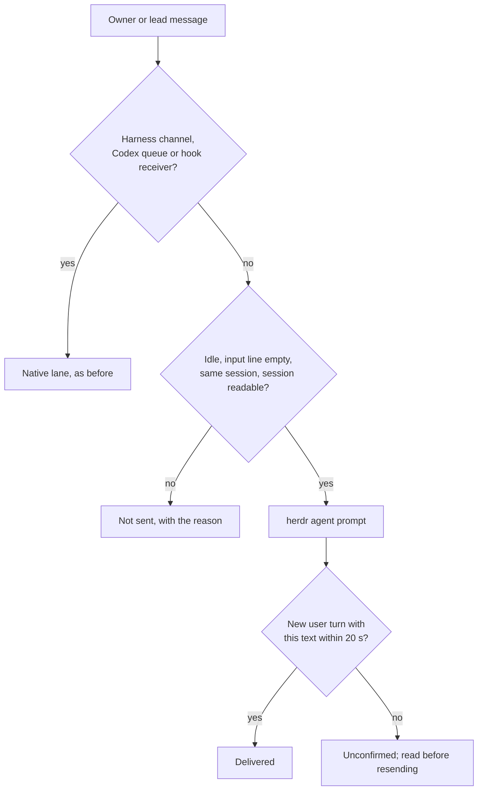

# 0334. Herdr direct prompting is the fallback for an agent with no channel

Status: accepted (James, 2026-11-01). Amends
[ADR 0207](0207-work-records-and-native-agent-delivery.md). Tracks
[issue #167](https://github.com/Volpestyle/clankie/issues/167).

## Context

ADR 0207 ruled out typing messages into an agent's terminal: a typed message
races the owner's own draft and can land in a question or approval prompt. Every
message therefore needed a harness channel or session API, and an agent without
one could not be messaged at all. A Claude session started in a Herdr pane
without Clankie's worker plugin, or a harness Clankie has no channel for yet,
answered every message with "no terminal input was sent".

The research behind issue #167 found that some harnesses have no native channel
upstream, and the owner chose a fallback: "we can still use any harness via
herdr direct prompting which im cool with for fallback". Herdr's
`herdr agent prompt` pastes a whole message with bracketed paste and presses
Enter, and refuses an agent held at a prompt, so the remaining races are the
owner's draft and a busy agent.

## Decision

A message to an agent with no native channel is typed into its own terminal
through `herdr agent prompt` only when all of these hold, read fresh just before
typing:

- The agent has no harness channel, no Codex queue and no live or next-turn hook
  receiver for its session. Any of those keeps its lane; typing is never a
  second lane for the same session. A Codex queue that proves it can't take the
  message and sent nothing, as a plain Codex TUI with no shared app server does,
  is no lane: the message may then be typed, and a send that can't be typed keeps
  the queue's own reason.
- The message is the owner's or a lead's own send, cleared by the service for
  the exact session the sender saw, with no uncertain worker-channel original to
  that seat. A peer's message, a room turn, a huddle or review request, a chosen
  delivery mode (steer or queue), a reconcile-only retry and a stable-receipt
  delivery never take it.
- Herdr reports the agent `idle` or `done`, not `working` or `blocked`.
- The agent's input line reads empty from the pane's styled screen. Only Claude
  and Codex input lines can be read so far; a dim suggestion or placeholder
  counts as empty, typed words never do, and a harness whose line can't be read
  is refused.
- The same session still holds the same pane, and the sender's authority still
  stands.
- The message is at most 8,000 characters, a hire brief's own cap, and does not
  start with `/`, `!` or `#`, which the harness would run as a command.

The agent's session must be readable before typing, because only the session
confirms the message: Clankie records a delivery receipt, types, then waits up to
20 seconds for a new user turn with exactly that text, matched as every other
receipt is. A match is delivered and consumed. No match is unconfirmed: the send
that typed it never rediscovers and types it again, and its receipt holds other
messages to that seat until it settles. A later send of the same text by the
owner is ADR 0312's one rediscovery: typed again only if the session still lacks
it and the input line is empty. Herdr's own refusal, read from its error code,
clears the receipt; any other failure of the command still reads the session.

The Herdr desktop app's terminals are not covered. Its core reads a terminal only
as plain text, which cannot tell a placeholder or suggestion from someone's
draft, so a message to an owner's desktop agent is still refused, and Clankie's
desktop hires keep their worker channel.

Everything else in ADR 0207 stands: questions and approvals stay with the owner,
and an uncertain delivery is never permission to type the same message again.

## Consequences

- Any harness Herdr runs in a pane can be messaged once Clankie can read its
  input line and its session; Claude without the worker plugin can be messaged
  today.
- An owner typing in the pane at the moment of a send still races it: the check
  and the paste are separate calls. The window is one read long and the paste is
  atomic, so a draft started inside it is joined, not lost.
- Reading other harnesses' input lines (OpenCode, Pi, Grok) and plain-text reads
  in the desktop app are follow-ups.
