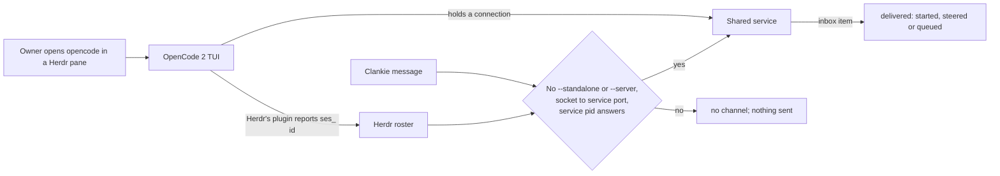

# ADR 0337: Hand-opened OpenCode 2 sessions take messages through the shared service

Status: Accepted, 2026-11-01, for issue #168 (part 2). The owner said yes to
adding a plugin to his OpenCode settings for this. Builds on
[ADR 0333](0333-opencode-2-hires-run-a-private-server.md) (hires run a private
server), [ADR 0139](0139-clankie-rides-vanilla-herdr.md) (Clankie rides
vanilla Herdr) and [ADR 0334](0334-herdr-direct-prompting-is-the-fallback.md)
(typing is only for an agent with no channel).

## Context

An OpenCode session the owner opens by hand had no channel. Clankie's OpenCode
plugin reaches only the hires it starts, and it never touches the owner's
settings.

OpenCode 2 changed what is available. By default every TUI talks to one shared
background service per user, registered in `$XDG_STATE_HOME/opencode/service.json`
with its URL, pid and a password for Basic auth (user `opencode`). Its
`POST /api/session/:id/prompt` admits a message into that session's inbox with
`delivery: "steer"` (into the running turn) or `"queue"` (after it). The client
`id` makes a repeat return the original item. An unknown session gets a 404.
Every TUI watching the session shows the message, and the owner's draft is
untouched.

The missing piece is which session a pane shows. Herdr's own OpenCode
integration (`herdr integration install opencode`) adds a TUI plugin to the
owner's OpenCode settings. That plugin reports each pane's selected root
session to Herdr (`pane.report_agent_session`, source `herdr:opencode`), for V1
and V2 alike. With it, Clankie's roster shows the pane's exact `ses_` session.

## Decision

- **The plugin is Herdr's.** `clankie harness opencode install` runs
  `herdr integration install opencode` through the owner's selected Herdr
  runtime. It first creates the OpenCode settings folder, which Herdr requires.
  `clankie harness opencode status` and `clankie doctor --json`
  (`harnessBridges.opencode`) say whether hand-opened sessions can take
  messages and what to run if not.
  - Herdr defers OpenCode 2's registration while V1 settings still wait to
    migrate. The status then says to open `opencode` once and install again.
  - Clankie ships no plugin of its own for this.
- **Delivery goes into the session's inbox.** For a local OpenCode pane with a
  Herdr-reported `ses_` session and no Clankie controller, fleet seat control
  admits the message on the shared service. Steer is OpenCode's own default, and
  an explicit Steer or Queue is honoured. The app sees both modes.
- **It must be the same service.** Before anything is sent, all of these must hold:
  - The pane's OpenCode process has neither `--standalone` nor `--server`.
  - The kernel's socket table (`lsof -p PID -Fn`) shows that process holding a
    connection to the registered service's port. A V1 TUI, a private server and
    a disabled shared service all fail this check.
  - The registration names a loopback `http` URL and a live pid.
  - `GET /api/info` answers with that pid.
- **Receipts.**
  - The admitted inbox item, matching the client id and session, is the receipt.
    It reads `started` when no turn was running, otherwise `steered` or `queued`.
  - A 4xx before admission, or a refused connection, means nothing was sent. The
    receipt clears, and the typing fallback still refuses, because it can't read
    an OpenCode input line.
  - A lost or malformed answer is unconfirmed. It is never rediscovered and sent
    again, because a second send would carry a new id.
- **The password stays inside the request.** It is read fresh for each send and
  used only as the Authorization header. It never appears in a result, a
  receipt, an error or a log.

Remote fleets, the desktop app's terminals and V1 TUIs keep their current
behaviour.

## Consequences

- Herdr's integration writes to the owner's OpenCode settings. The owner chose
  that, and Clankie runs it only on `clankie harness opencode install`.
- A session the owner opens with `--standalone` stays unreachable. That is
  correct, because its own server isn't the shared one.
- Proven against OpenCode 2.2.5 with a real TUI and the real shared service in
  `opencode2-shared-service.integration.test.ts`. Herdr's own report of the
  session is the one fixture: Herdr isn't installed in CI.
