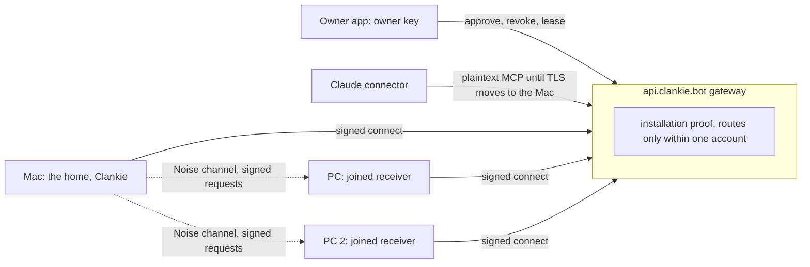

# ADR 0342: Every machine joins the fleet without a private network

Status: Proposed, 2026-11-02, on James's ask that a new owner's PCs show up in
one fleet with no Tailscale, SSH or open ports, and his condition that the
design get "a lot of security scrutinization, because we're essentially
replacing benefits of a private network". Revised the same day after two
independent security reviews (a Codex review on the owner's Mac and a separate
Claude review, both written before either saw the other or the private gap
list). Awaiting James's answers under **Decisions for James**. Builds on
[ADR 0212](0212-machines-and-devices.md) (the `join` transport),
[ADR 0244](0244-machines-join-clankie-at-an-access-level.md) (access levels),
[ADR 0173](0173-the-gateway-cannot-read-device-traffic.md) (the gateway can't
read device traffic), [ADR 0286](0286-one-body-holds-clankie-at-a-time.md)
(one body) and [ADR 0301](0301-claude-reaches-the-fleet-through-a-narrow-connector.md)
(the connector). The private threat model in `clankie-ops`
(`docs/security/hosted-threat-model.md`, section 12) carries the open gaps,
their ratings and the reviews.

## Context

James's fleet is one connector because his Mac reaches his two PCs over ssh on
his tailnet. The Mac opens its own outbound WebSocket to `api.clankie.bot`, and
everything the connector does on a PC rides that ssh. An owner without Tailscale
and ssh gets one machine.

`clankie join` already lets a PC dial out with no inbound port. The PC prints a
256-bit code, the owner approves it, and every request after that is sealed end
to end with a one-use challenge. It doesn't replace the tailnet yet: setup needs
a typed host id and a pasted code, each machine shares one symmetric token with
the Mac, the connector's agent tools don't reach joined machines, and `join`
is a foreground command polling over HTTP.

A tailnet gives each node its own key, authenticated by a control plane that
can't read traffic, with Tailnet Lock so even that control plane can't add a
node, a one-click node removal, keys held by a root or SYSTEM service, and no
internet-facing parser. Ssh adds pinned host keys and then hands over a full
shell.

The reviews found that the first draft of this ADR claimed more than it
delivered. The ones that change the design:

- **An account token is not an installation identity.** Today the gateway lets
  any holder of the account's token connect with a known installation id, and
  the new socket replaces the old one. Whoever does that to the home receives
  the connector's plaintext OAuth and MCP traffic, refresh tokens included.
- **Only one side confirmed enrollment.** Someone with the account's email
  could bring up their own "home" and approve the PC from their own phone.
- **Rotation signed by the old key helps whoever copied the key.** They rotate
  first and lock the owner out.
- **Nothing outside the home could revoke a stolen home,** and a hostile
  gateway can ignore token expiry.
- **The connector is a P1, not a footnote.** The gateway terminates its TLS,
  sees refresh tokens as well as access tokens, and refresh has no reuse
  detection, so a hostile gateway can make the home issue perfectly signed
  requests to every machine.
- **A joined machine can already call into the home** (its `clankie claude`
  lead seat reaches home lead tools), which the draft didn't mention.
- **Keys and policy kept as the owner's user are readable by that user's
  agents.** Credential stores on Windows and Linux are per user, and agent
  panes already get `CLANKIE_CREDENTIALS_FILE`.
- **The protocol needed specifying,** not naming: the approval transcript,
  replay state across crashes, the Noise first message, and downgrade to the
  legacy routes.

## Decision

### Shape

**One Clankie, many machines.** The Mac stays the one body (ADR 0286). Every
other machine runs the Clankie install in joined mode: no captain, no memory,
no Discord, only a receiver that answers the home's typed requests for its own
agents. A machine belongs to one home at a time.

**Three kinds of identity, each with its own key:**

- **The owner key.** Each owner app (the phone or desktop app, paired with Take
  Control) holds an owner signing key, in the Secure Enclave or Android
  Keystore where available. It is the root of trust for the fleet: it approves
  machines, revokes them, replaces or rotates the home, and renews the home's
  lease. Neither the home nor the gateway holds it. A second owner key is added
  only by a signature from an existing one.
- **The home key.** The Mac's install holds an X25519 key for channels and an
  Ed25519 key for signing.
- **The machine key.** Each joined machine holds the same pair, generated
  there. The X25519 and Ed25519 keys are generated independently, never
  converted from each other, and pinned and rotated as a pair.

### Enrollment: start on your phone, confirm on both screens

1. On the PC the owner runs `clankie login` with the same account, then
   `clankie join`. Sign-in only lets the PC reach its account's rendezvous at
   the gateway; it adds the PC to nothing.
2. On the phone the owner taps **Add a computer**. The phone asks the home,
   over the existing encrypted device channel, for one enrollment slot (one
   pending per account, five minutes). The PC sees that slot through its
   account and joins it. The PC never picks a home: the home it joins is the
   one the owner's phone names, signed by the owner key.
3. The phone and the PC run a numeric comparison, the Bluetooth LE Secure
   Connections construction:
   - both send fresh ephemeral X25519 keys;
   - the PC sends a commitment, a MAC of its ephemeral key, the phone's
     ephemeral key and a fresh 128-bit nonce;
   - the phone then sends its own nonce, the PC reveals its nonce, and the
     phone checks the commitment;
   - both compute six digits from the full transcript: protocol version, roles,
     account subject, home installation id, enrollment id, both ephemeral keys,
     both nonces, the PC's static keys, the owner key, the home's static keys,
     the PC's name, platform, proposed folders and its local access level.

   A gateway in the middle has to commit before it sees the other side's
   nonce, so each attempt gives it one chance in a million.

4. The phone shows the six digits with the PC's name, platform, folders and
   level. The PC shows the same six digits with the home's name and key
   fingerprint and the approving phone's name. The owner confirms on **both**:
   Approve on the phone and Enter on the PC. Each side then proves it computed
   the same transcript (key confirmation) before anything is saved.
5. The phone signs an enrollment record (the PC's keys, metadata, its level no
   higher than the PC's local level, folders within those proposed, the home's
   identity, the owner keys, epoch 1) and hands it to the home and the PC. The
   home pins the PC's keys; the PC pins the home's keys and the owner keys.

Attempts are limited at each endpoint, not only at the gateway: three failed
or aborted ceremonies lock `clankie join` for 15 minutes; the phone refuses a
second ceremony while one is open and warns plainly on a mismatch; the home
allows five per hour. A paste or QR of a 256-bit link from the phone to the PC
remains the alternative to digits.

**Only an owner app approves.** The Mac's CLI and TUI can no longer approve a
join, because an agent on the Mac could read the pending code and approve its
own machine. A connected app can never approve, revoke or change policy.

### The channel and signed requests

**Installation proof at the gateway.** Every outbound connection, the home's
included, signs a fresh gateway nonce with its Ed25519 key and names its role
(home or machine). The gateway records each installation's public key the first
time it connects this way and from then on lets a new socket replace an old one
only when it proves the same key. A replacement is reported to the owner apps.
A machine role can never connect as the home's installation. Existing installs
record their key on their first connect after this change.

**A Noise channel per connection.** Home and machine run Noise IK between the
pinned static keys and fresh ephemeral keys, using a maintained implementation.
The prologue binds the protocol version, both roles, the account subject and
both installation ids. Nothing acts on the first handshake message's payload
(it is replayable and lacks forward secrecy); effects wait for the completed
handshake. After a failure there is no fallback to the legacy routes or to an
unpinned key.

**Every effect carries a signed envelope.** Inside the channel, each request
the home sends is signed by the home's key over a canonical encoding of:

- a context string and direction (`clankie-machine-request-v1`, home to
  machine);
- the home's and machine's key ids and epochs, and the Noise handshake hash;
- a request id and a per-machine sequence number;
- a timestamp, refused when more than two minutes off;
- the actor: the owner, Clankie on his own, or a connected app by its device
  id, set by the home from what it authenticated, never by the caller; a turn
  Clankie took because of an app's message or note carries that app too;
- the target: machine, native session and occupant id;
- the operation and digests of its full payload and attachments.

Each reply is signed by the machine and binds the request id, its digest and the
outcome.

**Replay holds across crashes.** The machine writes the request id and sequence
to a durable store before it acts, and refuses any id it has seen. After a crash
mid-dispatch the outcome is reported as unknown, never retried; the home asks
by request id instead. A sequence gap is refused and the channel reopened. A
restore from backup that rolls the store back refuses every request until the
home and machine agree a new session. Timestamps guard only the window; the
durable store is the replay defence.

**Unsigned errors never revoke.** Today the receiver deletes its credential
when the gateway returns `403 {"error":"revoked"}`, which any gateway can send.
Only a statement signed by the home or an owner key can change a machine's
identity or revocation state; anything else is an outage.

**The gateway routes inside one account.** It forwards frames only between a
machine connection and the home installation that machine pinned, when both
verified tokens carry the same account subject, from a validated issuer and
client id, never from an email or a caller field. It checks the role, target
installation and live connection on every frame. Static-token legacy hosts are
kept out of machine routing.

What a hostile gateway can still do: drop, delay or reorder traffic (reorders
are refused), see which machines are online, when and how much they send, deny
service, and abuse the connector (below). What it can no longer do: read or
forge home-to-machine requests, add a machine, take over the home's socket,
raise a level, or wipe a machine's credential.

### What crosses the relay

**Home to machine: the agent API.** Typed operations only, never commands or
keystrokes the home composes:

| Operation                                                       | Needs on that machine                  |
| --------------------------------------------------------------- | -------------------------------------- |
| list agents, read an agent, fleet capacity, list places         | Portal                                 |
| read an image in an agent's worktree                            | Workers, that worktree only            |
| start an agent in an approved folder, message one, close a hire | Workers                                |
| press keys, answer a prompt                                     | Workers, and the machine's keys switch |
| Clankie's own shell, the screen                                 | Shell or Screen, chosen on the machine |

`close_agent` keeps the connector's refusals (only Clankie's and apps' idle
hires with landed work) and its log. The machine checks the target occupant
again immediately before each effect, so a recycled pane id can't redirect a
message.

**Machine to home: off by default.** A joined machine can open a lead chat on
the home with `clankie claude`, which reaches home lead tools. That stays
available, but each machine gets home-side switches, all off at enrollment:
lead chats; routines and wakes; questions to the owner (marked as coming from
that machine); and tracker writes.

### The machine's own limits, and what they don't stop

Each machine sets its access level and its permission rules when it joins
(`clankie join --access workers` by default), and the approved level can't
exceed it. Its local policy covers: level and folders; which harnesses a remote
start may use; whether a remote start may skip the harness's permission
prompts; whether keys and prompt answers may reach panes the owner started by
hand; and whether connected apps may start and message agents there. The home
decides none of these.

Defaults follow James's accepted risk (2026-11-02, "acceptable risk"): with
bypass-permission panes, a remote message is close to running code on that
machine, and remote work should stay easy. So by default a joined machine at
Workers allows every harness, skipped permissions, keys into every agent pane
and connected apps.

This policy binds the wire: a hostile gateway, another account or a stolen
token can't change it. It does **not** bind code running as the owner's user on
that machine. An agent with skipped permissions can edit the policy and read the
machine's keys, because the credential store is per user. This ADR keeps keys
with the owner's user for now and says so; moving the receiver, its keys and
its policy under a separate service account with a local socket for panes is
the follow-up (Decision 5). Since such an agent could already run anything as
the owner, the new loss is that it can copy the machine's identity off the
machine; revocation and the home lease bound that.

### Rotation, revocation and the home lease

**Rotation is routine hygiene, not compromise recovery.** Keys carry monotonic
epochs. A machine's rotation is signed by its old key and acknowledged by the
home; a home's rotation also needs an owner-key signature. The old key stays
valid for at most ten minutes. A rotation while another session for the same
identity was live in the last hour, or two competing rotations, freezes that
identity and alerts the owner apps. Every rotation is reported to the owner. A
key thought stolen is never rotated: the machine is removed and joins again.

**Revocation is signed by the owner.**

- **A machine:** remove it from an owner app. The owner key signs a revocation;
  the home drops the pin, closes the connection and cancels queued requests.
  Agents already running there keep running; the owner closes them locally.
  `clankie join leave` on the machine stops dispatch and wipes its keys at once,
  even offline, then tells the home when it can.
- **A stolen or lost home:** from an owner app, sign a home revocation. It goes
  to every machine through the gateway, sealed to each machine's key, and the
  gateway also refuses that installation. Machines refuse the old home from
  then on. Joining them to a new home takes an owner-signed home replacement.
- **The home lease.** Machines accept requests only from a home holding a lease
  signed by an owner key, valid for 30 days and renewed by the owner apps
  whenever they are open. A hostile gateway can delay a revocation, but a
  stolen home loses every machine when its lease runs out (Decision 4).
- **The account.** The gateway checks the account token's revocation on every
  connect and refuses tokens whose lifetime exceeds an hour; the account page
  can revoke one installation.

### The connector

Claude reaches the home through the gateway in plaintext (ADR 0301). A hostile
gateway sees access and refresh tokens and can call the home as that connected
app. The home then issues correctly signed requests to every machine the
connector reaches, which with bypass panes is running code there. This exists
today for the Mac and, over ssh, for the PCs; joined machines extend it to
every new machine.

What ships with this ADR regardless: a reused refresh token revokes that app's
device and alerts the owner; the owner apps get one switch that stops every
connected app reaching any machine; each machine has its connected-apps
switch; and the audit names the app. The fix is ending the connector's TLS on
the Mac (an opaque tunnel through the gateway to a certificate the Mac holds),
so the gateway carries only ciphertext for the connector too. Decision 1 is
whether joined machines accept connector requests before that lands.

### Rate limits and abuse

Limits are enforced at each endpoint as well as the gateway, because a hostile
gateway ignores its own. The receiver caps frame and message size, handshakes in
flight, requests in flight, queue depth, images and log growth before it does
any cryptographic work, and keeps capacity reserved for revocation and stop.
The gateway budgets per account, per installation and per client, including
WebSocket upgrades, with separate budgets for unauthenticated traffic so it
can't spend an authenticated home's, at most 16 machine connections and one
pending enrollment per account. Sign-up is open, so per-account limits are
backed by per-client ones.

### Audit

Both ends record enrollment, failed and aborted approvals, rotations, policy
changes, refused and replayed requests, revocations and every remote operation:
when, which machine, the actor, the operation, a digest of any message or keys,
and the outcome, written before the effect and again after it. Each log is a
hash chain, and each end periodically sends the other its current head, so
editing one end's history shows against the other's. `clankie machines audit
[--machine NAME] [--json]` reads either end. This is corroboration, not proof:
someone holding both ends, or the home's key, can still write a convincing
history.

### Migration

Existing joins don't upgrade in place: each machine enrolls afresh. Enrolling
atomically revokes the old registration, its `clankie_join_` token and its
delegated seats at both ends, and records a protocol floor so that machine
never speaks the old protocol again, including after a restore. The legacy HTTP
join routes get a switch to close them now (closed by default for a home with
no legacy joins) and a removal date.

### Compared with Tailscale and ssh

| Tailscale and ssh give                                   | With join                                                                                                                                                          |
| -------------------------------------------------------- | ------------------------------------------------------------------------------------------------------------------------------------------------------------------ |
| No machine reachable from the internet                   | Partly. Nothing listens, but the receiver parses frames that come from an internet-facing gateway with open sign-up, so its parser is exposed through the gateway. |
| Each node authenticated by its own key                   | Kept, with installation proof at the gateway and pinned keys end to end.                                                                                           |
| The control plane can't read traffic                     | Kept for home-to-machine traffic. **Not** kept for the connector until its TLS ends on the Mac.                                                                    |
| Tailnet Lock: the control plane can't add a node         | Kept, through owner-key approval confirmed on both screens.                                                                                                        |
| One-click node removal                                   | Kept, through owner-signed revocation, but a hostile gateway can delay delivery up to the home lease.                                                              |
| Keys held by a root or SYSTEM service                    | Lost for now: keys sit with the owner's user until the receiver moves to its own account.                                                                          |
| Traffic flows when the vendor is down                    | Lost. If `api.clankie.bot` is down the fleet shrinks to the Mac. Ssh stays available.                                                                              |
| WireGuard and OpenSSH's long scrutiny                    | Lost. Standard constructions and maintained libraries, these reviews, a security review of every PR, and a hostile-relay test suite.                               |
| Narrow access, if you configure ACLs and forced commands | Gained by default: typed agent operations and a level the machine sets, against a wire attacker. Not against code running as the owner on that machine.            |

**Ssh stays a choice.** An owner with a tailnet can keep using it (ADR 0212's
ssh transport is unchanged), and it remains a recovery path. New setups default
to join.

## Decisions for James

1. **The connector before its TLS moves to the Mac.** Either joined machines
   accept connected apps from the start, with the P1 written down as an
   accepted interim risk (it already applies to your PCs over ssh) and the
   reuse detection and kill switch above; or connected apps can't reach joined
   machines until the connector's TLS ends on the Mac. Recommended: the first,
   with the TLS change as the first follow-up.
2. **Approval needs the Clankie app.** Adding a machine starts on the phone or
   desktop app and is confirmed on both screens; the Mac's CLI can't approve.
3. **Defaults on a joined machine:** every harness, skipped permissions, keys
   into every agent pane and connected apps allowed, each a switch on that
   machine; the machine-to-home lead chat and its tools off.
4. **The home lease:** machines stop obeying a home whose owner-signed lease is
   older than 30 days, renewed automatically whenever an owner app is open.
   It bounds a stolen Mac even through a hostile gateway; the cost is that a
   fleet left with no owner app opened for a month pauses until one is.
5. **Key custody:** keys stay with your user account for now, stated plainly,
   with the receiver moving to its own service account as a follow-up.

## Consequences

- Fixes to today's code come first, filed as private issues: installation proof
  for gateway sockets, unsigned errors no longer revoking a receiver, refresh
  reuse detection, revocation checks and a lifetime cap on account tokens, and
  a switch to close the legacy join routes.
- Then pull requests, each with a security review and hostile-relay tests:
  owner keys in the apps and the enrollment ceremony; Noise channels, signed
  envelopes, the replay store and local policy; the agent API as a session
  source for joined machines, so `list_agents` and the other tools show them;
  revocation, rotation and the home lease; `clankie join` as a background
  service (launchd, systemd, a Windows service); audit at both ends; the
  connector's TLS on the Mac; then proof on pc2 joining without ssh.
- The hostile-relay suite covers at least: substituted transcripts, metadata
  and keys; reveal before commit; concurrent and aborted enrollments and local
  limits; acting on the first Noise message; altered or missing signatures on
  every effect path; wrong tenant, home, machine, epoch or direction; reboot and
  crash around dispatch; replay, reorder and reconnect; duplicate and
  replacement sockets; rotation forks; offline revocation; legacy credentials
  after migration; connector refresh theft; pane occupant swaps; policy reload
  failure; and resource exhaustion.
- The protocol lands in `packages/protocol` first; `clankie-app` adds owner
  keys and the Add a computer screen, recorded in its own ADR.
