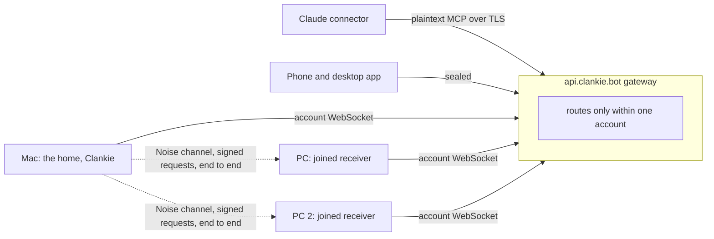

# ADR 0342: Every machine joins the fleet without a private network

Status: Proposed, 2026-11-02, on James's ask that a new owner's PCs show up in
one fleet with no Tailscale, SSH or open ports, and his condition that the
design get "a lot of security scrutinization, because we're essentially
replacing benefits of a private network". Awaiting an independent security
review and James's decisions on the points under **Decisions for James**.
Builds on [ADR 0212](0212-machines-and-devices.md) (the `join` transport),
[ADR 0244](0244-machines-join-clankie-at-an-access-level.md) (access levels),
[ADR 0173](0173-the-gateway-cannot-read-device-traffic.md) (the gateway can't
read device traffic), [ADR 0286](0286-one-body-holds-clankie-at-a-time.md)
(one body) and [ADR 0301](0301-claude-reaches-the-fleet-through-a-narrow-connector.md)
(the connector). The private threat model in `clankie-ops`
(`docs/security/hosted-threat-model.md`, section "Joined machines without a
private network") carries the open gaps and their ratings.

## Context

James's fleet is one connector because his Mac reaches his two PCs over ssh on
his tailnet. The Mac opens its own outbound WebSocket to `api.clankie.bot`,
and everything the connector does on a PC rides that ssh: Herdr reads and
messages, starts, closes, files and transcripts. An owner without Tailscale
and ssh gets one machine.

`clankie join` already lets a PC dial out with no inbound port. The PC prints a
256-bit code, the owner approves it on an existing device, and every request
after that is sealed end to end between the Mac and the PC with a one-use
challenge, so the gateway carries ciphertext it can neither read nor forge.
The PC enforces the access level and folders it agreed to, whatever the Mac
asks. Four things keep it from replacing the tailnet:

- **Setup.** The PC needs `--gateway URL --host HOST_ID` typed in, and the
  owner copies a 43-character code to another device.
- **Identity.** Each machine shares one symmetric token with the Mac. Both
  ends hold it, there is no forward secrecy, and nothing rotates it.
- **Surface.** The connector's agent tools (list, read, start, message,
  close, keys, prompt answers, images) only reach Herdr locally and over ssh.
  A joined machine offers Clankie's own hires, a shell and a screen, not the
  owner's agents.
- **Running.** `clankie join` is a foreground command polling over HTTP
  twice a second, not a service that survives a reboot.

The security question is what a private network gave us and how much of it
we keep. A tailnet hides every machine from the internet, authenticates each
node with its own WireGuard key, and puts the coordination server outside the
data path. Ssh adds pinned host keys and per-user keys, and then hands over a
full shell.

## Decision

**One Clankie, many machines.** The Mac stays the one body (ADR 0286). Every
other machine runs the Clankie install in joined mode: no captain, no memory,
no Discord, only a receiver that answers the home's typed requests for its own
agents. A machine joins one home at a time.

**Sign in, then approve on a device you already have.**

1. On the PC, the owner runs `clankie login` with the same account as the Mac
   and then `clankie join`. Sign-in tells the gateway which account the PC
   belongs to, so it can route the PC to that account's home without a typed
   host id. It does not add the PC to anything.
2. The PC makes its own key pairs (below) and starts a commit-then-reveal
   handshake with the home through the gateway. Both ends then show the same
   six digits, derived from the whole handshake, plus the PC's name, platform
   and proposed folders.
3. The owner approves on a device that already holds owner authority (the
   phone or desktop app with Take Control, or the Mac's own CLI or TUI),
   after checking the digits match the PC's screen. A connected app such as
   Claude can never approve a machine.
4. Approval pins the PC's public keys on the home and the home's public keys
   on the PC. From then on, each side refuses any key it did not pin.

Commit-then-reveal is what makes six digits enough: each side commits to its
key before it sees the other's, so a gateway sitting in the middle gets one
guess at a one-in-a-million match and can't search for one. The 43-character
code stays available for an owner who prefers to paste.

Why both steps: sign-in alone would let anyone who takes over the account's
email, or the gateway itself, add a machine. Approval alone, without sign-in,
leaves the join routes open to anyone who learns a host id. Together, a new
machine needs the account and the owner's hand on a trusted device.

**A key pair per machine, and per home.** Each install generates a long-term
X25519 key for the channel and an Ed25519 key for signing, kept in the
credential broker (Keychain on macOS, the Windows credential store on
Windows) and never sent anywhere. These replace the shared `clankie_join_`
token.

- **The channel.** Each connection opens with a Noise handshake (the IK
  pattern) between the pinned static keys and fresh ephemeral keys, using a
  maintained implementation rather than hand-rolled code. That gives mutual
  authentication on every connection and forward secrecy: a key stolen
  tomorrow does not decrypt today's traffic.
- **Every request is signed.** Inside the channel, each request carries the
  home's Ed25519 signature over the machine id, a monotonic sequence number,
  a timestamp and the operation's digest. The receiver checks the signature,
  refuses a sequence number it has seen or one out of order, and refuses a
  timestamp more than two minutes off. Each reply is signed by the machine.
  The channel already stops the gateway forging traffic; the signatures make
  each machine's own log evidence of what the home asked, even if the home is
  later compromised.
- **Rotation.** Both ends rotate their keys every 30 days and on demand
  (`clankie machines rotate`), with the new key signed by the old one over an
  open channel. Rotation limits how long a quietly copied key is useful. A key
  known to be stolen is not rotated: the machine is removed and joins again.

**The relay only routes, inside one account.** The PC opens the same kind of
account-authenticated outbound WebSocket the Mac does
(`/gateway/v1/hosts/connect`, with its own installation id), marked as a
machine. The gateway forwards frames between a machine connection and a home
connection only when both verified access tokens carry the same account
subject. No frame crosses accounts. A machine addresses only the home
installation it pinned at approval (on its first join, if the account has more
than one home online, it asks which); the gateway delivers to that
installation or nowhere. The gateway stores nothing about these
connections beyond the live sockets. The HTTP join routes stay until existing
joins have moved, then close.

What a gateway in an attacker's hands can do: drop, delay or reorder traffic
(the receiver refuses the reorder), see which machines are online, when, and
how much they send, and refuse service. What it cannot do: read requests or
replies, forge or replay one, add a machine, raise a machine's level, or
connect one account's machines to another's. Someone who takes over the
account's email gets no further: a home or machine they connect is refused by
every pinned key.

**Only the agent API crosses the relay.** A joined machine answers the same
operations the connector already offers for local and ssh machines, as typed
requests, never as commands or keystrokes the home composes:

| Operation                                                       | What it needs on that machine             |
| --------------------------------------------------------------- | ----------------------------------------- |
| list agents, read an agent, fleet capacity, list places         | Portal                                    |
| read an image from an agent's worktree                          | Workers, inside the agent's worktree only |
| start an agent in an approved folder, message one, close a hire | Workers                                   |
| press keys, answer a prompt                                     | Workers, and the machine's keys switch on |
| Clankie's own shell, the screen                                 | Shell or Screen, chosen on the machine    |

No raw shell, file read or write, or arbitrary command crosses the relay at
Workers. An image sent to an agent lands only in that agent's inbox folder
(ADR 0316's contained path). Shell and Screen stay what ADR 0244 made them:
opt-in levels the owner picks for that machine.

**The machine sets its own limits, and the home can't raise them.** Each
joined machine keeps a local policy, changed only from that machine's own CLI
and never over the relay:

- its access level and approved folders (as today);
- which harnesses a remote start may use (Claude, Codex, OpenCode);
- whether a remote start may skip the harness's permission prompts;
- whether keys and prompt answers may reach panes the owner started by hand,
  as well as Clankie's and connected apps' hires;
- whether connected apps (the connector) may start and message agents there,
  or only Clankie.

Defaults follow James's accepted risk (2026-11-02, "acceptable risk"): with
bypass-permission panes, a remote message is close to running code on that
machine, and the owner wants remote work to stay easy. So by default a joined
machine at Workers allows every harness, allows skipped permissions, allows
keys into all agent panes and allows connected apps. An owner who wants less
turns a switch off on that machine. The home also keeps its own checks
(directory grants, hire records, close rules), so a request has to pass both.

**Revoking.**

- **One machine:** `clankie machines remove NAME` on any owner device, or
  `clankie join leave` on the machine. The home drops the pinned keys and
  closes the machine's connection; the machine wipes its keys. A removed
  machine needs a fresh join.
- **A lost or stolen PC:** remove it from the phone. Its keys are useless
  without the home's pin.
- **A lost or stolen Mac:** sign out everywhere from the account page, which
  stops its refresh token, and on each machine run `clankie join leave`, or
  let it refuse the old home once the owner joins it to a new one. Until the
  last access token expires (at most an hour), a stolen Mac can still reach
  its machines through the gateway. This is the same exposure as a stolen Mac
  with ssh keys today, but shorter.
- **The account itself:** a global sign-out stops every install's gateway
  connections within the access token's lifetime.

**Rate limits.** The gateway budgets per account, per installation and per
connection: frames and bytes per second, at most 16 machine connections per
account, and at most 5 join attempts per account an hour with one pending at
a time. An unauthenticated caller can't start a join at all once the HTTP
routes close. Budgets refuse, they never queue, and a refusal never counts
against the real home's budget.

**Audit at both ends.** The home appends one record per remote operation:
when, which machine, the operation, who asked (the owner, Clankie on his own,
or which connected app by its approved name), a digest of any message or
keys, and the outcome. The machine appends its own record of each request it
ran or refused, with the home's signature. Both logs are append-only private
files, like today's shell audit. `clankie machines audit [--machine NAME]
[--json]` reads either end. Message text is kept as a digest and a length;
the agent's own transcript already holds the words.

**Ssh stays a choice.** An owner who has a tailnet and ssh can keep using it
(ADR 0212's ssh transport is unchanged), and a machine can be reached either
way. New setups default to join.

**Compared with Tailscale and ssh.**

| What the private network gave us                        | With join                                                                                                                                                        |
| ------------------------------------------------------- | ---------------------------------------------------------------------------------------------------------------------------------------------------------------- |
| No machine reachable from the internet                  | Kept. Machines only dial out; nothing listens. The new exposure is the receiver's parsing of frames from the gateway, kept strict.                               |
| Each node authenticated by its own key                  | Kept. Pinned X25519 and Ed25519 keys per install, with Noise on every connection.                                                                                |
| Coordination server can't read traffic                  | Kept. The gateway carries only ciphertext.                                                                                                                       |
| Coordination server can't add nodes (with Tailnet Lock) | Kept. A machine needs the owner's approval with matching digits on a trusted device.                                                                             |
| Traffic still flows when the vendor is down             | Lost. If `api.clankie.bot` is down, the fleet shrinks to the Mac until it's back. Ssh remains an option.                                                         |
| WireGuard and OpenSSH's long scrutiny                   | Partly lost. We use standard constructions from maintained libraries, an independent review of this design, a review of each PR, and tests with a hostile relay. |
| Least privilege                                         | Gained. Ssh hands over a full shell and a tailnet opens every port; join offers typed agent operations and a level the machine enforces.                         |
| An audit trail                                          | Gained. Both ends log every remote operation.                                                                                                                    |

**The connector is still the weakest link, and this decision doesn't change
that.** Claude reaches the home through the gateway in plaintext (ADR 0301),
because Claude speaks ordinary OAuth and MCP and holds no device key. A
gateway in an attacker's hands sees the connector's access tokens and could
act as a connected app until they expire, which reaches every machine the
connector reaches. That is true today for the Mac and, over ssh, for the PCs.
This decision narrows it with the machine's connected-apps switch and the
audit naming each app, and leaves the fuller fix to a follow-up: ending the
connector's TLS on the Mac instead of the gateway.

## Decisions for James

1. One home with joined machines, rather than a full Clankie on every machine.
2. Sign-in on the new machine plus approval with matching digits on a device
   you already have, rather than sign-in alone.
3. Defaults on a joined machine: every harness, skipped permissions allowed,
   keys into all agent panes, connected apps allowed, each a switch on that
   machine.
4. The connector's plaintext path stays as it is for now, with the follow-up
   to end its TLS on the Mac filed as an issue.

## Consequences

- The work lands as pull requests, each with a security review: account-scoped
  machine connections in the gateway; machine keys, the approval handshake,
  signed requests and the local policy; the agent API as a session source for
  joined machines, so `list_agents` and the other tools show them; `clankie
join` as a background service (launchd, systemd, a Windows service); audit
  at both ends; then proof on pc2 joining without ssh.
- Existing joins move by joining again; their shared tokens stop working when
  the HTTP routes close.
- The protocol change lands in `packages/protocol` first, which `clankie-app`
  consumes for the approval screen.
- The connector's plaintext path and the hour a stolen Mac keeps its access
  are recorded as open gaps in the private threat model.
