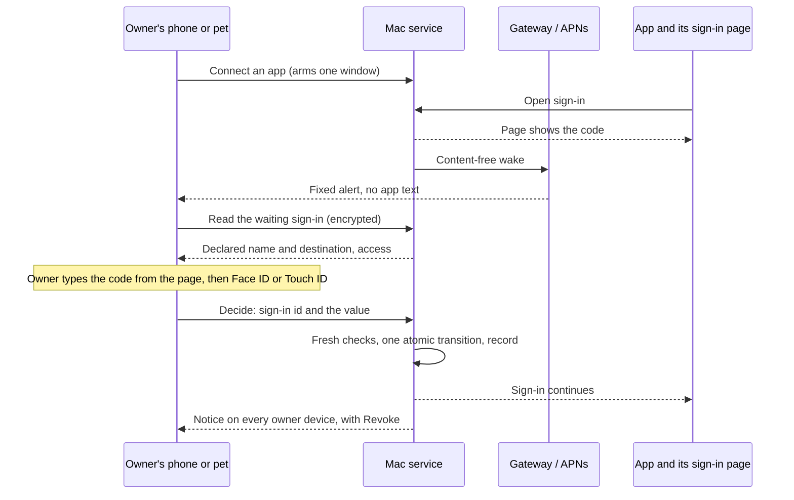

# ADR 0356: An app asks to connect and the owner confirms its code

Status: Proposed, 2026-11-04, for [#723](https://github.com/Volpestyle/clankie/issues/723)
and its app half, clankie-app #104. Amends the sign-in of
[ADR 0301](0301-claude-reaches-the-fleet-through-a-narrow-connector.md). Revised after
independent security review. Design only: nothing here is built, and it needs
James's [decisions](#decisions-for-james) before any code.

## Context

An app connects to the Mac by OAuth. Its sign-in page shows a short code, and the
owner types `clankie connector approve CODE` on the Mac. James asked for one Allow
from Clankie on the iPhone or the desktop pet instead, with the same two checks
underneath.

**The review changed the answer.** A true one-tap Allow is a measurable weakening of
today's typed code, so this ADR recommends moving the typing to the owner's phone or
pet, after the owner arms the Mac. That removes the terminal, but it isn't one tap.
One tap stays available as a recorded choice ([decision 1](#decisions-for-james)).

The service has most of the parts. `GET /v1/connector/sign-ins` and the approve and
deny routes accept the owner's Take Control devices, and the doorway already carries
them encrypted. The app has no client for them yet. Nothing tells the owner a sign-in
is waiting.

Four facts about the flow shape the design:

- **Everything a request declares is a claim.** Clients are public and register
  themselves. The app name is the requester's own word, and the destination is a
  declared redirect, not proof of who receives access. ADR 0301 says it plainly:
  "whoever opened that page receives the access." Whoever prepared a sign-in can
  receive that access, whatever name and destination it declares.
- **So no displayed detail identifies the requester.** A request prepared by someone
  else can declare a familiar name and a familiar destination truthfully. Changing how
  the page receives its result would not change this: it would not establish which
  client is on the other end.
- **The listing can't feed a prompt as it stands.** It returns each waiting code
  ([CLI reference](../cli.md)). A prompt built on it would hold what's needed to
  approve, so the code would prove nothing.
- **The two checks guard the approver, not the requester.** The account check proves
  the doorway reaches this owner's Mac: the host id derives from the account, and the
  Mac signs in to hold it. Connector routes then pass through without an account, by
  design (ADR 0301), and a self-hosted Mac may have no account at all
  ([ADR 0204](0204-a-self-hosted-mac-pairs-the-app-directly.md)). The grant check is the
  Mac's own device record. An Allow is authorized by a device session the Mac issued.

This is the cross-device consent problem of
[RFC 10027 (BCP 247)](https://www.rfc-editor.org/info/rfc10027). It finds user
education insufficient on its own, and treats the user's judgement as the only control
over the unauthenticated channel between devices. CISA recommends
[number matching](https://www.cisa.gov/sites/default/files/publications/fact-sheet-implement-number-matching-in-mfa-applications-508c.pdf)
that has the user enter the number, as an interim step when phishing-resistant
authentication isn't available.

## Threat model

**Protected:** a connector device, with [the access listed below](#what-the-owner-is-told).
It lasts until revoked, so one wrong approval has a lasting cost.

**Property to keep:** access is granted only when the owner means to admit a sign-in
they started. What a code can prove is narrower: the person approving has seen the
value for this sign-in. It can't prove who prepared it.

| Actor                                           | Assumed able to                                                 | In scope                                        |
| ----------------------------------------------- | --------------------------------------------------------------- | ----------------------------------------------- |
| Anyone holding the connector URL                | Start sign-ins under any name and any allowed destination       | Yes. The URL is given to apps and is no secret. |
| A sender of links or messages                   | Show the owner a prepared sign-in, or tell them what to do      | Yes. Not closed: see the residual risk.         |
| Someone holding the owner's unlocked phone      | Tap, if the phone's own check allows it                         | Yes                                             |
| An agent on the Mac without the owner's secrets | Read the screen, press controls through accessibility           | Yes                                             |
| Code running as the owner with a shell          | Read local credentials and mint device sessions                 | No. See [Limits](#limits).                      |
| The gateway                                     | Read and alter the plaintext sign-in page, as ADR 0301 accepted | Partly: it must gain nothing new                |

| Concern                       | Risk                                                                       | Answer                                                                                                                                                                        |
| ----------------------------- | -------------------------------------------------------------------------- | ----------------------------------------------------------------------------------------------------------------------------------------------------------------------------- |
| Who can trigger a prompt      | Anyone with the URL, without signing in                                    | Nobody, unless the owner has armed the Mac. Without arming, a sign-in waits silently for the typed path.                                                                      |
| Unseen look-alike             | A request reads exactly like the app the owner uses                        | The typed code. Someone who hasn't seen the value can't enter it, and a wrong entry ends the sign-in.                                                                         |
| Prepared session              | The owner is shown someone else's sign-in with a familiar destination      | **Not closed.** See the residual risk.                                                                                                                                        |
| Replay                        | An old prompt, push or decision is reused                                  | One atomic transition per sign-in (below). A pending sign-in dies on restart, as it does now.                                                                                 |
| Prompt fatigue                | Repeated prompts until the owner gives in                                  | Arming removes unsolicited prompts. Typing can't be done blindly. Deny is always as easy as confirming.                                                                       |
| Guessing                      | Repeated attempts at a value                                               | Server-owned decision limits, separate from any notification budget. Presence checks don't help here: Face ID proves someone is there, not that the right sign-in was picked. |
| Which devices may approve     | A weaker device becomes the way in                                         | See [Who may decide](#who-may-decide).                                                                                                                                        |
| Prompt text as attack surface | The app name is requester text on a trusted surface, and may reach a model | Only readable text is accepted (#776). Render in a fixed template, in quotes. The name never enters a model's context as anything but quoted data.                            |
| Clankie or an agent approves  | Model output or an injected worker grants itself a way in                  | No tool, ask or Feed answer can decide a sign-in. Prompts stay out of the owner-ask store.                                                                                    |
| Flooding                      | Heavy traffic crowds out or starves a real sign-in                         | Best effort only. See [Capacity](#capacity).                                                                                                                                  |
| Lost record                   | A denied or failed attempt leaves nothing to read                          | Durable decision events below.                                                                                                                                                |
| Gateway in the path           | It can read the page's value                                               | The prompt and decision stay end-to-end encrypted ([ADR 0173](0173-the-gateway-cannot-read-device-traffic.md)), so it can't forge either. Push alerts stay fixed text.        |

### The residual risk

An attacker can prepare a sign-in, declare a familiar destination and put the real
value in front of the owner, on a page of their own or in a message. The owner then
enters a correct code for a sign-in that isn't theirs. **Typed approval and matched
Allow are both open to this, and so is today's CLI.** The destination can't warn the
owner, because it can be declared truthfully.

Nothing proposed here closes that. Whether the first version ships with it is James's
call ([decision 7](#decisions-for-james)). Three things bound it:

- **Arming.** The attacker needs the owner to arm the Mac and to act within one short
  window that admits one sign-in.
- **Truthful copy.** The prompt never suggests the destination proves anything, and
  says what Allow really does.
- **Detection.** Every approval notifies every owner device, with Revoke.

No real binding is available today, and none is designed here. Two directions look
tempting, and neither closes this on its own:

- **A passkey on the sign-in page** (option H). It is phishing-resistant authentication
  of the owner at the genuine origin:
  [assertion verification](https://www.w3.org/TR/webauthn-3/#sctn-verifying-assertion)
  checks the challenge and the origin. That doesn't prove the owner started this OAuth
  request, or stop whoever prepared it from collecting the result. RFC 10027's proximity
  text concerns CTAP hybrid transport over BLE, not OAuth consent pages in general.
- **A client that proves a key at the token endpoint** (option I). Possession of a
  self-registered key doesn't establish the intended recipient or the owner's intent.
  PKCE already proves a requester-chosen secret, and it didn't solve this.

Our inference, not a cited result: a safe upgrade would need a fresh authenticated
browser session that creates or rebinds the transaction, invalidates earlier status and
collection capabilities, and binds the client and grants. That binding has to be
designed and reviewed separately. Nothing here promises it would be enough.

## Options considered

| Option                                     | Value                                                                                            | Taps             | Verdict                                         |
| ------------------------------------------ | ------------------------------------------------------------------------------------------------ | ---------------- | ----------------------------------------------- |
| A. Plain Allow on the existing routes      | None: the attack the typed code prevents                                                         | One              | Rejected                                        |
| B. Allow plus better wording and timing    | None alone: wording can be matched exactly                                                       | One              | Rejected alone; truthful wording is kept        |
| C. **Typed code on the phone or pet**      | Same interaction as today's typed code, with no terminal; a shorter value, with bounded attempts | Type four        | **Recommended**                                 |
| D. Four choices, tap the one on the page   | Weaker: a blind tap succeeds one time in four                                                    | One              | Only if James accepts the measured weakening    |
| E. **Owner arms the Mac first**            | Removes unsolicited prompts; narrows the prepared session                                        | One more step    | **Recommended with C**                          |
| F. QR scan, or a link that carries a match | None against a sent link or image                                                                | Scan             | Rejected. Links must never pre-answer anything. |
| G. Reverse: the phone shows, the page asks | Comparable, but the owner types into whatever page they were shown                               | Type             | Rejected: it trains typing a secret into a page |
| H. Passkey on the sign-in page             | Phishing-resistant owner authentication, not a binding by itself                                 | One, once set up | Only as part of a separately designed binding   |
| I. Verified client identity                | Metadata documents give an honest name; a proven key doesn't show intent                         | Same             | Names later; never as the proof                 |
| J. Remember an app and skip the prompt     | None: a repeat name and destination are claims too                                               | Zero             | Rejected                                        |

On option I: the
[MCP authorization spec](https://modelcontextprotocol.io/specification/2025-11-25/basic/authorization)
says clients and servers should support client metadata documents, and warns they
can't stop impersonation over a loopback callback. A metadata document alone names an
app. It doesn't bind a sign-in to it.

## Recommended decision

**An owner-armed, typed confirmation, off until the owner turns it on.**

### Arming

- The owner turns the feature on, then taps Connect an app (or runs `clankie connector
arm`). The window lasts five minutes and admits one approval. A decision, its expiry
  or the owner's cancel closes it.
- Only a sign-in opened during a window wakes a device or shows a prompt. Any other
  sign-in behaves as today and waits for the typed code on the Mac.
- A link from the page may open the app. It never arms, and never pre-answers.

### The value

- The first group of the page's code is the value: four characters, entered on the
  phone or pet. The page says which to enter. `clankie connector approve CODE` stays as
  the fallback.
- Four characters have less entropy than the eight today's CLI takes (31⁴ against 31⁸).
  This is the same interaction, not the same assurance. It is acceptable because attempts
  are bounded: a wrong entry ends the sign-in, and the decision limits below apply.
- The listing stops returning codes, to every caller. It gains an opaque sign-in id.
  The CLI's typed path then needs a code read from the page, as intended.
- If James chooses option D, each sign-in holds one stable set of four distinct
  choices, fixed when it is created. Only the display order is shuffled. All four are
  candidate approvals, so the prompt is as sensitive as the sign-in. A wrong tap ends
  that sign-in, but an attacker's next sign-in is a new try: three blind tries succeed
  57.8% of the time (1 − 0.75³), against about one in 920,000 per try for four typed
  characters.

### One decision, once

Every path, typed approval and deny included, goes through one transition.

- A sign-in is immutable once created, and binds its id, client, PKCE challenge,
  redirect, grants and expiry. Its only change is `waiting` to `approved`, `denied` or
  `expired`, once, atomically.
- Each attempt re-authenticates the decider and re-reads its device record and the
  expiry in the same step as the transition. The record names the decider.
- The first decision wins. Another device gets "already decided". The same decider
  retrying after a lost response gets the recorded outcome and changes nothing.
- A wrong value ends that sign-in as denied.
- The code's 60 seconds start when the page first collects it, not at approval, so a
  slow doorway can't lose a good approval.

### Decision limits

These are server-owned and separate from notifications. Suppressing a wake limits
nothing, so these count attempts wherever they come from.

- Per decider: five failed decisions in 10 minutes locks that decider out for 15.
- Per Mac: ten failed decisions in 10 minutes closes any window and refuses decisions
  for 15 minutes, except deny. The typed path on the Mac counts here too.
- Under option D, one failed decision per Mac in 10 minutes closes the window and
  pauses that path for 15 minutes.
- Wakes are a courtesy on top: one per sign-in, and only during a window.

Numbers here are starting values.

### What the owner is told

The prompt is a fixed template:

- The title: `An app calling itself "NAME" wants to connect to MAC`.
- The destination, labelled as a claim: `It says access goes to HOST`, with the
  registrable domain marked. A loopback address reads `the computer that opened the
sign-in page`, with a warning that it names no app.
- Why it isn't proof: `Allowing gives this access to whoever started this sign-in,
wherever it says access goes. Only continue if you just started it yourself in the
app. Never enter a code because someone asked you to.`
- The access below, from the same source as the sign-in page's sentence.
- Deny, the same size as the confirm control.

It shows no verified mark, no warning-free "safe" state, no requester network or
location, and no requester text beyond the name. A warning that a known app's name has
an unfamiliar destination may help, but its absence never reads as a check passed.

The access comes from the real connector allowlists, not a summary of intent:

| Access                                                                | When                                                  |
| --------------------------------------------------------------------- | ----------------------------------------------------- |
| List agents, read their screens and sessions, see capacity and places | Always                                                |
| Message agents, and pass images to and from them                      | Always                                                |
| Start an agent in a known project                                     | Always                                                |
| Close a finished, idle agent that Clankie or a connected app hired    | Always, with the close tool's own refusals            |
| Read the owner's projects and issues                                  | Always                                                |
| Create and change issues, and comment                                 | Under each project's posting setting (ADR 0305)       |
| Post and read notes on the shared board, and wake a connected lead    | Always                                                |
| Read held work and its own hires' reports, and acknowledge them       | While the owner has handed the lead to connected apps |
| Answer prompts and press keys in agents' terminals                    | Only after the owner turns it on for that app         |

It can't read or change the owner's settings. A change to the connector's allowlist
must change this table and the shared sentence together.

### Who may decide

Only a device that passes `ownerAppRecord` may read or decide: Take Control, durable,
not a run's, not support, and not a hosted pairing. Connector devices never can.

- **iPhone:** yes, with Face ID or the passcode. The app has no such check today, so it
  is new work. Deny needs none.
- **Desktop pet:** yes, with Touch ID or the password, always through the system's own
  prompt. No accessibility action can stand in for that check. An agent on the Mac can
  read the page and press controls, so on this surface the code proves nothing and
  presence is the only human check.
- **Clankie, workers and connected apps:** never. Prompts are not owner asks:
  [ADR 0351](0351-clankie-proposes-a-setting-and-the-owner-taps-it.md) shows why an
  ask's answer is not an effect, and agents can read asks. The app shows these in the
  mailbox from this listing.
- **Lock screen and notification actions:** never. The alert only opens the prompt.

A presence check proves someone is there. It proves nothing about which sign-in they
meant.

### Telling the owner

Each armed sign-in sends a wake to `ownerAppRecord` devices only, and to no other
device with `chat`. ADR 0159's wake names a conversation and carries a fixed alert.
This needs a second fixed alert kind, which is a protocol and gateway change. With the
app open, the prompt comes from a read of the listing.

### Capacity

All of this is best effort. No limit here guarantees a sign-in succeeds under a
determined flood, and a requester with many addresses is held only by the shared caps.

- **Requester metadata.** The gateway computes the requester's identity from the
  address it verified (through the trusted proxy), hashes it per host, and sets it on
  the sign-in route only (#776). That a caller can't set it through the doorway depends
  on #776's encrypted-path fix, which is still under review. The Mac's tunnel passes it
  to the service over loopback. A sign-in without it counts only toward the shared cap.
  The service doesn't authenticate it, so a direct caller can set their own. That local
  access is trusted is an assumption here, not something any check establishes.
- **Shares.** One requester keeps at most four waiting sign-ins, and its next replaces
  its oldest (#776). People behind one address (a NAT, an office, a VPN) share that
  share, and one can displace another's waiting sign-in.
- **Reserved capacity.** Eight of the 32 slots are held for sign-ins opened during a
  window, so traffic before the window can't fill them. Traffic during the window can
  still compete for them, and the typed value still picks out the right one.
- **Host budget.** The gateway's per-host budget is shared by discovery, sign-in pages,
  polling and connected apps' own calls, so heavy sign-in traffic can slow all of them.
  The build should give sign-in routes their own budget beneath the host's, so connected
  apps keep working, and poll with backoff.
- **Page polling.** A starved page may not see its result in time. The owner's decision
  doesn't depend on those routes, because it travels the encrypted path. With the code's
  timer starting at collection, the page finishes once polling recovers, within the
  sign-in's life.

### Audit

Only an approval leaves a durable record today (`mintedBy`).

- Durable events for approved, denied, failed value and expired-after-prompt, naming the
  deciding device and surface, app name, declared destination, grants and sign-in id.
- Durable events for arming and for each lockout.
- No durable event per waiting sign-in. Unauthenticated requests must not grow the log;
  they are counted, and logged at a capped rate.
- The declared destination goes on the device record, so `clankie devices` and the app
  can show it.
- Every approval sends an owner notice to all owner devices, with Revoke, and `clankie
doctor` shows recent failures. The notice uses fixed text with the name as quoted data.

## Limits

- **A prepared session still works**, as above.
- **Same-user code on the Mac is out of scope.** It can already obtain owner credentials
  and mint device sessions, so it can approve anything
  ([ADR 0253](0253-owner-confirmation-needs-an-isolated-authority.md),
  [ADR 0296](0296-hired-workers-run-under-an-os-profile.md)). This design makes that no
  worse. ADR 0253's protected set covers issuing device grants, so a decision here
  carries the fields its challenge needs, and a later signer can bind them.
- **Face ID and Touch ID are checks on the device, not proofs the Mac verifies.** They
  stop a person holding the phone and an accessibility press, not same-user code.
- **The first version doesn't prove which app is connecting.**

## Consequences

- The listing's shape changes, and `clankie connector` no longer prints codes. No app
  reads this route today, so only the CLI and its docs move.
- A new `clankie connector arm` and an owner setting, CLI-first, with the Common tier in
  the app and pet. Sign-in page copy, `docs/cli.md` and the field guide change with the
  build.
- A change to admission, so its pull requests go through independent review before
  merging ([ADR 0347](0347-a-pull-request-merges-on-local-checks-and-the-quick-checks.md)).
- Proof must use the real thing ([ADR 0221](0221-tests-prove-the-product-and-its-boundaries.md)):
  a real sign-in through the doorway to a real device, plus a wrong value, a replayed
  decision, expiry, two devices deciding at once, an unarmed sign-in, and a flood.
- The gateway needs a deployment for the new alert kind and the sign-in budget.

## Decisions for James

Decisions 1 to 6 state the security reviewer's position, which this ADR adopts. Decision
7 has no such position: it is James's alone.

1. **Typed code, or one tap?** Typed by default. It removes the terminal but isn't the
   one tap you asked for. Choosing four-choice one tap (option D) is allowed, and is
   recorded as a measurable weakening: three blind tries succeed 57.8% of the time.
2. **Prompt for every sign-in, or arm first?** Arm first. The owner taps Connect an app
   before any prompt can appear, which adds a step.
3. **May the pet approve?** Yes, with Touch ID or the password through the system prompt,
   and no accessibility bypass.
4. **Does "the core account" mean more than the code does?** No: keep the Mac-issued
   device authority. The account only proves the doorway reaches this Mac. Requiring a
   fresh account sign-in would need the Mac to verify account tokens and wouldn't work
   without an account.
5. **On by default, or opt-in?** Opt-in. The typed code on the Mac stays the default.
6. **Wait for ADR 0253's protected signer?** No.
7. **Accept the prepared-session risk for the first version, or defer?** Either accept
   this residual risk, as described above, for the first version, or defer until a
   separately designed and reviewed binding closes it. It exists in today's typed flow
   too. No such binding exists yet, and waiting for a passkey alone wouldn't close it.
