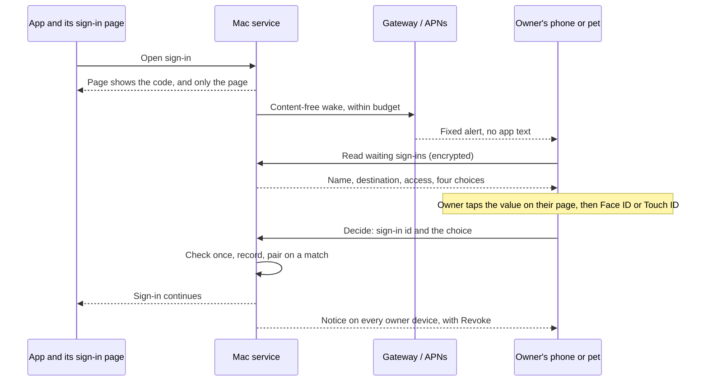

# ADR 0356: An app asks to connect and the owner taps what its page shows

Status: Proposed, 2026-11-04, for [#723](https://github.com/Volpestyle/clankie/issues/723)
and its app half, clankie-app #104. Amends the sign-in of
[ADR 0301](0301-claude-reaches-the-fleet-through-a-narrow-connector.md). Design
only: nothing here is built, and it needs an independent security review and
James's [decisions](#decisions-for-james) before any code.

## Context

An app connects to the Mac by OAuth. Its sign-in page shows a short code, and the
owner types `clankie connector approve CODE` on the Mac. James wants one Allow
from Clankie on the iPhone or the desktop pet instead, with the same two checks
underneath.

The service has most of the parts. `GET /v1/connector/sign-ins` and the approve and
deny routes accept the owner's Take Control devices, and the doorway already
carries them encrypted. The app has no client for them yet. Nothing tells the owner
a sign-in is waiting.

The hard part is what the typed code does beyond approving. The page is public:
anyone with the connector URL can open a sign-in. The code is shown only on that
page, so a typed code means the person approving is looking at that page. An Allow
button loses that unless something replaces it.

Three facts about today's code shape the design:

- **What a request says about itself proves nothing.** Clients are public and
  register themselves, so the app name is the requester's own claim. The
  destination host limits where a code is sent by a real browser, but it does not
  show who is holding the sign-in open. ADR 0301 already says it: "whoever opened
  that page receives the access." No prompt wording can make a look-alike request
  look different, because it can be identical.
- **The listing can't feed a prompt as it stands.** It returns each waiting code
  ([CLI reference](../cli.md)), which suits an owner told to approve only a code on
  a page they opened. A prompt built on it would hold everything needed to approve,
  so the code would prove nothing.
- **The two checks guard the approver, not the requester.** The account check proves
  the doorway reaches this owner's Mac: the host id derives from the account, and
  the Mac signs in to hold it. Connector routes then pass through without an
  account, by design (ADR 0301), and a self-hosted Mac may have no account at all
  ([ADR 0204](0204-a-self-hosted-mac-pairs-the-app-directly.md)). The grant check is
  the Mac's own device record. An Allow is therefore authorized by a device session
  the Mac issued, not by a fresh account sign-in.

This is the cross-device consent problem that the IETF's
[Cross-Device Flows BCP](https://datatracker.ietf.org/doc/html/draft-ietf-oauth-cross-device-security)
describes. It finds user education insufficient on its own, and it treats the
user's judgement as the only control over the unauthenticated channel between
devices. CISA recommends
[number matching](https://www.cisa.gov/sites/default/files/publications/fact-sheet-implement-number-matching-in-mfa-applications-508c.pdf)
for push approval when phishing-resistant authentication isn't available.

## Threat model

**Protected:** a connector device, which can list and read agents, message them and
start them. That access lasts until revoked, so one wrong tap has a lasting cost.

**Property to keep:** access is granted only when the owner means to admit this
sign-in, the one on a page in front of them.

| Actor                                           | Assumed able to                                                 | In scope                                        |
| ----------------------------------------------- | --------------------------------------------------------------- | ----------------------------------------------- |
| Anyone holding the connector URL                | Start sign-ins under any name and any allowed destination       | Yes. The URL is given to apps and is no secret. |
| A sender of links or messages                   | Get the owner to open a page, or tell them what to do           | Yes, reduced but not closed (below)             |
| Someone holding the owner's unlocked phone      | Tap                                                             | Yes                                             |
| An agent on the Mac without the owner's secrets | Read the screen, press controls through accessibility           | Yes                                             |
| Code running as the owner with a shell          | Read local credentials and mint device sessions                 | No. See [Limits](#limits).                      |
| The gateway                                     | Read and alter the plaintext sign-in page, as ADR 0301 accepted | Partly: it must gain nothing new                |

How each concern is answered:

| Concern                       | Risk                                                                                       | Answer                                                                                                                                                                         |
| ----------------------------- | ------------------------------------------------------------------------------------------ | ------------------------------------------------------------------------------------------------------------------------------------------------------------------------------ |
| Who can trigger a prompt      | Anyone with the URL, without signing in                                                    | Assume every prompt may be hostile. Triggering costs the owner attention only: budgets below, and no prompt is ever enough to connect without the match.                       |
| Look-alike request            | A request that reads exactly like the app the owner uses                                   | The match. The owner taps the value on their own page, and a sign-in they can't see has a value they don't know. No "verified" mark comes from a name or a host.               |
| Confused deputy               | The owner opens a real page for a sign-in someone else prepared, and access goes elsewhere | The destination is shown prominently on both page and prompt. Here the page is on the owner's screen, so the match passes and the destination is the defence. Both are needed. |
| Live coaching                 | Someone tells the owner which value to tap                                                 | Not closed, as with a typed code today. Fixed prompt wording says never to tap for anyone else; the after-the-fact notice and revoke limit the damage.                         |
| Replay                        | An old prompt, push or decision is reused                                                  | Decisions name one sign-in, are single use, and the first wins. The match is one attempt. A pending sign-in dies on restart, as it does now. Stale prompts answer "ended".     |
| Prompt fatigue                | Repeated prompts until the owner taps to clear them                                        | Budgets and collapsing below. A blind tap succeeds at most one time in four and ends that sign-in. Deny is always as easy as Allow.                                            |
| Which devices may approve     | A weaker device becomes the way in                                                         | See [Who may decide](#who-may-decide).                                                                                                                                         |
| Prompt text as attack surface | The app name is attacker text on a trusted surface, and may reach a model                  | Refuse control, bidi and zero-width characters at registration. Render in a fixed template, in quotes. The name never enters a model's context as anything but quoted data.    |
| Clankie or an agent approves  | Model output or an injected worker grants itself a way in                                  | No tool, ask or Feed answer can decide a sign-in. Prompts stay out of the owner-ask store.                                                                                     |
| Flooding                      | A flood crowds out the owner's own sign-in                                                 | Fair limits below, so a flood can't crowd out the owner's own sign-in.                                                                                                         |
| Lost record                   | A denied or failed attempt leaves nothing to read                                          | Durable decision events below.                                                                                                                                                 |
| Gateway in the path           | It can read the page's value                                                               | The prompt and Allow stay end-to-end encrypted ([ADR 0173](0173-the-gateway-cannot-read-device-traffic.md)), so it can't forge either. Push alerts stay fixed text.            |

## Options considered

| Option                                           | Keeps "this is my sign-in"?                    | One tap?               | Verdict                                                 |
| ------------------------------------------------ | ---------------------------------------------- | ---------------------- | ------------------------------------------------------- |
| A. Plain Allow on the existing routes            | No                                             | Yes                    | Rejected: it is the attack the typed code prevents      |
| B. Allow plus better wording and timing          | No: wording can be matched exactly             | Yes                    | Rejected alone; its wording is kept in C                |
| C. **Matched Allow**: tap the page's code        | Yes, for sign-ins the owner can't see          | Yes                    | **Recommended**                                         |
| D. Type the value (two digits or more)           | Yes, and stronger against blind taps           | No                     | The fallback if review rejects C's blind-tap odds       |
| E. Prompts only after "Connect an app"           | Partly: closes unsolicited prompts, not races  | Two steps              | A setting beside C ([decision 2](#decisions-for-james)) |
| F. QR scan or a link that carries a match        | No: the link or image can be sent to the owner | Scan, or no            | Rejected, and links must never pre-answer the match     |
| G. Reverse: the phone shows, the page asks       | Yes, the strongest of the code options         | No: typing on the page | Rejected for friction; the BCP's 6.1.16 shape           |
| H. Passkey on the sign-in page                   | Yes, and phishing-resistant                    | Yes, after enrollment  | The later upgrade (below)                               |
| I. Verified client identity (metadata documents) | No: identifies an app, not who holds the page  | Yes                    | Worth adding for naming, never as the proof             |
| J. Remember an app and skip the prompt           | No: a repeat name and host are claims too      | Zero                   | Rejected                                                |

Option H is the right long-term shape, because a passkey is bound to the page's origin. It
waits on enrollment, on hosts reached at more than one origin, and on in-app
browsers. [MCP's authorization spec](https://modelcontextprotocol.io/specification/2025-11-25/basic/authorization)
says clients and servers should support client metadata documents, so option I is
worth adding for honest naming later. That spec also warns they can't stop
impersonation over a loopback callback. Neither is needed for the first version.

## Recommended decision

**A matched Allow.** One tap both proves the owner sees the page and approves it.

### The match

- The page keeps its code. The first group of that code is the match value, and the
  page tells the owner to tap it in Clankie, or to type the whole code on the Mac.
- The listing stops returning codes, to every caller. It gains an opaque sign-in id
  and four choices in random order: the true value and three decoys from the same
  alphabet. A reader can't tell which is true, so the prompt holds nothing that
  approves anything.
- A new decide route takes the sign-in id and the chosen value. A wrong value ends
  that sign-in as denied, and a retry means starting again. The page says so.
- `clankie connector approve CODE` stays as the fallback, and now needs a code read
  from the page. That restores the typed code's property.
- Nothing pre-answers the match. A link from the page may open the app at the
  prompt, and nothing more.

The approval stays one tap. The owner's cost is carrying four characters by eye
from the page to the prompt, which also works when both are on one phone.

### What the prompt must show

- Whose name it is: `An app calling itself "NAME" wants to connect to MAC`.
- **Where access goes**, as the largest line after the title: the destination host
  with its registrable domain marked. A loopback address reads `the computer that
opened the sign-in page` with a warning that this names no app, as the
  [MCP spec](https://modelcontextprotocol.io/specification/2025-11-25/basic/authorization)
  advises.
- What it can do, from the same source as the sign-in page's sentence, so the two
  can't disagree.
- The four choices, with `Tap the code on your sign-in page. If you didn't just
start this, or someone told you to tap, choose Deny.` Deny is the same size.
- A warning when a name uses a known app's name but the destination isn't that
  app's own. The absence of a warning never reads as a check passed.

It never shows a verified mark, the true value, the requester's network or location
(easily faked, and noisy for hosted apps), or any requester text outside the name.

### Who may decide

Only a device that passes `ownerAppRecord` may read or decide: Take Control, durable,
not a run's, not support, and not a hosted pairing. Connector devices never can.

- **iPhone:** yes, with Face ID or the passcode on Allow. The app has no such check
  today, so it is new work. Deny needs none.
- **Desktop pet:** yes, with Touch ID or the password on Allow, required rather than
  optional. An agent on the Mac can read the page and press a control, so on that
  surface the match proves nothing and presence is the only human check. Touch ID
  on the pet is a client-side check, which is why it stops an accessibility press
  and not same-user code ([Limits](#limits)).
- **Clankie, workers and connected apps:** never. Prompts are not owner asks, because
  [ADR 0351](0351-clankie-proposes-a-setting-and-the-owner-taps-it.md) shows why an
  ask's answer is not an effect, and asks are readable by agents. The app shows these
  in the mailbox from this listing.
- **Lock screen and notification actions:** never. The alert only opens the prompt.

### Telling the owner

- Each new waiting sign-in sends a wake to `ownerAppRecord` devices only, and to no
  other device with `chat`. ADR 0159's wake names a conversation and carries a fixed
  alert. This needs a second fixed alert kind, which is a protocol and gateway change.
- With the app open, the prompt comes from a read of the listing. The first version
  needs no new stream, if the review agrees.

### Limits and expiry

Starting values, for the review to adjust:

- The sign-in still lasts 10 minutes, and the prompt ends with it, or at once when any
  surface decides. A decision after that gets "ended" and connects nothing.
- At most one wake per sign-in, and three wakes an hour per Mac. Past that, sign-ins
  wait silently and the mailbox shows one line with a count. The page always says to
  open Clankie, so a spent budget never strands a real sign-in.
- With several waiting, the newest comes first and each still needs its match. The
  typed code on the Mac goes straight to the right one.
- After a wrong match or three denials in an hour, wakes stop for 15 minutes and a
  notice says so. The owner can still open the prompt or use the Mac.
- The pending pool gives each peer a small share, so one source can't fill it. A flood
  must not stop the owner's own sign-in.
- The owner can turn prompts off: a `clankie connector` setting, in the Common tier
  for the app and pet, API- and CLI-first. It leaves the typed code working.

### Audit

The gap today is that only an approval leaves a durable record (`mintedBy`).

- Durable events for approved, denied, match-failed and expired-after-prompt, naming
  the deciding device and surface, app name, destination, grants and sign-in id.
- No durable event per waiting sign-in. Unauthenticated requests must not grow the
  log; they are counted, and logged at a capped rate.
- The destination goes on the device record, so `clankie devices` and the app can
  show where a connected app sends access.
- Every Allow sends an owner notice to all owner devices with Revoke, and `clankie
doctor` shows recent match failures. The notice uses fixed text with the name as
  quoted data.

## Limits

- **Same-user code on the Mac is out of scope.** Code running as the owner can already
  obtain owner credentials and mint device sessions, so it can approve anything
  ([ADR 0253](0253-owner-confirmation-needs-an-isolated-authority.md),
  [ADR 0296](0296-hired-workers-run-under-an-os-profile.md)). This design makes that no
  worse. ADR 0253's protected set covers issuing device grants, so a decision here
  should carry the same fields its challenge does: the principal, target, exact grants,
  nonce and expiry. A later signer can then bind them.
- **Face ID and Touch ID here are checks on the device, not proofs the Mac verifies.**
  They stop a person holding the phone and an accessibility press. They don't stop
  same-user code.
- **Live coaching still works**, as it does against a typed code. Only option H would
  stop it for a sign-in the owner can't see.
- **A blind tap on a hostile prompt succeeds one time in four.** A typed code has no
  such odds, so this is the real cost of keeping one tap. It is what budgets, the
  lockout and decision 1 exist to bound.
- **The first version doesn't prove which app is connecting.** It proves the owner saw
  the page and accepted the destination.

## Consequences

- The listing's shape changes, and `clankie connector` no longer prints codes. No
  shipped app reads this route, so only the CLI and its docs move.
- Sign-in page copy, `docs/cli.md`, the field guide and ADR 0301's consequences change
  with the build.
- A change to admission, so its pull requests go through independent review before
  merging ([ADR 0347](0347-a-pull-request-merges-on-local-checks-and-the-quick-checks.md)).
- Proof must use the real thing ([ADR 0221](0221-tests-prove-the-product-and-its-boundaries.md)):
  a real sign-in through the doorway to a real device, plus a hostile sign-in, wrong
  match, replayed decision, expiry, two devices deciding at once, and a flood.
- The gateway needs a deployment for the new alert kind.

## Decisions for James

1. **Is a one-in-four blind tap acceptable for true one-tap?** Recommended: yes, with
   the budgets and lockout. If not, type two digits (option D): stronger, but not one
   tap. More choices lower the odds and make the prompt harder to read.
2. **Prompts for every sign-in, or only after "Connect an app"?** Recommended: every
   sign-in, as asked, because the match makes an unsolicited prompt safe to ignore.
   Arming first (option E) removes unsolicited prompts at the cost of a step.
3. **May the pet approve, or only show and deny?** Recommended: approve with required
   Touch ID. Phone-only is stricter, because an agent can reach the pet's screen, but
   it leaves a Mac user with no phone on the typed code.
4. **Does "the core account" mean more than the code does?** Today an Allow rests on a
   device session the Mac issued, and the account only proves the doorway. Recommended:
   keep that. Requiring a fresh account sign-in on Allow would need the Mac to verify
   account tokens and wouldn't work without an account.
5. **Default on, or owner-enabled?** Recommended: on for owners with a Take Control
   phone, with the typed code always available. It widens how admission can happen, so
   opt-in is the cautious alternative.
6. **Should a phone Allow wait for ADR 0253?** Recommended: no. This adds no authority
   a same-user process lacks today, and 0253 is still undecided. If James wants device
   grants confirmed by a protected signer first, this waits for it.
