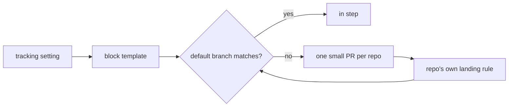

# ADR 0362: A project owns its repos and tracker

Status: Accepted, 2026-11-05. James approved the design on 2026-10-31 in
[#79](https://github.com/Volpestyle/clankie/issues/79). Builds on
[ADR 0191](0191-work-is-tracked-where-the-repo-tracks-it.md) and
[ADR 0332](0332-clankies-own-pull-requests-merge-on-green-checks.md).

## Context

Where a project files its work lived only in prose in each repo's guide. When the
choice changed, every guide had to be rewritten by hand, and nothing checked that
the guides still said the same thing.

## Decision

A project's `tracking` setting names its repos and its tracker: GitHub or Linear,
with a board for public work and a board for private work. Clankie owns one marked
block in each repo's guide, between `<!-- clankie:tracking -->` and
`<!-- /clankie:tracking -->`. Every byte outside the markers stays the owner's.

- **Deterministic.** The block is a pure function of the tracker choice. No model
  and no worker run, and it holds no timestamp, so a repeat pass writes nothing.
- **Which file.** A block already in a guide stays there. Otherwise it goes in the
  file the other includes: a `CLAUDE.md` symlink to `AGENTS.md`, or an `@AGENTS.md`
  import. It goes in `CLAUDE.md` when neither includes the other, when each includes
  the other, and when a repo has no guide, which is then created.
- **Proposals only.** Applying and the hourly sweep each propose from one branch,
  `clankie/tracking-block`, through the forge's API, so no local checkout is touched.
  This code never merges. The pull request lands under that repo's own rule, even
  where that rule would allow a direct push. Reading the block back from the default
  branch after a merge is the same read the sweep makes.
- **The owner's answer holds.** A closed proposal stays closed for that exact block:
  the sweep reports it and only `clankie project tracking PROJECT apply` reopens it. A
  commit someone else put on the branch is never replaced. The sweep only reads when
  the project's `push` preference is `owner`.
- **Refusal over guessing.** Malformed markers, two blocks, an unclosed code fence, a
  guide that links elsewhere or is not UTF-8 are reported, and nothing is written.
- **The block is public.** It lands in public and private repos alike, so it names
  only the tracker and boards the owner chose. It never lists the project's other
  repos, and a proposal in one repo names no other.
- **Issues stay put.** A changed tracker never moves or closes an issue. The change
  offers that to the owner, and approved work is hired out separately.
- **Suggested, then confirmed.** `clankie project tracking PROJECT` opens with what
  the project's local repos say: origins, `.clankie/tracking.json`, guide links and
  recent commit keys. Signals that disagree or run out become a question, and the
  private board is always asked, because a wrong guess there publishes private work.
  Nothing saves itself. When signals later name a different tracker than the setting,
  the read and the sweep's log report it and leave the setting alone.

## Consequences

- A repo's `.clankie/tracking.json` stays the per-repo answer `clankie work` reads
  (ADR 0191). The block tells agents reading the guide; this setting does not write
  that file.
- Only GitHub repos can be proposed to today, through the connected account or the
  owner's `gh` login. Linear is a tracker choice, not a place the block lands.
- The branch check and its forced update are two calls, because GitHub has no
  compare-and-swap for refs. A commit pushed between them would be replaced.
- The app's Common control still needs its relay route and screen.
