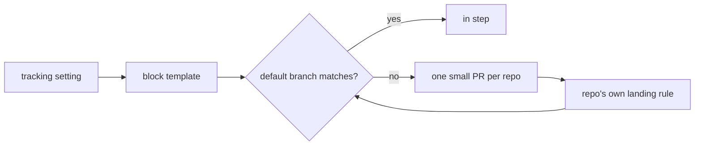

# ADR 0362: A project owns its repos and tracker

Status: Accepted, 2026-11-05. James approved the design on 2026-10-31 in
[#79](https://github.com/Volpestyle/clankie/issues/79). Builds on
[ADR 0191](0191-work-is-tracked-where-the-repo-tracks-it.md) and
[ADR 0332](0332-clankies-own-pull-requests-merge-on-green-checks.md).

## Context

Where a project files its work lived only in prose in each repo's guide. When the
choice changed, every guide had to be rewritten by hand, and nothing checked that
the guides still said the same thing.

## Decision

A project's `tracking` setting names its repos and its tracker: GitHub or Linear,
with a board for public work and a board for private work. Clankie owns one marked
block in each repo's guide, between `<!-- clankie:tracking -->` and
`<!-- /clankie:tracking -->`. Every byte outside the markers stays the owner's.

- **Deterministic.** The block is a pure function of the tracker choice. No model
  and no worker run, and it holds no timestamp, so a repeat pass writes nothing.
- **Which file.** A block already in a guide stays there. Otherwise it goes in the
  file the other includes: a `CLAUDE.md` symlink to `AGENTS.md`, or an `@AGENTS.md`
  import. It goes in `CLAUDE.md` when neither includes the other, when each includes
  the other, and when a repo has no guide, which is then created.
- **Proposals only.** Applying and the sweep, which runs at service start and then
  hourly, each propose from one branch,
  `clankie/tracking-block`, through the forge's API, so no local checkout is touched.
  This code never merges. The pull request lands under that repo's own rule, even
  where that rule would allow a direct push. Reading the block back from the default
  branch after a merge is the same read the sweep makes.
- **The owner's answer holds.** A closed proposal stays closed for that exact block,
  whichever closed proposal carried it: the sweep reports it and only
  `clankie project tracking PROJECT apply` reopens it. A commit someone else put on the
  branch is never replaced: the branch is Clankie's only when its tip is one commit whose
  parent is in the default branch's history and whose tree differs from that parent's only
  in the guide it rewrote, holding the block its trailer names with every byte outside the
  markers unchanged. The trailer alone proves nothing, since an amended commit keeps it.
  The branch then moves only from the tip just checked, through GitHub's conditional
  `updateRefs`, so a push in between is refused rather than replaced. The sweep only reads
  when the project's `push` preference is `owner`.
- **Writes pass the tracker's write checks.** Each proposal write renews the authority it
  rests on and confirms the connected GitHub account, or `gh` login, is the one the pass
  began with, the same `authorizeWrite` and account checks every other tracker write passes.
  For `apply` that authority is the owner's request at the revision they applied; for the
  sweep it is the same tracking setting still under `push: lead`, and for a departed repo
  that it is still unclaimed under that preference.
- **Refusal over guessing.** Malformed markers, two blocks, an unclosed code fence with
  no block above it, a guide that links elsewhere or is not UTF-8 are reported, and
  nothing is written. So is a repo two projects claim, since their blocks would rewrite
  each other: both are refused until the owner removes it from one.
- **A public repo names only the public destination.** Each pass asks the forge
  whether the repo is private. Only a repo it confirms as private gets the private
  board. A public repo, an `internal` one, and one whose visibility it won't confirm
  all get the public block, which says private work is not named there. No pull request
  body holds a block at all, because a body outlives its branch and the repo's audience
  can change. Any public board that looks like GitHub, including any address GitHub
  hosts and a bare `owner/name` under Linear, must parse to a repo the forge shows as
  public, in whatever spelling, or it is refused rather than published. The two
  boards must differ, compared by the repo they parse to. No block lists the project's
  other repos, and a proposal in one repo names no other.
- **A proposal doesn't outlive its audience.** When a repo is no longer confirmed
  private and the tip of `clankie/tracking-block` names a private board, that comes
  before every other check, so no refusal can strand it: `apply` and a sweep close every
  open pull on the branch and delete it, even with someone else's commit on top, then
  carry on as usual. The configured board counts wherever it appears on the branch,
  fenced or in broken markers, unless the default branch already says it: withdrawing
  the owner's own text would only bring it back. Under `push: owner` the sweep writes
  nothing and alerts the owner instead, as it does when the withdrawal fails. A default
  branch that names the board reaches the owner whatever else happens to the repo,
  refused, proposing, or with any later forge call failing: the status reason opens with
  `private_board_published`. Only a default branch the forge won't serve at all goes
  unread, and the next pass reads it again.
- **Leaving the setting ends no duty.** No pass reads a repo after `clear` or a drop, so
  a proposal left there could turn public unseen. Clankie records each repo a pass
  reaches in `project-tracking-repos.json` under its state root, and the next sweep
  treats one that no project claims like a public flip, whatever its audience, with one
  difference: it only writes to a branch Clankie wrote for this board, meaning the tip
  is Clankie's own commit, as above, carrying this board's private block. That proposal it
  withdraws, only from the tip it read, or
  under `push: owner` alerts until it is gone. A branch with someone else's commit on
  top, or an earlier block of Clankie's, is left in place and alerted on until it is
  gone if it says this board or carries that block. Any other branch of that name is
  left alone, unreported. A public repo whose default branch names the board alerts the
  owner, and that merged text stays theirs to manage. The repo is forgotten once the
  branch is settled, that alert has reached the owner, and the default branch has been
  read. A repo that returned, or that another project claims, is left alone.
- **Issues stay put.** A changed tracker never moves or closes an issue. The change
  offers that to the owner, and approved work is hired out separately.
- **Shown, never taken.** `clankie project tracking PROJECT` opens with what the
  project's local repos say: origins, `.clankie/tracking.json`, guide links and recent
  commit keys. Signals that disagree or run out become a question. Repo content never
  decides what is saved or written: `--accept-suggestion` only shows the suggestion, and
  the owner sets each value by hand. A suggestion never overrides a saved value or
  triggers an apply. When signals later name a different tracker than the setting, the
  read and the sweep's log report it and leave the setting alone.

## Consequences

- A repo's `.clankie/tracking.json` stays the per-repo answer `clankie work` reads
  (ADR 0191). The block tells agents reading the guide; this setting does not write
  that file.
- Only a public board that is a GitHub repo can be checked. A Linear board is the
  owner's word, because no forge read says who can see it. A GitHub Project URL is
  refused for the same reason: use the repo that takes the issues, or a Linear board.
- A repo's own merged history is the owner's to manage. Withdrawing removes the branch,
  not what was already published: merged commits stay, and GitHub keeps a closed pull
  request's commits and diff on its page until GitHub Support removes them. Between the
  repo changing or leaving the setting and the next pass, up to an hour, the proposal
  stays visible.
- A proposal Clankie withdrew reads as closed. If the repo turns private again, or
  returns to the setting, that block reads as `declined` until the owner applies.
- Only GitHub repos can be proposed to today, through the connected account or the
  owner's `gh` login. Linear is a tracker choice, not a place the block lands.
- A ref update or delete names the tip it expects (GraphQL `updateRefs` with `beforeOid`),
  so a commit pushed after the check is never replaced or deleted (#958).
- GitHub lists a very large root tree only in part (`truncated`). A guide it leaves out is
  looked up by path, so it is always found, but that lookup doesn't give a file's exec bit:
  Clankie reads such a guide and refuses to rewrite it (`guide_mode_unknown`), and can't
  confirm a proposal there as his own, so he never replaces one.
- The app's Common control still needs its relay route and screen.
