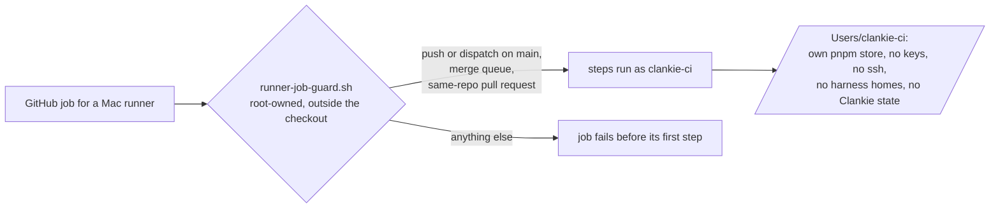

# Mac runner

The `mac` and `real-run` jobs ([quality gates](testing/quality-gates.md)) run on the
owner's Mac. Their runners run as a dedicated standard macOS user behind a guard
on the runner itself ([ADR 0351](adr/0351-mac-runners-run-as-their-own-user-behind-a-runner-side-guard.md)).



## What the setup does

`scripts/ci/setup-runner-user.sh` prints each step and changes nothing without
`--apply`; rerunning repairs changed configuration and leaves current runners
running. Apply repairs while the new runners are idle: a changed `.env` reloads
that runner's LaunchDaemon so its listener picks up the configuration.

1. Creates the hidden standard user `clankie-ci` with its own home and a random
   password nobody keeps, and makes sure it is not an administrator.
2. Warns if its home holds `.ssh`, `.gnupg`, `.claude`, `.codex`, `.config/gh`,
   `.clankie`, `.aws`, `.netrc` or keychains, or if the owner's home is readable
   by other users.
3. Installs `scripts/ci/runner-job-guard.sh` root-owned at
   `/Library/ClankieCI/runner-job-guard.sh` (root:wheel, mode 0755).
4. For each runner (three by default): downloads the pinned runner release into
   `/Users/clankie-ci/actions-runner/clankie-N`, writes its `.env` (the guard and
   a plain `PATH`; nothing secret), registers it with the labels the workflows
   use (`self-hosted,macOS,ARM64,james-mac`), and loads a LaunchDaemon that runs
   it as `clankie-ci` without a login session.
5. Lists the runners still registered under the owner's own user, with the
   commands that retire them once the new ones are online. Runners for other
   repositories are left alone.

## Run it

```sh
scripts/ci/setup-runner-user.sh                     # read the plan
RUNNER_TOKEN=$(gh api -X POST repos/Volpestyle/clankie/actions/runners/registration-token --jq .token) \
  scripts/ci/setup-runner-user.sh --apply           # make it so
gh api repos/Volpestyle/clankie/actions/runners --jq '.runners[] | [.name,.status] | @tsv'
```

`--allowed-actors "login ..."` limits pull-request jobs to those authors as
well. Agents never run this script; the owner does.

For already registered runners, repair with `scripts/ci/setup-runner-user.sh --apply`;
no registration token is needed. This also migrates the hook from
the earlier `/Library/Application Support/ClankieCI` path. The new path is
written unquoted in `.env`: runner v2.338.2 preserves literal quotes there,
but passes the hook path to bash without shell quoting, so it must have no spaces.
The script does not remove the old hook or retire old runners. Confirm a real
job succeeds on each new runner before running the printed retirement commands.

## Tradeoffs

- Jobs keep their runners, labels and order, so they are exactly as fast. The
  first job per runner fills the new user's empty pnpm store.
- `clankie heavy` is not on the CI user's `PATH`, so Mac jobs no longer take the
  owner's fleet permits; they run as ordinary background processes.
- The guard reads the job's own GitHub context. If GitHub ever stops providing
  it to the hook, the guard refuses every job rather than allowing one.
