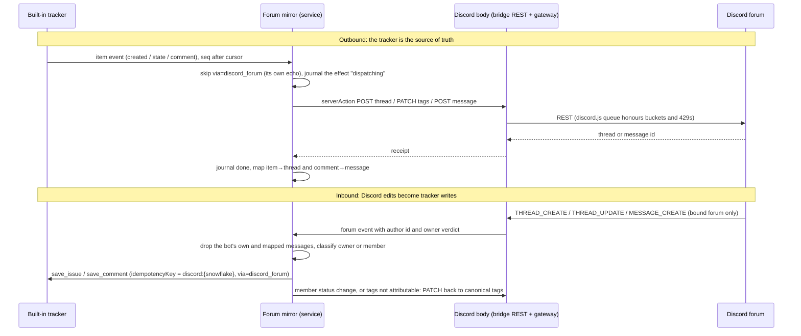

# Discord forum as a view of the built-in tracker

Status: proposal for [VUH-2531](https://linear.app/vuhlp/issue/VUH-2531). James
approved the direction on 2026-10-20, and the lead settled the open decisions on
2026-10-21 (below). Slice 1 is built offline in
[`discord-forum-mirror.ts`](../../apps/clankie/src/discord-forum-mirror.ts). Live
Discord writes wait for the lead's choice of test server, channel and bot.

Date: 2026-10-21

The built-in tracker stays the only store
([ADR 0226](../adr/0226-one-tracker-tool-surface.md), VUH-2532 amendment). One
Discord forum channel per built-in project is a live two-way view of it:

- a forum post is an item, and its first message is the description;
- forum tags carry the status and up to four labels;
- replies are comments, and evidence links land in the thread.

## Discord's limits (read 2026-10-21)

These come from the current docs, not from memory. Sources:
[rate limits](https://docs.discord.com/developers/topics/rate-limits),
[channels](https://docs.discord.com/developers/resources/channel),
[threads](https://docs.discord.com/developers/topics/threads),
[gateway](https://docs.discord.com/developers/events/gateway) and
[audit log](https://docs.discord.com/developers/resources/audit-log).

| Limit                         | Value                                                                                                                                                                                                                       |
| ----------------------------- | --------------------------------------------------------------------------------------------------------------------------------------------------------------------------------------------------------------------------- |
| Global REST rate              | 50 requests/s per bot. Interaction endpoints are exempt.                                                                                                                                                                    |
| Per-route rate                | Per bucket (`X-RateLimit-Bucket`), keyed by the top-level resource: channel, guild or webhook. The docs say "rate limits should not be hard coded".                                                                         |
| 429 handling                  | Wait `retry_after`. `X-RateLimit-Scope` is `user`, `global` or `shared`.                                                                                                                                                    |
| Invalid requests              | 10,000 per 10 minutes for 401, 403 and 429 responses, or Cloudflare bans the IP. A `shared`-scope 429 does not count.                                                                                                       |
| Gateway sends                 | 120 commands per connection per 60 s.                                                                                                                                                                                       |
| Tags per forum                | 20 (`available_tags`), names 0–20 characters. A `moderated` tag can be added or removed only by `MANAGE_THREADS` holders.                                                                                                   |
| Tags per post                 | 5 (`applied_tags`).                                                                                                                                                                                                         |
| Post title                    | 1–100 characters.                                                                                                                                                                                                           |
| Message                       | `content` up to 2000 characters; up to 10 embeds totalling 6000 characters; 25 MiB per request.                                                                                                                             |
| Forum topic (guidelines)      | 0–4096 characters.                                                                                                                                                                                                          |
| Auto-archive                  | 60, 1440, 4320 or 10080 minutes. Under the guild's active-thread cap, Discord may archive sooner. Pinned posts never auto-archive.                                                                                          |
| Archived threads              | No edits, reactions or commands. A message from anyone with `SEND_MESSAGES` unarchives the thread. Setting `archived:false` needs only `SEND_MESSAGES` unless the thread is locked; a locked thread needs `MANAGE_THREADS`. |
| Archived threads on reconnect | Not synced over the gateway. List them over REST: `GET /channels/{id}/threads/archived/public?before=&limit=`.                                                                                                              |
| Starter message               | Has the same id as its post.                                                                                                                                                                                                |
| Message content               | Privileged `MESSAGE_CONTENT` intent. Without it, content is empty except in the app's own messages, DMs and mentions. Verified apps (100+ guilds) need approval.                                                            |
| Thread events                 | `GUILDS` delivers `THREAD_CREATE`, `THREAD_UPDATE`, `THREAD_DELETE` and `THREAD_LIST_SYNC`. The docs do not name the event for a tag change; `THREAD_UPDATE` is expected and the live trial confirms it.                    |
| Audit log                     | `GET /guilds/{id}/audit-logs`, `action_type` 111 for a thread update, `limit` 1–100, kept 45 days. The docs do not say whether `applied_tags` appears in its change list; the live trial checks.                            |

## Mapping

| Built-in tracker                              | Discord forum                                                                                                                                         |
| --------------------------------------------- | ----------------------------------------------------------------------------------------------------------------------------------------------------- |
| Project with a Discord view                   | One forum channel. The binding records the project, guild and forum id.                                                                               |
| Item                                          | A post titled `CLK-12 Title`, cut to 100 characters.                                                                                                  |
| Description                                   | The starter message, chunked to 2000 characters, with a link to the full item when cut.                                                               |
| Status Backlog / Todo / In Progress           | Tag `Later` / `Next` / `Now`.                                                                                                                         |
| Status In Review or Delivered                 | Tag `Review`.                                                                                                                                         |
| Status Done                                   | Tag `Done`, then the post is archived.                                                                                                                |
| Status Canceled or Duplicate                  | Tag `Closed`, then the post is archived.                                                                                                              |
| Labels                                        | Up to 4 label tags per post (5 minus status). The forum holds 6 status tags plus 14 label tags; labels beyond that are listed in the starter message. |
| Comment                                       | A reply. Long comments use up to three messages, then a link.                                                                                         |
| Evidence link                                 | A reply carrying the `clankie://evidence` link and caption. No files are re-uploaded.                                                                 |
| Blocks, parents, priority, cycles, runs, asks | Kept only in the tracker. Priority shows in the starter message.                                                                                      |

The six status tags are `moderated`, so Discord itself stops anyone without
`MANAGE_THREADS` from setting a status. Label tags are not moderated.

## Flows

### Dedupe and exactly-once

- **Outbound.** Each tracker event becomes one journaled effect, following
  `discord-tracking.ts`: `pending`, then `dispatching`, then `done`. A crash
  while `dispatching` leaves the effect `uncertain`, visible and never replayed.
  The cursor and `storeId` follow `tracker-owner-loop.ts`, and a `store_changed`
  rebootstrap reconciles the maps instead of reposting. Events stamped
  `via=discord_forum` are not mirrored back.
- **Inbound.** Every write carries `idempotencyKey: discord:{snowflake}`. The
  built-in tracker keeps receipts per actor and key, so a redelivered gateway
  event or a restart replay cannot create a second item or comment. Messages
  the bot wrote, or that are already mapped, are ignored.
- **Maps.** The journal maps item to thread and comment to message. Both are
  checked before any create, in both directions.
- **Coalescing.** Changes to one item that arrive close together become one
  `PATCH` per post. The mirror writes to each forum one request at a time and
  takes the latest canonical tags, not a delta.

### Archived threads

- Before editing an archived post, the mirror sends `PATCH {archived:false}`,
  then the change. Posting a reply unarchives the post by itself. Done and
  Closed items are re-archived after their tag lands.
- A locked post, or a 403 or 404, stops that projection and records the reason.
  The mirror never retries in a loop, which protects the invalid-request budget.
- At startup and after a gateway resume, the mirror lists active threads and
  pages archived public threads. It then compares each mapped post's tags with
  the tracker and repairs any drift outbound. A tag drift with no author cannot
  be attributed, so it is not imported.

## Trust

Owners follow the guild policy (`me`, `everyone` or a role) through the same
decision as `planDiscordTurnSession` ([ADR 0251](../adr/0251-discord-owners-and-room-skills.md)).

- **Owner post or reply:** written as the owner, `human` actor, `via=discord_forum`.
- **Member post or reply:** untrusted input, never an instruction.
  - The tracker records the member as an `external` actor, which is never the
    owner and never Clankie's own echo. The text starts with a provenance line
    that marks it as untrusted.
  - Member posts start in Backlog. An owner setting can switch the forum to
    owner-tag-only, where a member's post waits until an owner sets its status.
  - A per-forum daily limit bounds member posts and replies. Posts over the limit
    wait for an owner; replies over the limit stay in Discord only.
  - Nothing a member writes can set a status, wake Clankie with tools, start a
    run or reach a worker's brief unfenced. The owner loop never wakes on
    `external` activity.
- **Status-tag change:** these tags are moderated, so only `MANAGE_THREADS`
  holders or the bot can set them.
  - The forum's overwrites grant `MANAGE_THREADS` to the owner (or owner role)
    and the bot only.
  - Members with Discord's Administrator permission bypass overwrites. A change
    is therefore accepted only when the audit log attributes it to an owner;
    otherwise the mirror restores the canonical tags.
  - If the live trial shows the audit log does not record `applied_tags`, every
    unattributed status change is reverted and the owner changes status from a
    Clankie surface instead.
- **Label-tag change** by a post's author on their own post is applied only
  when that author is an owner; otherwise it is reverted.
- **The tracker's own rules still apply.** For example, Done needs an evidence
  bundle. If the tracker refuses an owner's tag change, the mirror restores the
  tags and tells the owner why. If it refuses an owner's new post at a status,
  the post is filed in Backlog.

### Audience

Binding a project to a forum that members can read publishes that project's
items to them; it is the owner's explicit choice for that one project. The
body's owner-only-audience check refuses thread writes to shared rooms today,
so slice 2 adds an exception for exactly the owner-bound forum.

## Slices

1. **Offline mirror core** (this landing, no live Discord):
   - pure mapping: the tag catalog, a post's tags, title and body chunking;
   - an outbound mirror over a real local built-in tracker, through the
     existing `serverAction` path, against a loopback mock of Discord REST;
   - the inbound handler, given normalized forum events and an owner verdict.

   Tests cover: create to post, status to tags, Done to archive, reopen to
   unarchive, comments in both directions, no duplicates on replay or self-echo,
   an archived post before an edit, a crash mid-dispatch becoming `uncertain`,
   a member post as untrusted Backlog, and a member status change reverted.

2. **Body wiring:**
   - forward `THREAD_CREATE`, `THREAD_UPDATE` and `MESSAGE_CREATE` for bound
     forums from the bridge, attributing tag changes from the audit log;
   - accept the mirror's writes to the owner-bound forum despite its shared
     audience;
   - allow the bounded archived-list and audit-log `GET` query strings in
     `DiscordServerActionSchema`;
   - startup reconciliation.
3. **Owner surface:** make the Discord forum option available in work-tracker
   settings (API, then CLI, TUI, app and hosted), bound to a built-in project,
   with docs and skill updates.
4. **Live trial** on the lead's chosen test server, channel and bot:
   - each of post, tag change and reply round-trips;
   - an archived post;
   - a duplicate redelivery;
   - a member post and a member tag change;
   - whether the audit log records `applied_tags`.

## Decisions (lead, 2026-10-21)

1. Member posts create untrusted Backlog items automatically. An owner setting
   switches a forum to owner-tag-only, and a per-forum daily limit stops a busy
   server from flooding the tracker.
2. Status changes made in Discord count only when the audit log attributes them
   to an owner. Without `VIEW_AUDIT_LOG`, status tags are display-only, and the
   owner gets a notice instead of a silent revert.
3. Self-hosted first. The hosted official bot follows later and stays
   mention-only until `MESSAGE_CONTENT` is approved; that is a separate
   follow-up.
