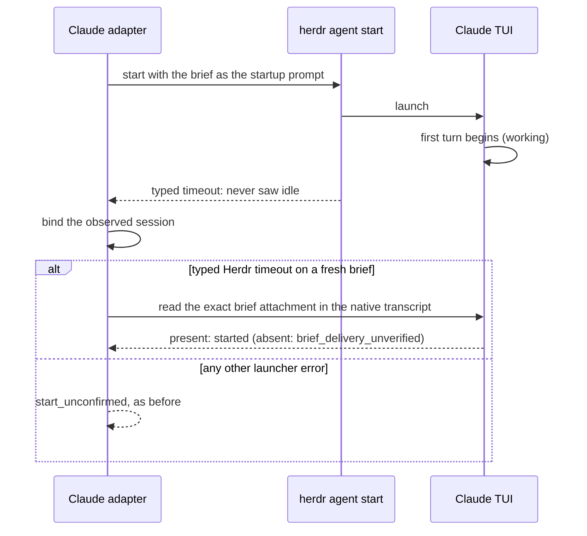

# VUH-2802: auto-tidy leaves finished workers open

Tracks: https://linear.app/vuhlp/issue/VUH-2802

## Root cause of the unconfirmed Claude starts

`herdr agent start` waits for the named agent to become ready. Its loop keeps waiting
while the agent is `working` and succeeds only at `idle`/`done` with `interactive_ready`
(`~/dev/herdr/src/cli/agent.rs`, `wait_for_named_agent`). Since VUH-2499, a fresh Claude
hire takes its brief as the native startup prompt, so its first turn can already be running
when Herdr's settle delay ends. Herdr then never sees idle within its 30 s wait and
returns `{"code":"timeout","message":"timed out waiting for agent startup"}`. The Claude
adapter treated every launcher error as unconfirmed, even after it had bound the session
and the brief was in the transcript. Codex hires take their brief over the app server after
startup, so Herdr sees them idle first.

In the service log, 56 of the 59 recent local Claude `start_unconfirmed` hires carry exactly
this error, and local Claude hires went from mostly `spawned` to almost always failing
right after VUH-2499 landed (`production-hire-outcomes.txt` in the captures).

Whether a given start hits the timeout depends on how Herdr reads Claude's screen during
startup. In three unforced real runs it did not: Herdr 0.9.3 resolved at 8.1 s twice, and the
service's Herdr 0.9.1 resolved at 21.5 s. So the native before/after proof forces Herdr's own
typed timeout with a 4 s `--timeout`.

## Proof

- **Claude start, real TUI.** The source adapter in disposable live-Herdr panes, with
  the service's Herdr 0.9.1, high effort and the worker skills plugin directory, a
  first turn of `sleep 45`, and a forced 4 s readiness wait. The old adapter returns
  `Claude startup is unconfirmed: Error: {"error":{"code":"timeout",…}}`, the exact
  production failure, while the turn completes. The fixed adapter returns `started`, with
  one native prompt and no channel send. Captures: `before-forced-timeout/`,
  `after-forced-timeout/`. Unforced runs (`run/`, `prod-like/`, `svc-herdr/`) started
  normally.
- **Auto-tidy, real Herdr and Claude.** `apps/clankie/test/auto-tidy-unconfirmed-native.integration.test.ts`
  (manual: `AUTO_TIDY_UNCONFIRMED_NATIVE_TEST=1`, `CLAUDE_NATIVE_CONFIG_DIR` for a
  non-default profile). It runs an idle real Claude TUI (no prompt, worker plugin disabled)
  in an isolated Herdr, with real process proof and draft detection, and closes the
  native pane. It restores the live Juniper journals from just before their manual
  adopt (`fixtures/hire-receipts/local-unconfirmed-claude-start.json`). An unread report
  holds the pane, and the lead-round text names it with `acknowledge_worker_reports`. A
  receipt that never recorded its session is not adopted, and the close refuses
  `provenance_unknown`. Once the receipt records the observed session, the next sweep
  adopts it, settles the receipt `adopted`, confirms the allocation and closes the pane.
  Results: `auto-tidy/results.json`.
- **Retirement fence (review).** Sage found that adoption confirmed the allocation
  before it saved the receipt settlement, so a failed save released the retirement
  barrier for good. Now the settlement is durable first. `retirementGuard` also refuses
  any unsettled original for the pane's occupant, even with a confirmed allocation or an
  unreadable journal, and auto-tidy holds (`adoption_refused`) when adoption refuses.
  `auto-tidy-adoption-fence.integration.test.ts` forces the journal's rename to fail.
  The fence holds immediately and after a restart, auto-tidy does not close, and later
  adoption settles and releases it. A confirmed allocation with an unsettled original
  stays fenced until operator adopt. Both tests fail on the first candidate, and Sage's
  own probe passes.
- **Regression.** `claude-hire-startup.integration.test.ts` adds the typed-timeout cases,
  with the prompt recorded (started) and not recorded (unverified). Both fail on the old
  adapter.

## Limits

- The lead-round text is checked in the native test. A live 30-minute round was not observed.
- Parking clean, unlanded work (the issue's third criterion) is not implemented.
  Such seats now appear in the lead round as `unlanded_work`.
- During development, one native run let the isolated Herdr's `XDG_DATA_HOME` reach
  Claude. Its installer repointed `~/.local/bin/claude` into the temporary directory for
  about a minute (01:40–01:41Z) until it was restored. The test now strips those
  variables, disables the updater and asserts that the launcher is unchanged.

[Captures: native driver, results, transcripts, production outcome summary](captures.tar)
