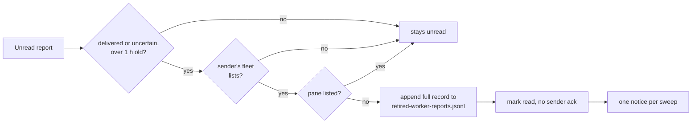

# VUH-2806: history from gone seats no longer buries the lead or blocks tidy

Tracks: https://linear.app/vuhlp/issue/VUH-2806

## What changed

Every five minutes, whatever the `autoTidy` setting, the service runs one round over
history left by seats that are gone (`captain.ts`, `stopClosedSeatHistory`):

- **Reports.** `retireClosedSeatReports` (`captain-worker-reports.ts`) lists each sender's
  own fleet once. A report is retired only when that listing succeeds and no longer shows
  its pane, it was accepted over an hour ago (`CLOSED_SEAT_REPORT_GRACE_MS`), and it was
  already handed to the lead (`delivered`) or has an uncertain handoff. Each one is first
  appended in full to `retired-worker-reports.jsonl` in the service state directory
  (fsynced), then the store marks it read with no acknowledgment to the gone sender
  (`retireInboundReports`, `conversations/worker-reports.ts`). The conversation gets one
  service notice per sweep, which never queues a turn. Pending reports, reports from any
  listed pane (whatever session it now runs) and reports from a fleet that cannot be listed
  are never touched. Read reports then age out after a day, as acknowledged ones always have.
- **Keeps.** `PaneTidy.dropGoneKeeps` drops a keep only when its fleet lists and neither its
  pane nor its native session appears. Herdr can show a live Codex pane without a session,
  so the pane alone holds its keep. `keep_worker_pane keep:false` (and `clankie agents
unkeep`) on a pane that neither the listing nor `herdr get` finds now releases the keeps
  recorded for that pane id, instead of failing `pane_unknown`.

The meta shape is unchanged (a retired report is an ordinary read report), so a rollback
reads it.



## Proof

**Integration** (`apps/clankie/test/closed-seat-history.integration.test.ts`, CI). Real
`ConversationStore`, `InboundSeatReceipts` and `PaneTidy` keep journal against a Herdr
inventory boundary. Reports: a live pane keeps its reports after a session change; a gone
pane's delivered and uncertain reports are retired with their full text in the journal and
no sender event; a report inside the grace hour, a pending report and an unlistable remote
fleet's report all stay; the result survives a store reopen, and the graced and remote
reports go once the hour passes or the fleet lists. Keeps: live, sessionless-live and
moved-session keeps stay, the unlistable remote keep stays until its fleet lists, a gone
pane's keep is dropped, and releasing a gone pane by id works.

**Copy of the live store** (`apps/clankie/test/closed-seat-history-store-copy.integration.test.ts`,
opt-in). `~/.clankie/captain/conversations` and `pane-keeps.json` were copied to a scratch
directory. Production code ran against the copy with this Mac's live Herdr and the PC fleet
through the service's own ssh transport, listing only. The test asserts that every retired
report was eligible and every other report is untouched across a reopen, that the journal
holds exactly the retired IDs with their original text, and that only keeps of unlisted
panes went. Results are in `store-copy-results.json`, counts and pane IDs only:

|                            | before | after                                                              |
| -------------------------- | ------ | ------------------------------------------------------------------ |
| `global-default` unread    | 2,520  | 354: Sage `w4F:p2G` (92) and PC Rowan `pc/w18:pW` (262), both live |
| KH2 lead (inactive) unread | 359    | 0                                                                  |
| keeps                      | 16     | 1: Sage `w4F:p2G` (kept 2026-10-25, live)                          |

2,525 reports were retired. The journal was 2.98 MB, and no pending report existed.

```sh
S=$(mktemp -d); cp -R ~/.clankie/captain/conversations ~/.clankie/captain/pane-keeps.json "$S/"
clankie heavy -- env VUH2806_STORE_COPY="$S" VUH2806_LIVE_STORE="$HOME/.clankie/captain" \
  VUH2806_HERDR_SOCKET="$HERDR_SOCKET_PATH" \
  VUH2806_FLEETS='[{"id":"pc","session":"default","ssh":{"host":"volpe@supedupsilly","shell":"powershell"}}]' \
  VUH2806_PROOF_OUT="$S/results.json" \
  pnpm --dir apps/clankie exec vitest run test/closed-seat-history-store-copy.integration.test.ts
```

## Not done

- The live store is untouched. Live proof needs the service to restart onto this commit;
  its first round (within five minutes) should leave the same live-only counts.
- The `kh2` fleet did not answer the roster at proof time. No report or keep in the copy
  belonged to it, and while it stays unreachable, any that do are kept.
- A keep dropped while its pane is closed is gone if that session is later resumed by Undo.
