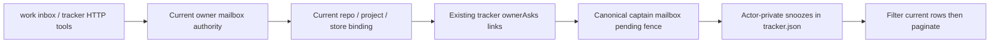

# Work inbox attention

The API/CLI foundation uses the existing Work question identities and pending rules.
It defers attention only. It cannot answer or cancel an ask, approve a gate, verify
an issue, advance delivery or steer a worker. UI discovery and iPhone/iPad/Mac
presentation are a subsequent slice of LOCAL-VUH-24's parent work.

## Current row contract

Work already presents several kinds of attention. They are not interchangeable:

| Existing surface                 | Identity                                                        | Current pending rule                                            | Snoozable here               |
| -------------------------------- | --------------------------------------------------------------- | --------------------------------------------------------------- | ---------------------------- |
| Worker needs-you/stuck           | Project person ID                                               | Current worker status                                           | No                           |
| Lead conversation                | Conversation ID                                                 | Current lead status                                             | No                           |
| Project issue                    | Tracker issue UUID                                              | Current tracker state                                           | No                           |
| Transcript/typed question        | Conversation + incarnation + request UUID                       | Canonical question is pending                                   | Only the linked subset below |
| Decision, gate, verification ask | Existing ownerAsks issue/event/request link plus question tuple | Live pending mailbox question, current context and owner access | Yes                          |

Preference/project-creation and native worker questions remain on their existing
surfaces. The latter require reconciliation; inspecting snoozes must not trigger
that reconciliation. No owner/recipient is inferred from a name, prompt, URL,
worker assignment or on-behalf-of chain. The existing mailbox policy accepts a
currently eligible authenticated owner; it has no historical named-recipient
stamp. Exact authenticated tracker actors have separate attention state, including
two devices belonging to the same person.

## API and storage

POST `/v1/tracker/call` with `{repo, name, arguments}`. Tools are
`inbox_pending_questions`, `get_inbox_item`, `post_snooze_inbox_item`, and
`post_unsnooze_inbox_item`. Every call requires `project` (UUID) and `storeId`.
Get/writes require the exact returned `target` object containing `issueId`,
`eventId`, `conversationId`, `incarnationId` and `requestId`. Writes also require
`expectedRevision`, `ifUpdatedAt` (null when no attention record exists), and an
`idempotencyKey`. Snooze requires an explicit RFC3339 `until`, strictly in the
future and at most 30 days away. Unknown fields are refused.

List defaults to `attention: active`; `snoozed` and `all` inspect current eligible
rows with those attention states. `limit` is 1–250, default 50. Follow the returned
`cursor` while `hasNextPage` is true; `complete` means the end of the current
query. Filtering precedes pagination. Cursors bind actor, store, project, mode
and current result fingerprint. Data changes or expiry may require restarting
pagination. Pending candidates are read from the real mailbox in batches of 250,
without the truncated input_list projection.

Version-1 `inboxSnoozes` records live in the existing tracker store and use its
lock, atomic replacement, actor stamping, audit and actor-private idempotency
receipts. At most 100 unexpired snoozes per actor across projects, and 1000 retained records per
store, are allowed. Attention writes reclaim expired records only in the caller’s
exact actor/project scope; a full store refuses new records without touching another scope. They carry only the target, actor key, timestamps and schema/store/project
identity. They are not sync models or a notification/configuration store; normal
issue and question reads retain their existing contracts.

Every operation checks current project settings, exact repository binding, store
identity, canonical link and live question context. Final synchronous file and
question checks run after the route's final authentication await. Replaced stores,
revoked devices, unsupported backends and native MCP without the real mailbox
capability refuse without fallback. A replay must pass current scope/access
checks before reading its original receipt.

Expiry is computed on reads, with no timer or owner action. Unsnooze removes only
the caller's exact attention record. Both re-evaluate current underlying data;
cancelled/submitted questions and cancelled issues do not reappear. A gate also
requires its current run to be active and still waiting on that exact gate event. Completed
issues retain only a still-pending verification ask, not decision/gate attention.

The existing asynchronous tracker rename is not a transaction with mailbox
resolution or credential revocation. If authority or current data changes after
dispatch, the route returns `tracker_uncertain`, `mayHaveCommitted: true` and the
original idempotency key. Inspect current attention and the existing
`get_write_receipt`; never resend with a new key. A durable snooze cannot revive
a terminal question. Current links establish current store membership, not
historical birth-store provenance. The existing same-user operator credential
isolation limit remains documented in ADR 0253.

## Source map

- `packages/protocol/src/work-items.ts`: strict selectors and input schemas.
- `packages/work-items/src/tracker-tools.ts`: tool catalog and unsupported-backend refusal.
- `packages/work-items/src/tracker-local.ts`: canonical links, bounded private
  state, existing persistence/receipts and current-data pagination.
- `apps/clankie/src/work-items.ts`: exact current binding and mailbox/link join.
- `apps/clankie/src/app/conversation-routes.ts`: real owner/device authentication,
  actor attribution and final publication/uncertainty handling.
- `apps/clankie/src/captain/conversations/inbox-fence.ts` and `store.ts`: pure
  canonical question reads; no save, retention or reconciliation hooks.
- `apps/clankie/src/captain/port.ts` and `captain.ts`: optional capability forwarded
  to the actual live captain store, invalidated at shutdown.
- `apps/tui/src/command/work.ts`: CLI over the same HTTP tools.
