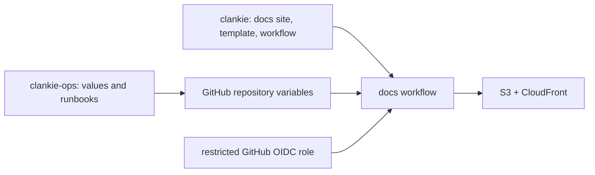

# AWS infrastructure boundary

This public repo deploys only the public docs site:

- [Docs](public-docs/README.md): S3/CloudFront deployment through GitHub OIDC.

The public gateway and Cognito accounts, with their templates, deploys and
production values, live in the private `Volpestyle/clankie-ops` repo
([ADR 0300](../../docs/adr/0300-clankie-runs-only-on-the-owners-machine.md)).
That repo also owns gateway values, operator runbooks, AWS support
correspondence, contact addresses, and operational evidence. Credentials remain
in their existing credential stores, never in either repo.

The docs workflow consumes repository variables populated from private
configuration. Keep resource IDs and operator records out of public source.
GitHub variables do not hide values from workflow logs or authorized repository
users.

