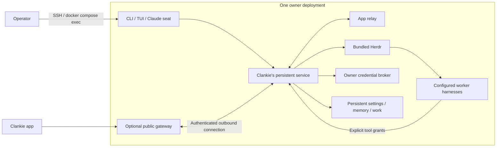

# Self-hosted Clankie on Linux

This is the advanced deployment guide for owners maintaining their own Linux
host. For app onboarding on a Mac, use
[Get started](https://docs.clankie.bot/get-started/). Clankie runs only on
machines the owner controls
([ADR 0300](../../docs/adr/0300-clankie-runs-only-on-the-owners-machine.md)); this
image is one of them, not a Clankie-run service.

This Compose deployment runs one owner's Clankie service,
Herdr workers and app relay on a Linux host. It does not need an owner's desktop
or an open TUI. Each Compose project has separate state and workspace volumes;
use a dedicated VM for mutually untrusted owners. Containers within one deployment
are trusted parts of that owner's machine, not security sandboxes between workers.



## Start and configure

Run these commands from the repository on a Docker host with Compose v2.
The build supports Linux arm64 and x64; the retained smoke proof names the tested
architecture. It installs pinned Node, Claude Code, pi and the verified official
Herdr binary. The existing release bundler produces compiled entrypoints, shipped skills,
plugins and dependency license inventory. No local credential/configuration files
or `node_modules` enter the allowlisted build context.

```sh
docker compose -p my-clankie -f infra/hosted/compose.yaml up -d --build --wait
docker compose -p my-clankie -f infra/hosted/compose.yaml exec captain clankie doctor
docker compose -p my-clankie -f infra/hosted/compose.yaml exec captain clankie
```

The last command opens the TUI as a portal to the already-running service. Use
`/auth` to connect model credentials, `/model` to choose the captain's model and
`/connect` for connected services. Claude and Codex workers use their own
logins: `clankie harness login claude|codex` (or the app, or `/harness-login`)
signs them into your Claude subscription or ChatGPT plan with no shell
([harness sign-in](../../docs/harness-logins.md)); an `ANTHROPIC_API_KEY` on the
body also works, and a signed-in subscription takes precedence over it. Each body start prepares Claude for hires
nobody watches (ADR 0238): the image approves the `clankie-worker` channel in
`/etc/claude-code/managed-settings.json`, and the body installs that plugin
(disabled until a hire enables it) and Herdr's Claude hook, marks onboarding
done, trusts `/workspace` and sets Claude's default permission mode to `auto`
unless the owner chose one.
Pi workers use pi's own provider configuration under `/state/home/.pi/agent`
(`exec captain pi`, then `/login`). Clankie installs Herdr's pi integration there
before each pi hire; the session it reports is the seat's durable identity.
Model billing and connected-service delegation are separate: connecting Linear
does not authenticate a worker's model, and a worker login grants no Linear tools.
The pinned npm installation follows the [Claude setup documentation](https://code.claude.com/docs/en/setup#install-with-npm).
The image contains no owner subscription, API key or personal skill.

Headless setup uses the same [CLI](../../docs/cli.md), including `model`, `persona`,
`fleet`, `workdir`, `herdr` and `access`. Its first start selects `/workspace`
only if no workdir preference exists; subsequent starts preserve owner settings.
Clone project repositories there. User-installed skills live in
`/state/home/.agents/skills` or the project's own skill roots. SSH and Git are
installed; authorize remote machines using this deployment's own SSH configuration
and credentials. No owner machine names or personal remote-control skills ship.

## Remote portals and lifecycle

One container runs the whole body under the launcher (`clankie-body`): Clankie
and its relay listen on loopback inside it. Compose publishes no host ports. Run `clankie` through SSH/Compose for administrative access;
configure `/gateway` in that TUI for the existing app pairing and outbound gateway
connection. The public gateway lives in the private `clankie-ops` repository and is
independent of this deployment. Pairing, provider logins and actual remote-app traffic require
owner setup; the synthetic smoke does not establish those live integrations.

Use Compose for process lifecycle:

```sh
docker compose -p my-clankie -f infra/hosted/compose.yaml logs --tail 100
docker compose -p my-clankie -f infra/hosted/compose.yaml restart
docker compose -p my-clankie -f infra/hosted/compose.yaml down
```

A VM that runs one owner's body without Compose runs the same single container,
whose launcher starts Clankie and its relay and keeps them healthy:

```sh
docker run -d --init --name clankie --cap-drop ALL --security-opt no-new-privileges \
  -v clankie-state:/state -v clankie-workspace:/workspace clankie-hosted:local clankie-body
```

`--init` is required: the launcher's services are reparented to PID 1, which
must reap them. `docker stop` runs `clankie down`, so every service settles
before the container exits. The image's `CLANKIE_SERVICES=clankie,relay` is its
loadout: the launcher never starts Discord bodies, the activity surface or its
tunnel, which would keep a body busy without a paired device asking for
anything. Set it to another comma-separated list of service ids to widen it.

`down` preserves named volumes; adding `--volumes` destroys that owner's stored
work and credentials.

The body updates itself to official releases (ADR 0237). The image's
`/opt/clankie` is a seed: at start the entrypoint copies it to
`/state/install/releases/<version>` and points `/state/install/current` at the
newer of the seed and any release the body already installed, keeping one
previous release for rollback. The service then checks hourly and installs the
latest official `clankie-linux-<arch>` release while idle, with the same health
rollback as a Mac install; `clankie update auto off` leaves installs to
`clankie update`. Scheduling rechecks enabled/idle state after release lookup
before accepting the helper and after staging, immediately before stopping
services. If work starts during download, the body keeps running and the
verified release stays staged for the next enabled idle check, without another
archive download. The ready check closes turn admission before idle shutdown.
Hourly checks keep a newer image seed even when the latest release is older; an
explicit `--ref vX.Y.Z` can still roll back. Rebuilding the image (`up -d --build --wait`) still updates the
base system, Node tooling and global harnesses, and a newer seed takes over. Back up both volumes
with the deployment stopped. Replacing a container ends its live processes;
persisted tasks and dispatch intents require reconciliation, not blind reassignment.
This is different from restarting only the captain while Herdr remains alive.

`state` holds the owner home, settings, memory, broker and Herdr
state. `workspace` holds project files. Both run as UID 1000; the file credential
broker writes mode 0600. Do not share these volumes between owners or mount a
host home/Docker socket into a worker. The Docker host administrator can access
container state.

## Scope and verification

This is the headless coding bundle. Browser/tldraw hosts are disabled by default;
Vox, screen capture and media binaries are not included. Discord body
processes require their own configured deployment; the image retains compiled
entrypoints but the image's loadout starts Clankie and its relay only. Additional
capabilities need their actual executables and platform support.

```sh
docker build -f scripts/release/clankie-linux.Dockerfile -t clankie-hosted:local .
node scripts/smoke-hosted.mjs
```

The smoke creates and removes two isolated Compose deployments. A real Claude
process in Herdr executes a file tool under canned, local model responses after
a native hire through Clankie's MCP path, with no prompt answered for it. The
captain also completes a conversation through its compiled model client, then
asks to hire a briefed pi worker, which must refuse without starting a seat while
pi briefs are opt-in (`CLANKIE_PI_NATIVE_ENABLED`). It checks non-root execution,
private broker files, distinct owner credentials/workspaces, and preservation of
settings, credentials and work after container replacement. It never authenticates
to a real model/provider or reads the operator's accounts.

## Body telemetry

A body can record metadata-only operational events: boot phases,
service restarts and crashes, gateway doorway changes, each settled turn's
outcome, duration and tool-call count, and CPU, memory and disk pressure every
five minutes. The schema is in
[`body-telemetry.ts`](../../packages/observability/src/body-telemetry.ts): ids,
closed codes, numbers and booleans only. No message, prompt, tool argument,
file or repository name, command, error message or credential is ever a field,
and an event that does not match its schema is dropped.

It is off unless `CLANKIE_BODY_TELEMETRY_DIR` names a directory on the state
volume. The whole-body command and the service then append diagnostic hourly JSONL files
there, bounded to 1 MiB and 48 hours. Support grant/access audit uses a separate
mandatory `support-audit/` child directory, without diagnostic consent or
age/size pruning; an unauditable support access fails closed. Nothing leaves the container on its own:
the body holds no cloud credentials. An owner running the body on an EC2 host can
ship the spool to CloudWatch Logs with the same pinned image, outside the body's
network namespace:

```sh
docker run --rm --network host --read-only --cap-drop ALL \
  -v /var/lib/clankie/state/telemetry:/spool:ro -v /var/lib/clankie-telemetry:/cursor \
  -v /var/lib/clankie/state/telemetry/support-audit:/spool/support-audit \
  "$image" clankie telemetry ship --spool /spool --cursor /cursor/cursor.json \
  --log-group <body-group> --audit-log-group <audit-group>
```

The shipper reads the tenant and instance ids and its credentials from
instance metadata, so a body cannot choose whose stream it writes. The
instance role needs only `logs:CreateLogStream` and `logs:PutLogEvents` on that
groups. Support records ship to both groups through independent cursors;
completed prior-hour support files are removed only after both acknowledge.
Create the support child directory with the same body write ownership as the
parent before mounting it. See [`telemetry ship`](../../docs/cli.md) for its output.
